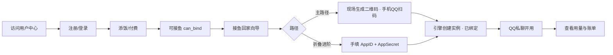

# 大肥鱼鱼咖 · 产品需求文档（PRD）

| 字段 | 内容 |
| --- | --- |
| 产品名称 | 大肥鱼鱼咖 |
| 仓库 | 本 monorepo（魔改自 AstrBot，对外不以 AstrBot 为产品名） |
| 文档版本 | v0.4 |
| 更新日期 | 2026-11-10 |

---

## 1. 背景与目标

### 1.1 背景

用户在 QQ 上希望拥有一只 **7×24 在线、带人格的 AI 机器人**，但不愿自购服务器、维护 Python、插件与模型密钥。大肥鱼鱼咖提供 **托管对话引擎 + 客户自助门户**，客户 **拥有 QQ 开放平台机器人主体**，平台 **拥有运行与计费**。

### 1.2 产品目标

1. 客户能 **自助注册、登录**，完成 **付费/添饭** 后，在用户中心 **接鱼回家**（绑定自己的 QQ 官方机器人）。
2. 绑定后机器人在 **QQ 私聊**（基线）正常对话；群聊能力以 QQ 开放平台对当前主体的限制为准，教程需如实说明。记忆与配置 **按客户机器人隔离**。
3. 客户能在用户中心查看 **用量与应付费用**（含平台服务系数）。
4. 教程与 FAQ 在仓库 `docs/customer/` 维护，并可在用户中心展示，减少工单。

### 1.3 非目标（本期不做）

- 客户自托管引擎安装包分发
- 多 IM 平台作为 **首期** 主卖套餐（可后续扩展）
- 在客户站内嵌入完整运营 Dashboard
- 开放第三方开发者 API 市场

---

## 2. 角色与分工

| 角色 | 说明 |
| --- | --- |
| **终端客户** | 注册、付费/添饭、用户中心扫码接鱼（或手填已有机器人）、在 QQ 里使用 |
| **平台运营** | 部署引擎、模型与插件策略、定价与系数、审核滥用、客户成功、必要时代配人格 |
| **QQ 开放平台** | 机器人主体、审核、头像昵称、沙箱与消息范围（客户在手机 QQ / q.qq.com 操作） |

**权属边界**

| 归客户 | 归平台 |
| --- | --- |
| QQ 机器人 appid、开放平台资料 | 服务器、对话进程、模型渠道密钥 |
| 是否加群、群消息范围 | 套餐配额、熔断与欠费策略 |
| 机器人对外名称/头像（开放平台） | 按 appid/租户隔离的运行配置与记忆 |

---

## 3. 用户旅程

**接鱼回家主路径（推荐）**：客户不必先去 q.qq.com 手建机器人；在用户中心点「接鱼」→ 现场生成一次性二维码 → 手机 QQ 扫码同意 → 平台服务端拿到 AppID/AppSecret 并写入对话引擎 → 面板显示「已到家」。

**折叠进阶路径**：客户已有企业主体或已在开放平台建好机器人时，展开「我已经有 QQ 机器人」，手填 AppID + AppSecret；凭证只提交到 fish-api，不落前端长期存储。

---

## 4. 功能需求

### 4.1 账号体系（P0）

| ID | 需求 | 验收标准 |
| --- | --- | --- |
| ACC-1 | 邮箱注册 | 合法邮箱 + 密码≥8 位；重复邮箱提示「该邮箱已注册」 |
| ACC-2 | 邮箱登录 | 错误凭证提示「邮箱或密码错误」 |
| ACC-3 | 会话保持 | 刷新页面仍登录；退出清除本地令牌 |
| ACC-4 | 鉴权接口 | 受保护页面无令牌跳转登录页 |

**状态：ACC-1～4 已实现（fish-api + fish-console）。**

### 4.2 用户中心门户（P0 → P1）

| ID | 需求 | 验收标准 |
| --- | --- | --- |
| PORT-1 | 品牌与导航 | 站点名「大肥鱼鱼咖」；侧栏：仪表盘、套餐、我的鱼、用量、文档外链 |
| PORT-2 | 未付费引导 | `paid=false` 时绑定入口不可用并引导至套餐 |
| PORT-3 | 仪表盘 | 展示套餐状态、绑定状态、简要用量（有数据后） |

**状态：PORT-1 已实现；PORT-2/3 部分为占位 UI。**

### 4.3 付费开通（P1）

| ID | 需求 | 验收标准 |
| --- | --- | --- |
| PAY-1 | 套餐展示 | 至少一档可购套餐（名称、价格、含 Token 或时长说明） |
| PAY-2 | 支付回调 | 支付成功后 `user.paid=true`（及订单记录） |
| PAY-3 | 失败与重复 | 支付失败可重试；幂等处理重复回调 |

### 4.4 QQ 机器人绑定（P1）

| ID | 需求 | 验收标准 |
| --- | --- | --- |
| BIND-1 | 资格校验 | 仅 `paid=true` 可调绑定流程 |
| BIND-2 | 关联 appid | 客户提交 QQ 机器人 appid，与租户账号一对一（可约定一品多机策略后扩展） |
| BIND-3 | 扫码登录 | 调用引擎侧适配器扫码/鉴权，成功后面板显示「已绑定」 |
| BIND-4 | 出口 IP 提示 | 绑定向导内展示 QQ 开放平台需填写的服务器 IP（链到客户教程） |

### 4.5 用量与账单（P1）

| ID | 需求 | 验收标准 |
| --- | --- | --- |
| USG-1 | Token 统计 | fish-api 只读 `provider_stats`，按 `umo_prefix` 汇总 |
| USG-2 | 展示倍数 | 用户站 Token 为内部统计 × 展示倍数（默认 2，不对用户展示公式） |
| USG-3 | 明细页 | 日期、模型、Token、鱼粮消耗（`UsagePage` 接 `/usage/me`） |
| USG-4 | 扣余额 | 用量折算成本后扣 `wallet_accounts.balance_yuan` |

### 4.5.1 欠费与停服（P1）

| ID | 需求 | 验收标准 |
| --- | --- | --- |
| ARR-1 | 欠费记账 | 余额不足时差额累加 `arrears_yuan`，`status=suspended_arrears` |
| ARR-2 | 手动关停 | 运营在 6185 关闭该客户平台实例 `enable`，机器人不再回复 |
| ARR-3 | 充值抵扣 | 下次入账先还 `arrears_yuan`，再增加 `balance_yuan` |
| ARR-4 | 恢复 | 欠费清后运营手动重新 `enable`；用户站提示状态 |

### 4.6 文档与客服（P0）

| ID | 需求 | 验收标准 |
| --- | --- | --- |
| DOC-1 | 客户教程 | 注册、付款、绑定、QQ 开放平台、用量说明、FAQ（`docs/customer/`） |
| DOC-2 | 门户外链（可选） | 配置 `VITE_DOCS_URL` 时侧栏显示「使用文档」 |

**状态：DOC-1 已在 `docs/customer/`；DOC-2 默认关闭（未设 `VITE_DOCS_URL`）。**

### 4.7 运营后台（内部）

| ID | 需求 | 验收标准 |
| --- | --- | --- |
| OPS-1 | 运营 Dashboard | 可管理适配器、模型、插件；zh-CN 品牌为大肥鱼鱼咖 |
| OPS-2 | 不面向客户 | 客户不依赖 6185 账号；运营账号独立管控 |

---

## 5. 非功能需求

| 类别 | 要求 |
| --- | --- |
| 安全 | 生产环境强 JWT 密钥；密码 bcrypt；HTTPS；运营后台与 fish-api 分权限 |
| 可用性 | 单租户故障不拖垮全局（进程/配置隔离演进） |
| 合规 | 客户数据与聊天记录按租户隔离；日志脱敏 |
| 性能 | 用户中心 API P95 &lt; 500ms（不含大报表）；对话链路以引擎为准 |
| 兼容 | Python 3.12+；现代浏览器访问控制台 |

---

## 6. 里程碑与优先级

| 阶段 | 交付 | 优先级 |
| --- | --- | --- |
| **M0** | 注册、登录、会话、门户骨架 | ✅ 完成 |
| **M1** | 支付 + `paid` + 绑定扫码闭环 | P0 |
| **M2** | 用量页 + 系数计费展示 | P0 |
| **M3** | 工单/订单列表、邮件通知 | P1 |
| **M4** | 多套餐、续费、欠费停服 | P1 |

---

## 7. 成功指标（上线后观察）

- 注册 → 付费转化率
- 绑定成功率（付费用户中完成扫码）
- 7 日活跃聊天机器人占比
- 用量页访问与账单争议率

---

## 8. 变更记录

| 版本 | 日期 | 说明 |
| --- | --- | --- |
| v0.1 | — | 初始骨架与 GitBook 流程 |
| v0.2 | 2025-03-10 | 对齐 fish-api 已实现账号能力 |
| v0.3 | 2025-03-10 | 文档迁至仓库根目录；产品名与引擎解耦 |
