# 大肥鱼鱼咖

托管 **QQ 官方 AI 机器人** 的 SaaS：客户拥有 QQ 开放平台机器人；我们在服务器跑 **对话引擎（本仓基于 AstrBot 魔改）**，并提供注册、付费、绑定、用量与教程。

## 大肥鱼鱼咖介绍

B 站视频：[一块钱也能养鱼!无需本地部署也能养鱼!大肥鱼鱼咖养一只自己的大肥鱼(附本地部署自己养鱼攻略)](https://www.bilibili.com/video/BV1J5Wj63Ete/)

<p align="center">
  
  
  
</p>
<p align="center"><sub>用户中心吉祥物 · 图源 fish-console</sub></p>

### 用户中心界面（fish-console · `http://localhost:5173`）

本地 `cd fish-console && pnpm dev` 实拍界面（截图见 [`docs/assets/readme/fish-console/`](docs/assets/readme/fish-console/)）。

| 登录 | 注册 |
| :---: | :---: |
| 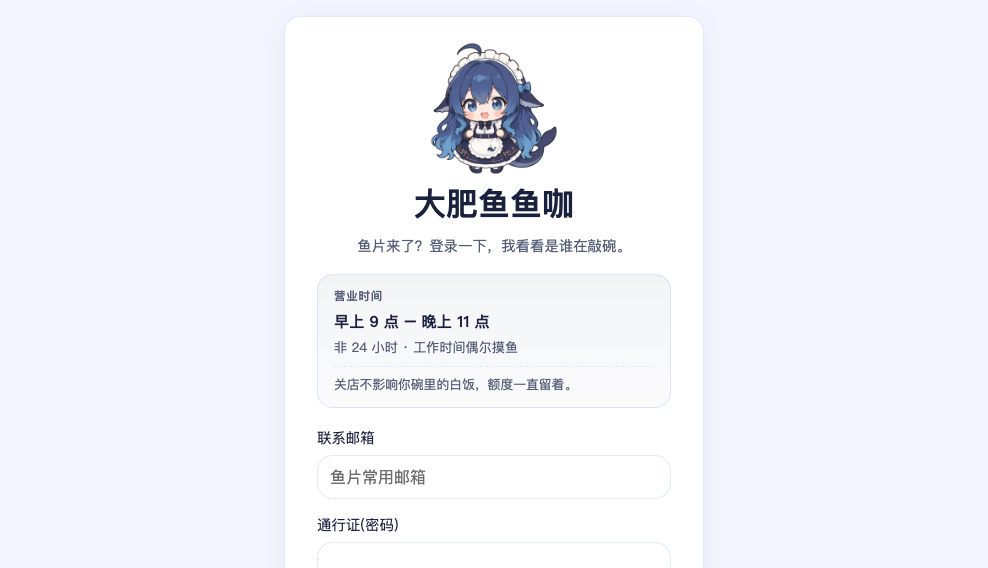 | 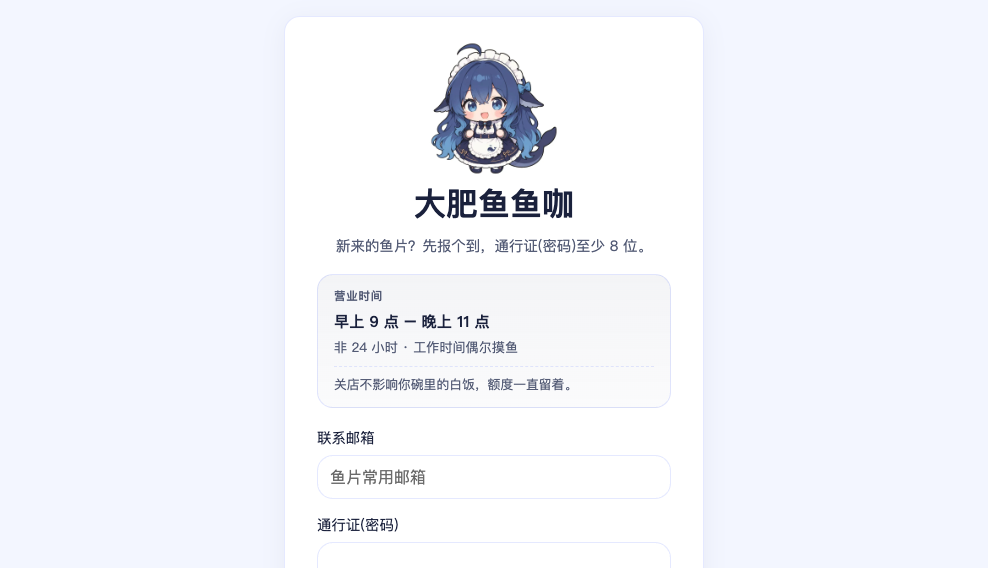 |

| 饭碗（仪表盘） | 电饭煲（添饭套餐） |
| :---: | :---: |
| 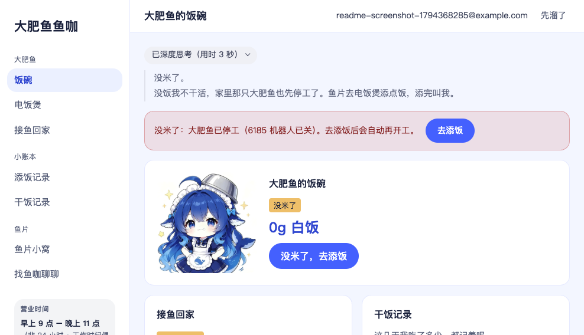 | 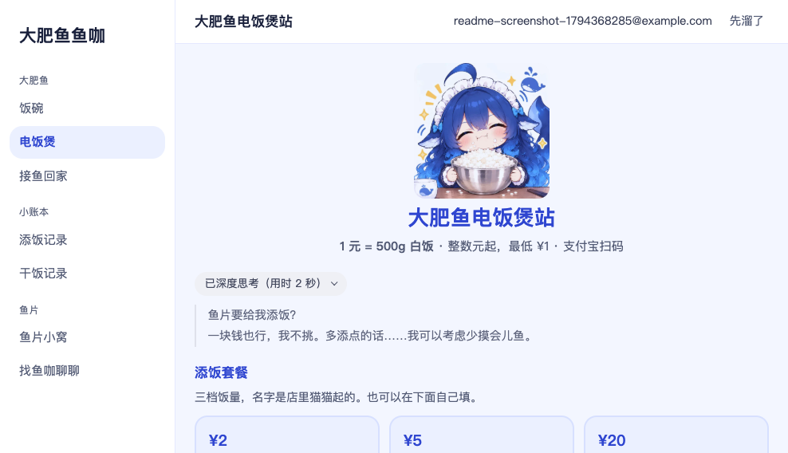 |

<p align="center">
  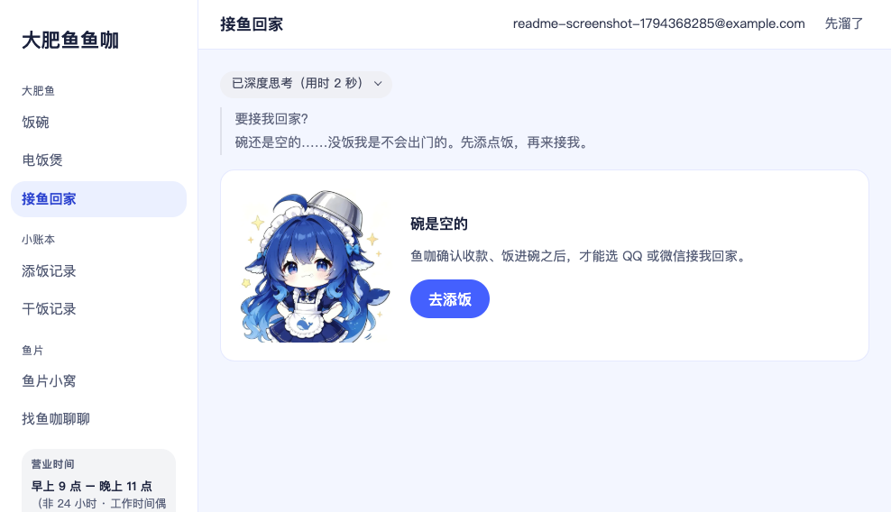
</p>
<p align="center"><sub>接鱼回家 · 付费后可绑定 QQ / 微信机器人</sub></p>

## 产品示意图

### 架构：客户、鱼咖、QQ

客户用浏览器进 **fish-console**，账号与订单走 **fish-api**；QQ 消息进 **对话引擎**；客户在 QQ 开放平台创建机器人后，把凭证交给鱼咖完成「接鱼回家」。

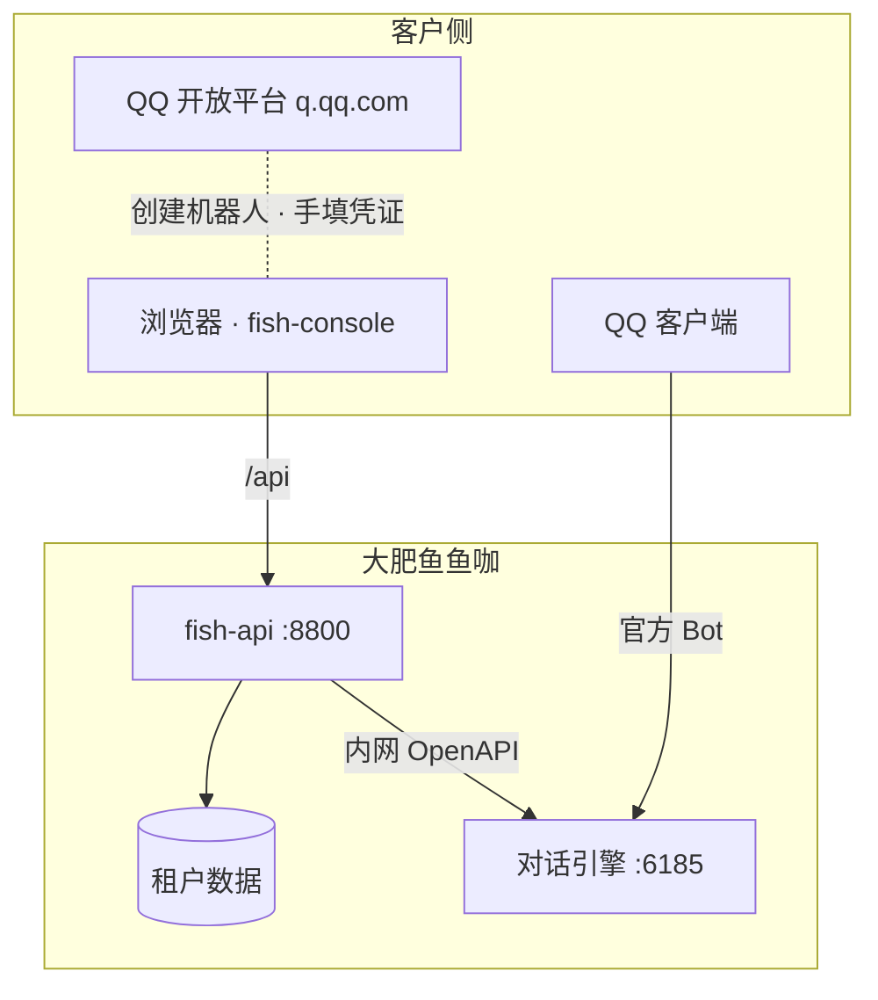

### 旅程：从注册到在 QQ 里聊天

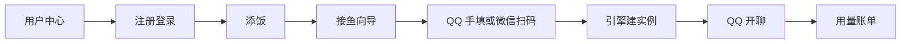

### 接鱼回家（QQ 图文步骤）

与用户中心向导一致，完整说明见 [接鱼回家教程](docs/customer/getting-started/bind-bot.md)。

| | | | |
| :---: | :---: | :---: | :---: |
| 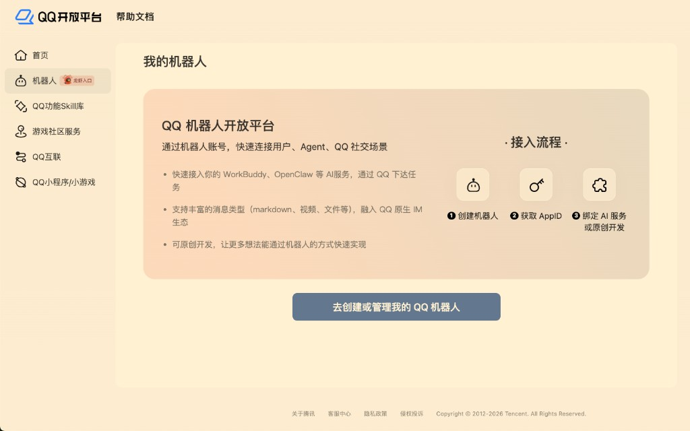 | 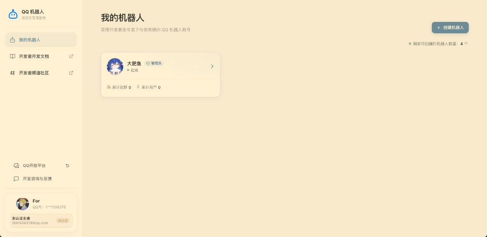 | 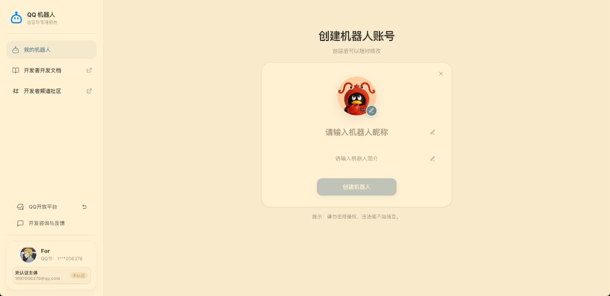 | 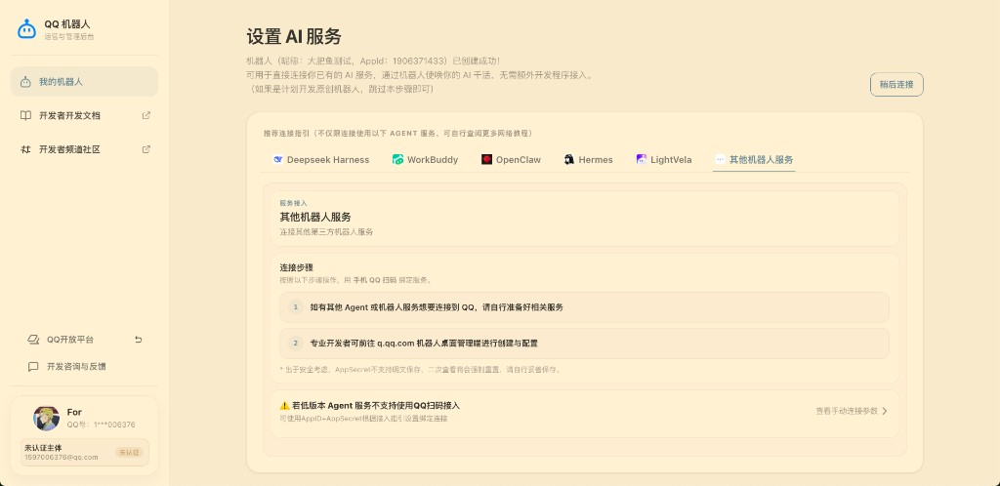 |
| 1. 开放平台 | 2. 我的机器人 | 3. 创建 | 4. AppID + Secret |

| 文档 | 说明 |
| --- | --- |
| [PRD.md](./PRD.md) | 产品需求与验收 |
| [技术方案.md](./技术方案.md) | 架构、边界、迭代阶段 |
| [docs/UPSTREAM-AstrBot-README.md](./docs/UPSTREAM-AstrBot-README.md) | 上游 AstrBot 原版说明（仅作引擎参考） |

客户教程 Markdown：`docs/customer/`（仓库内维护，无 GitBook）。

---

## 服务与端口（别搞混）

本仓库 **一个产品、多个进程**。对外品牌是 **大肥鱼鱼咖**；**AstrBot** 是底层对话与运营能力，不是对外产品名。

### 一张表看清楚

| 服务 | 是什么 | 谁用 | 默认端口 | 怎么启动 |
| --- | --- | --- | --- | --- |
| **对话引擎** | `uv run main.py`（AstrBot 核心 + 内置运营 WebUI） | 运营、机器人收消息 | **6185** | 仓库根目录：`uv sync && uv run main.py` |
| **fish-api** | 客户账号 API（注册/登录 JWT，后续订单绑定） | 用户中心后端 | **8800** | `cd fish-api && uv sync && uv run uvicorn app.main:app --reload --port 8800` |
| **fish-console** | 客户用户中心（大肥鱼鱼咖前台） | 付费客户 | **5173**（dev） | `cd fish-console && pnpm dev` |
| **dashboard**（可选） | 运营后台 **前端源码**，热更新 | 开发运营 UI 时 | **3000** | `cd dashboard && pnpm dev`（API 仍走 6185） |
| **`docs/customer/`** | 客户教程源码 | 运营/客户（只读） | 无 | 不单独起 HTTP |
| **本机 8000** | ⚠️ 常是**别的项目**（如带 PostgreSQL 的健康检查） | — | **8000** | **不是** fish-api，勿混用 |

### 开发时要开几个？

| 目标 | 需要起的进程 |
| --- | --- |
| 只要客户 **注册 / 登录** | **8800** + **5173**（不需要 `main.py`） |
| QQ / 微信等 **机器人要说话** | 上面 + **6185**（`main.py`） |
| 改运营 **Dashboard 页面代码** | **6185** + **3000**（一般客户站不依赖 3000） |

### 访问地址

| URL | 用途 |
| --- | --- |
| http://localhost:5173 | 客户用户中心 |
| http://127.0.0.1:8800/docs | fish-api OpenAPI |
| http://127.0.0.1:6185 | 运营后台（登录 `data/cmd_config.json` 里配置的账号） |
| http://127.0.0.1:6185/api/v1/docs | 对话引擎 OpenAPI（扫码 registration、bots 等；**不是** `/docs`） |

`fish-console` 开发时把浏览器的 `/api` 代理到 **8800**，所以 **8800 没开则注册登录失败**。

---

## 仓库目录（产品视角）

```
大肥鱼鱼咖（本仓）
├── main.py / astrbot/     # 对话引擎（AstrBot 魔改）
├── data/                  # 运行配置、密钥、业务数据（勿提交敏感信息）
├── dashboard/             # 运营后台前端源码
├── fish-api/              # 客户域 API
├── fish-console/          # 客户用户中心
├── docs/customer/         # 客户教程 Markdown
├── PRD.md
├── 技术方案.md
└── README.md              # 本文件
```

客户主要看 **fish-console**；教程在 `docs/customer/`（后续可内嵌控制台）。运营改模型、适配器、插件用 **6185**。

---

## 快速启动（推荐开 tmux 三窗）

```bash
# 窗 1 — 对话引擎（要机器人上线才需要）
uv run main.py

# 窗 2 — 客户 API
cd fish-api && uv run uvicorn app.main:app --reload --port 8800

# 窗 3 — 客户站
cd fish-console && pnpm dev
```

首次：`fish-api` 执行 `cp -n .env.example .env`；`fish-console` 执行 `cp -n .env.example .env` 并 `pnpm install`。

---

## 当前进度（摘要）

| 能力 | 状态 |
| --- | --- |
| 邮箱注册 / 登录 / JWT | ✅ |
| 付费 → `paid` | 🔲 |
| 接鱼回家（QQ 图文手填 + 微信扫码） | 🔲 需配置 `FISH_ASTRBOT_API_KEY` |
| 用量 × 服务系数 | 🔲 |

详见 [PRD.md](./PRD.md) 里程碑。

---

## 魔改原则

- 对外产品与文档统一叫 **大肥鱼鱼咖**；改需求改 **PRD**，改架构改 **技术方案**。
- 客户业务逻辑放在 `fish-api` / `fish-console`，尽量不污染引擎核心 unless 必须接 API。
- 引擎能力迭代可参考上游 AstrBot，见 `docs/UPSTREAM-AstrBot-README.md`。
