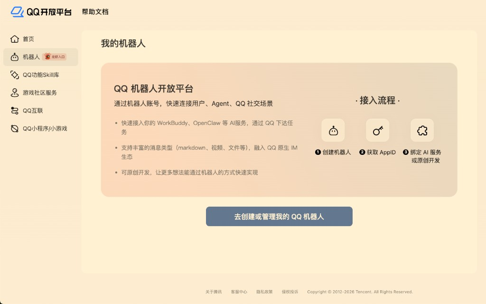
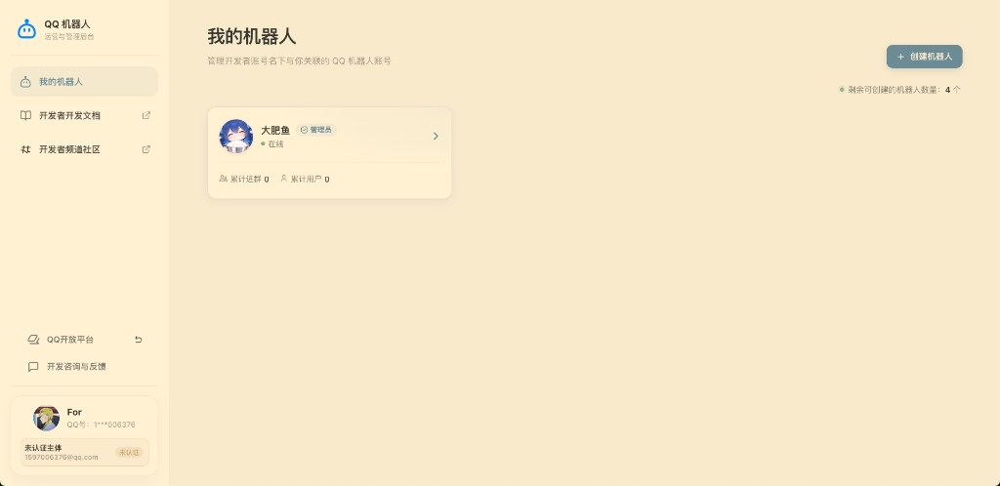
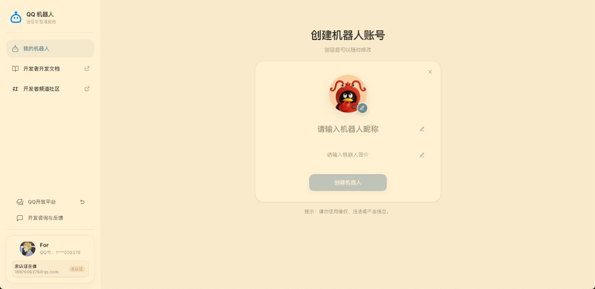
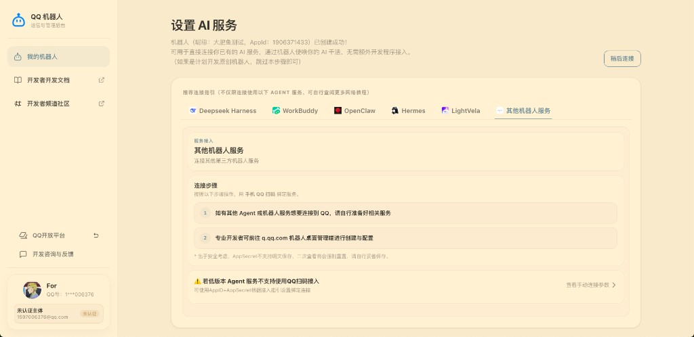

# 付款后绑定：接鱼回家

绑定发生在 **用户中心 → 接鱼回家**，不是在本教程站里扫码，也 **不是** 鱼咖运营手工给你发一张码。

流程是：

1. 你在用户中心 **添饭**（支付宝转账）
2. 鱼咖在收银台 **确认收款** 后，饭进碗（`can_bind`）
3. 「接鱼回家」里 **选渠道**（QQ 或微信）
4. **QQ**：按图文去 [q.qq.com](https://q.qq.com) 创建机器人 → 复制 AppID + AppSecret → 填回用户中心 →「已到家」
5. **微信**：现场生成二维码 → 手机微信扫码授权 →「已到家」


**必须先有饭再接鱼。** 碗空时 QQ 手填与微信二维码都不可用，防止未付费占用托管资源。


## 前提

- [ ] 已在用户中心 **添饭**，且鱼咖已确认入账（饭碗里有白饭）
- [ ] 手机已装 **QQ** 和/或 **微信**（按你要选的渠道）

## 选渠道

| 渠道（用户中心显示名） | 怎么接 | 说明 |
| :--- | :--- | :--- |
| **QQ 官方机器人** | 图文教学 + 手填 AppID/AppSecret | **不走鱼咖扫码**，避免「有壳无灵魂」 |
| **微信官方机器人** | 现场二维码 | 手机微信扫 |

## QQ：图文教学 + 手填（主路径）



### 登录用户中心并打开「接鱼回家」

使用已入账账号登录；若碗是空的，会先让你去添饭。选 **QQ 官方机器人**。



### 打开 QQ 开放平台

打开 [q.qq.com](https://q.qq.com)，点 **去创建或管理我的 QQ 机器人**。




### 创建（或进入）机器人

在 **我的机器人** 点 **+ 创建机器人**。若已有号，点进卡片即可。




### 换头像 + 起名

在「创建机器人账号」页：

1. 点头像，上传 **大肥鱼** 图（用户中心指引可下载推荐图）
2. 填写昵称（建议「大肥鱼」）
3. 简介可选 → 点 **创建机器人**


**创建时把头像选成大肥鱼并填好名称。** 选好后若无法更改图片或名称，请前往 [q.qq.com](https://q.qq.com) 处理。





### 查看手动连接参数

创建成功后进入 **设置 AI 服务**：

1. 选 **其他机器人服务**
2. 点 **查看手动连接参数**
3. 复制 **AppID**、**AppSecret**（Secret 二次查看会强制重置，立刻复制并妥善保存）




### 填回用户中心，接到大肥鱼

回到「接鱼回家」→ **填入凭证，接到大肥鱼** → 粘贴 AppID + AppSecret → 提交 → 等 **已到家**。

若托管方要求 **IP 白名单**，在开放平台加上绑定页展示的出口 IP。



### 开聊

手机 QQ → **联系人 → 机器人** → 找到大肥鱼，私聊试一句。



## 微信：扫码接鱼



### 选微信并生成二维码

用户中心选 **微信官方机器人**，点生成二维码。码由系统 **现场生成**，每人每次一张，会过期。


此二维码 **不要** 截图发到公开群。




### 扫码并完成微信侧创建/授权

1. 手机微信扫码并确认
2. 若出现资料页：头像换成大肥鱼，名称填好
3. **不要关本页**，等「已到家」



### 开聊

微信会话列表里找到大肥鱼，私聊试一句。



## 头像与名称说明

| 项目 | 何时设置 | 能否事后改 |
| :--- | :--- | :--- |
| 头像（大肥鱼图） | **创建时** | 改不了则去 [q.qq.com](https://q.qq.com) |
| 名称 | 创建时填写 | 改不了则去 [q.qq.com](https://q.qq.com) |
| 对话性格 | 托管侧人格，不是头像 | 与开放平台壳子分开 |

详见 [修改头像、名称与简介](../qq-open-platform/avatar-name.md)。

## 使用限制（请先读）

个人 QQ 主体创建的机器人，受开放平台规则约束，常见情况：

- 私聊：可能需把对方加为体验成员，或仅创建者可聊
- 群聊：往往只能进 **你是群主或管理员** 的群

这是 QQ 侧限制，不是鱼咖少开了开关。详见 [沙箱、加群与消息范围](../qq-open-platform/sandbox-and-group.md)。

## 绑定之后

- 人格、知识库：见 [什么是「你的鱼」](../persona/your-fish.md)
- 用量：见 [在用户中心查看用量](../usage/dashboard.md)

## 常见失败

| 现象 | 处理 |
| :--- | :--- |
| 碗是空的 / 不能填凭证 | 确认添饭后鱼咖已点确认入账；刷新页面 |
| 提示接线服务没配好 | 找鱼咖检查 AstrBot API Key |
| QQ 提示「未连接灵魂」 | 壳子已建好但未接到 AstrBot。到 q.qq.com 复制 AppID+AppSecret，在用户中心手填 |
| 创建后头像/名称改不了 | 前往 [q.qq.com](https://q.qq.com) 处理；下次创建时一次选对 |
| 能绑定但不回复 | 开放平台 IP 白名单、沙箱成员、群消息范围 |
| 提示 Secret 错误 | 重新「查看手动连接参数」或重置 Secret，注意不要多空格 |
| 微信扫码一直等待 | 检查手机是否确认；刷新二维码；**本页不要关** |

更多：[常见问题](../support/faq.md)。
