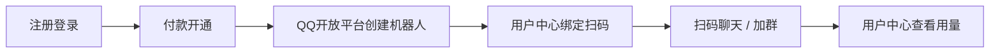

# 平台是做什么的


你拥有 **QQ 开放平台上的机器人账号**（头像、名称、审核归你）。我们负责 **服务器上跑 AstrBot**，让你的鱼 24 小时在线聊天。


## 分工一览

| 你负责 | 我们负责 |
| :--- | :--- |
| 在 [QQ 开放平台](https://q.qq.com) 创建/维护机器人 | 托管 AstrBot、模型接入、日常运维 |
| 机器人头像、对外名称、简介 | 按套餐提供算力配额 |
| 在 **用户中心** 注册、付款、绑定 | 按你的 `appid` 接入，隔离配置与记忆 |
| 加群、设置群消息范围（手机 QQ） | 统计用量并在用户中心展示 |

## 整体流程

## 和「自己买服务器装 AstrBot」的区别

- 不用自己维护 Python、插件、开机、备案 IP 白名单细节（QQ 官方 Bot 仍需在开放平台填我们提供的出口 IP，绑定流程里会提示）。
- 用量与费用在用户中心可查，含 **服务系数**（见 [费用如何计算](../usage/billing-coefficient.md)）。
- 每人一条机器人实例，聊天记忆按机器人分开，不会和其他客户混在同一上下文里。

下一步：[注册、登录与付款](register-and-pay.md)。
