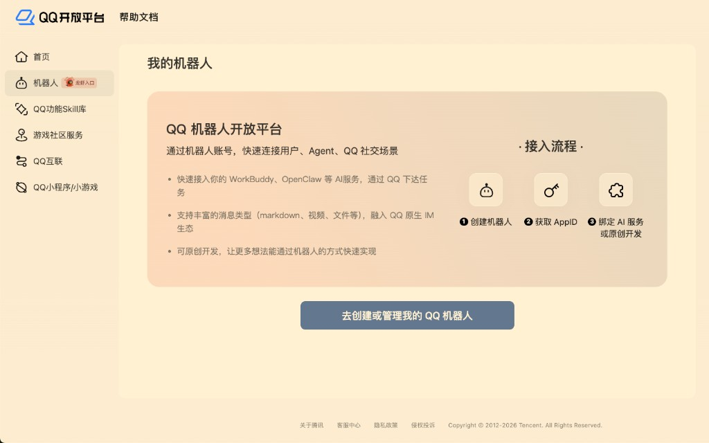
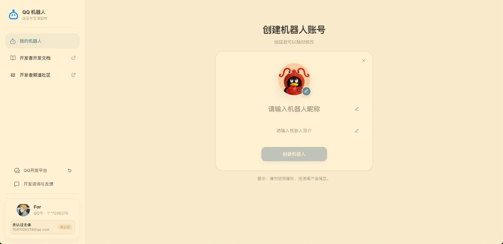
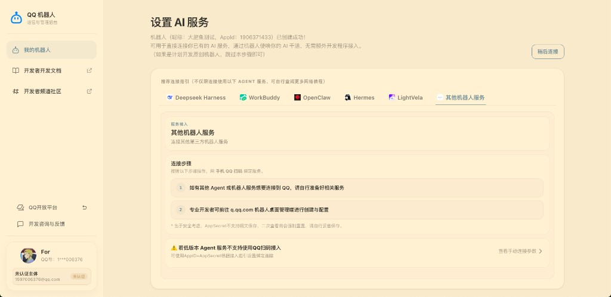

# 创建 QQ 官方机器人

官方入口：[QQ 开放平台](https://q.qq.com)

## 为什么要在 QQ 侧创建

- **头像、名称、简介** 都在腾讯侧展示，不由 AstrBot 修改。
- **AppID / Secret** 是你的机器人身份，绑定后交给托管方写入服务器。
- 审核与安全校验由 QQ 完成。

鱼咖用户中心对 **QQ 渠道**采用 **图文教学 + 手填凭证**（不走鱼咖扫码），与腾讯「创建 → 获取 AppID → 绑 AI 服务」一致。

## 创建步骤



### 登录 q.qq.com

使用打算作为 **机器人管理者** 的 QQ 账号登录，点 **去创建或管理我的 QQ 机器人**。





### 创建机器人

在 **我的机器人** 点 **+ 创建机器人**，填写：

- **名称**：如「大肥鱼」
- **简介**：可选
- **头像**：上传大肥鱼图（创建时一次选好）




选好后若无法更改图片或名称，请前往 [q.qq.com](https://q.qq.com) 处理。




### 获取 AppID / AppSecret

创建成功后在 **设置 AI 服务 → 其他机器人服务 → 查看手动连接参数**，复制 **AppID**、**AppSecret**。




出于安全，AppSecret **不支持明文二次查看**，再看会强制重置。复制后立刻到用户中心「接鱼回家」提交。




### 填回用户中心

打开用户中心 **接鱼回家 → QQ 官方机器人 → 填入凭证**，粘贴并提交，等到「已到家」。

完整图文见 [付款后绑定：接鱼回家](../getting-started/bind-bot.md)。



## 与用户中心绑定的关系

```text
q.qq.com 创建机器人 → 复制 AppID/AppSecret → 用户中心手填 → 托管 AstrBot 运行
```

下一节：[修改头像、名称与简介](avatar-name.md)。


不要把 **AppSecret** 发给陌生人或贴在公开教程里。只通过用户中心加密通道提交给托管方。

