# Plugin Configuration

Define `_conf_schema.json` in your plugin directory. AstrBot uses it to generate a WebUI form and passes the configuration to your plugin.

## Minimal example

Add `_conf_schema.json` to your [plugin template](./simple.md):

```json
{
  "greeting": {
    "type": "string",
    "description": "Greeting",
    "default": "Hello!"
  }
}
```

Receive and read the configuration in `main.py`:

```python
from astrbot.api import AstrBotConfig
from astrbot.api.event import AstrMessageEvent, filter
from astrbot.api.star import Context, Star


class GreetingPlugin(Star):
    def __init__(self, context: Context, config: AstrBotConfig):
        super().__init__(context)
        self.config = config

    @filter.command("greet")
    async def greet(self, event: AstrMessageEvent):
        yield event.plain_result(self.config["greeting"])
```

Reload the plugin and open its configuration from the WebUI **Plugins** page. Change the greeting, click **Save and Close**, and send `/greet` to receive the configured reply.

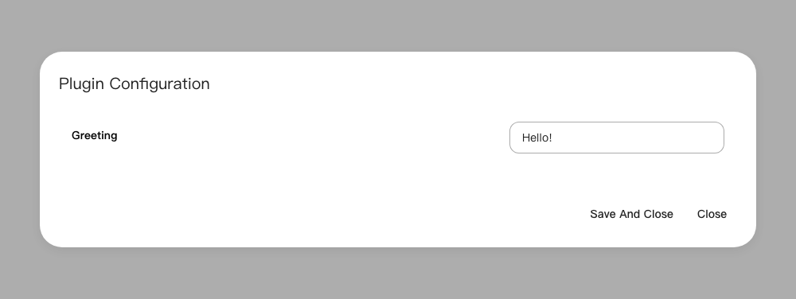

## Control examples

Each JSON example below is a complete `_conf_schema.json`. Use one on its own or combine the fields you need into a single file.

### Single-line text {#string}

Use `string` for a single line of text.

```json
{
  "nickname": {
    "type": "string",
    "description": "Assistant name",
    "default": "AstrBot"
  }
}
```

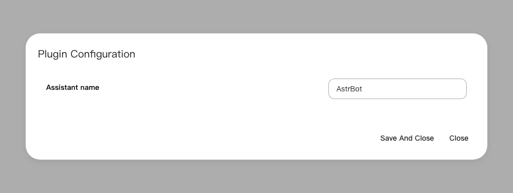

### Multiline text {#text}

Use `text` for a multiline input.

```json
{
  "reply_template": {
    "type": "text",
    "description": "Reply template",
    "default": "Hello!\nHow can I help?"
  }
}
```

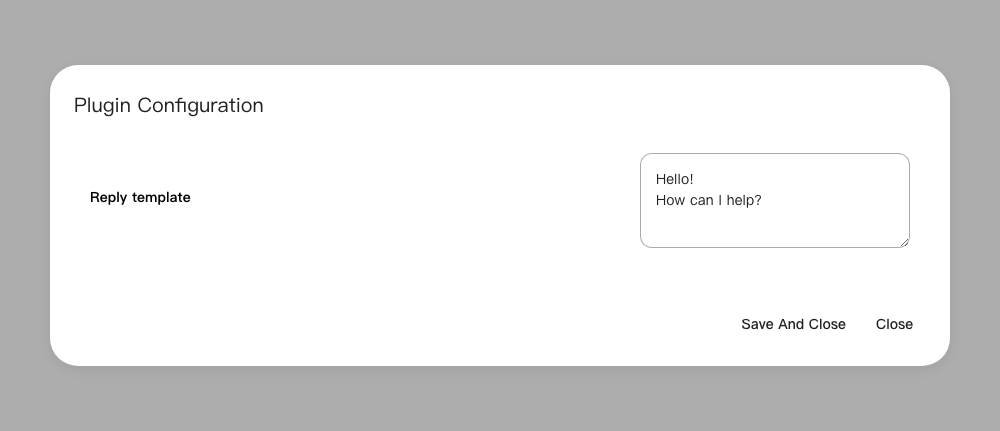

### Number inputs {#number}

Use `int` for integers and `float` for fractional values.

```json
{
  "retries": {
    "type": "int",
    "description": "Retry count",
    "default": 3
  },
  "timeout": {
    "type": "float",
    "description": "Timeout (seconds)",
    "default": 2.5
  }
}
```

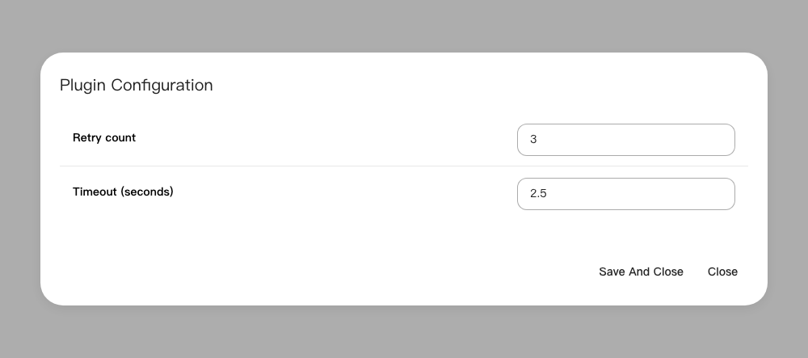

### Switch {#bool}

A `bool` stores `true` or `false`.

```json
{
  "enabled": {
    "type": "bool",
    "description": "Enable automatic replies",
    "default": true
  }
}
```

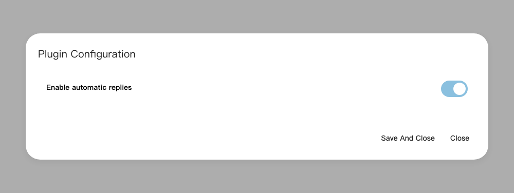

### Password input {#secret}

Add `secret: true` to mask a `string`; string lists also support it. Masking does not encrypt the saved value. The example key is fictional.

```json
{
  "api_key": {
    "type": "string",
    "description": "API Key",
    "default": "demo-key-not-a-real-secret",
    "secret": true
  }
}
```

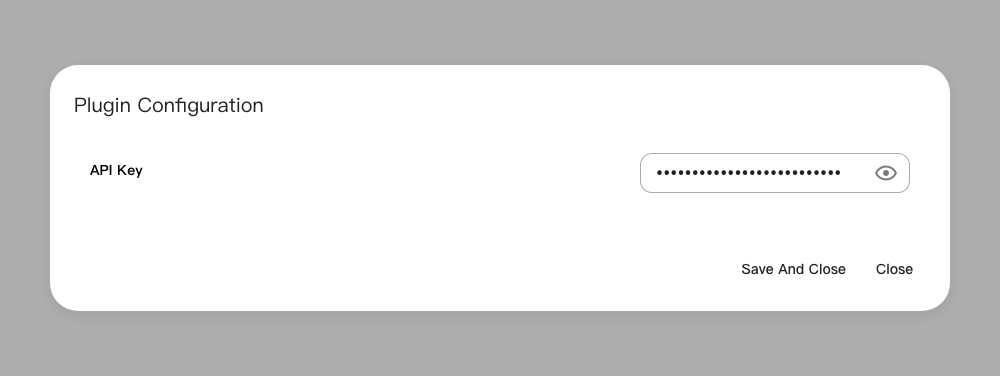

### Single-select dropdown {#select}

`options` contains saved values, `labels` supplies display names, and `subtitles` supplies descriptions, matched by position. The screenshot shows the open dropdown.

```json
{
  "reply_mode": {
    "type": "string",
    "description": "Reply style",
    "default": "short",
    "options": [
      "short",
      "detailed"
    ],
    "labels": [
      "Brief",
      "Detailed"
    ],
    "subtitles": [
      "For quick questions",
      "Include steps and explanations"
    ]
  }
}
```

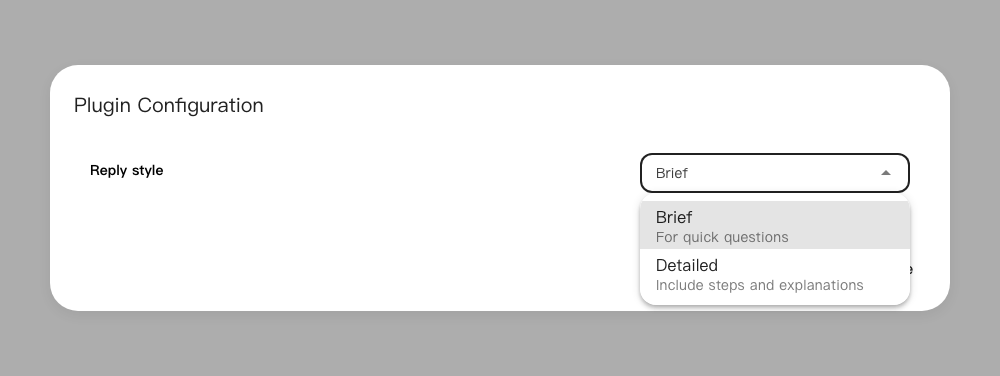

### Multi-select dropdown {#multiselect}

Use `list` with `options` for a multi-select dropdown that saves a list of option values.

```json
{
  "channels": {
    "type": "list",
    "description": "Enabled in",
    "default": [
      "private"
    ],
    "options": [
      "private",
      "group"
    ],
    "labels": [
      "Private chats",
      "Group chats"
    ]
  }
}
```

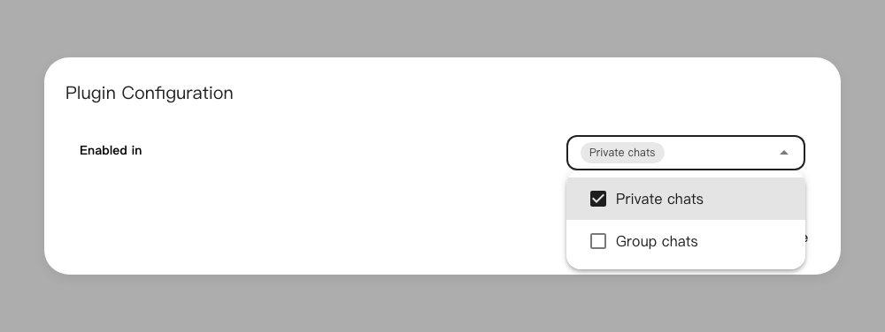

### Checkbox group {#checkbox}

Add `render_type: "checkbox"` to a multi-select field to display checkboxes.

```json
{
  "channels": {
    "type": "list",
    "description": "Enabled in",
    "default": [
      "private"
    ],
    "render_type": "checkbox",
    "options": [
      "private",
      "group"
    ],
    "labels": [
      "Private chats",
      "Group chats"
    ]
  }
}
```

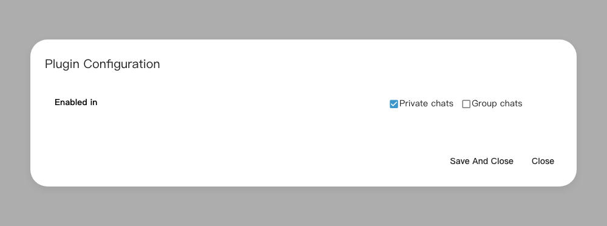

### Slider {#slider}

For `int` and `float`, `slider` defines the minimum, maximum, and step.

```json
{
  "temperature": {
    "type": "float",
    "description": "Randomness",
    "default": 0.7,
    "slider": {
      "min": 0,
      "max": 2,
      "step": 0.1
    }
  }
}
```

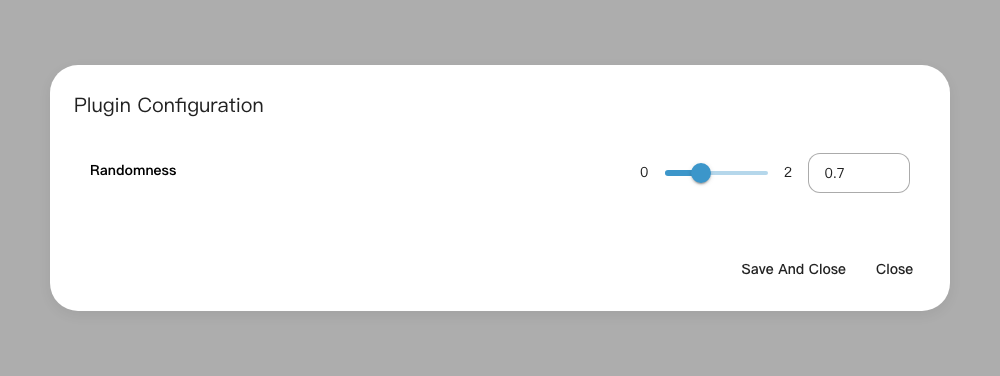

### String list {#list}

Without `options`, a `list` opens an editor for adding or removing strings. The screenshot shows the editor after clicking Add More.

```json
{
  "keywords": {
    "type": "list",
    "description": "Trigger words",
    "default": [
      "AstrBot",
      "help"
    ]
  }
}
```

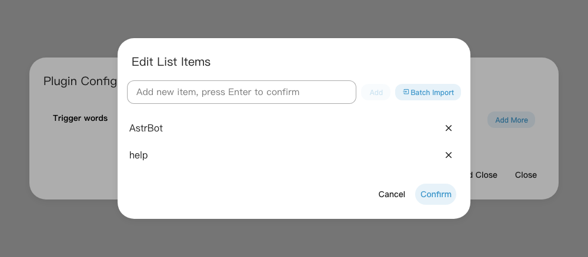

### Code editor {#editor}

`editor_mode` replaces the text input with a code editor. Set `editor_language` for syntax highlighting and `editor_theme` to `vs-light` or `vs-dark`. The saved value remains a string.

```json
{
  "payload": {
    "type": "text",
    "description": "Request body",
    "default": "{\n  \"temperature\": 0.7\n}",
    "editor_mode": true,
    "editor_language": "json",
    "editor_theme": "vs-light"
  }
}
```

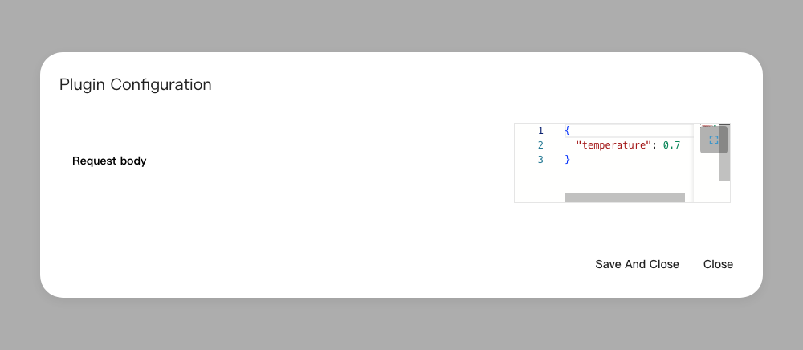

### File upload {#file}

A `file` field stores a list of uploaded file paths. `file_types` lists allowed extensions. The screenshot shows the upload dialog.

```json
{
  "reference_files": {
    "type": "file",
    "description": "Reference files",
    "default": [],
    "file_types": [
      "pdf",
      "txt"
    ]
  }
}
```

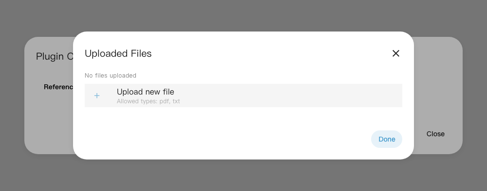

### Configuration group {#object}

Define child fields in `object.items`. `collapsed: true` starts a group collapsed; click its title to expand it, as shown. The outermost configuration object cannot collapse.

```json
{
  "advanced": {
    "type": "object",
    "description": "Advanced settings",
    "collapsed": true,
    "items": {
      "timeout": {
        "type": "int",
        "description": "Timeout (seconds)",
        "default": 30
      },
      "retries": {
        "type": "int",
        "description": "Retry count",
        "default": 3
      }
    }
  }
}
```

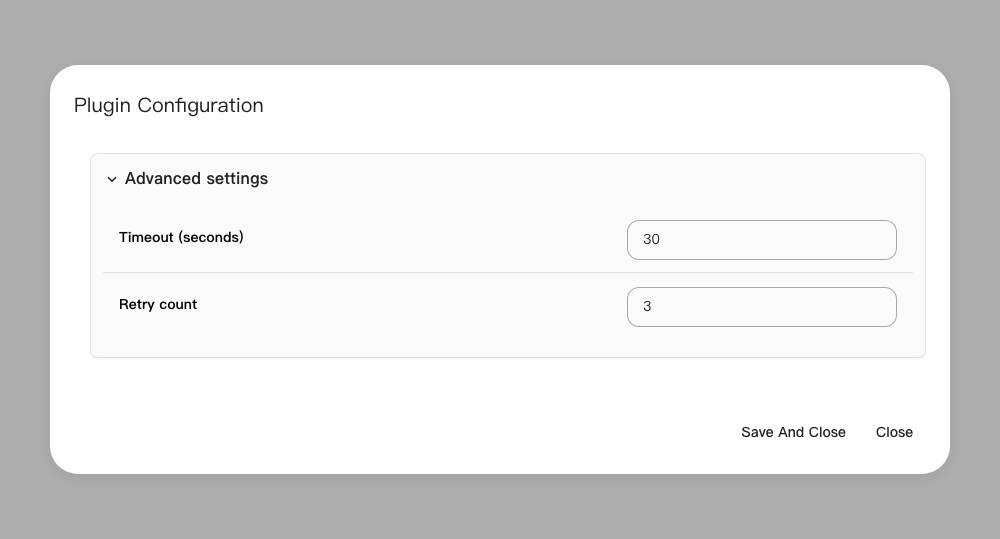

### Key-value editor {#dict}

Use `dict` for editable key-value pairs. Optional `template_schema` provides types and defaults for common keys. The screenshot shows the open editor.

```json
{
  "headers": {
    "type": "dict",
    "description": "Custom headers",
    "default": {
      "X-App": "demo"
    },
    "template_schema": {
      "X-App": {
        "type": "string",
        "description": "Application ID",
        "default": "demo"
      }
    }
  }
}
```

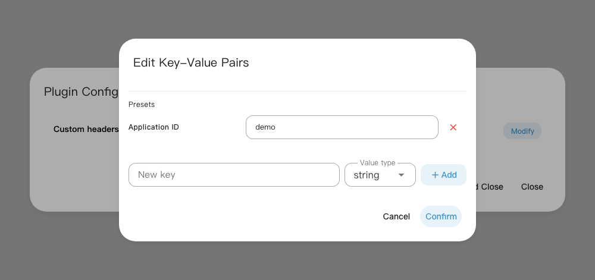

### Template list {#template-list}

`templates` defines repeatable structures, and `display_item` selects a summary field. The screenshot shows an added, expanded entry. Saved entries include a `__template_key` identifier.

```json
{
  "rules": {
    "type": "template_list",
    "description": "Reply rules",
    "default": [],
    "templates": {
      "keyword": {
        "name": "Keyword reply",
        "display_item": "keyword",
        "items": {
          "keyword": {
            "type": "string",
            "description": "Keyword",
            "default": "help"
          },
          "reply": {
            "type": "text",
            "description": "Reply text",
            "default": "Please describe your problem."
          }
        }
      }
    }
  }
}
```

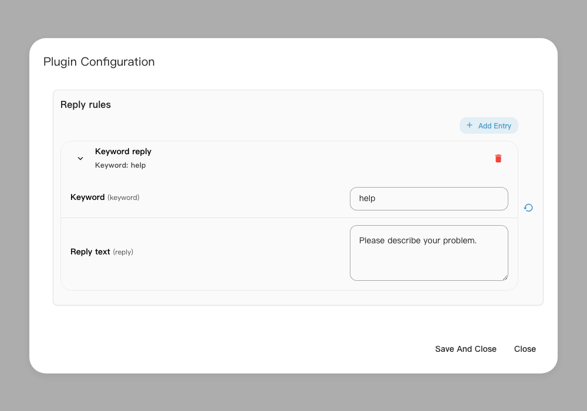

Example of the saved `rules` value:

```json
{
  "rules": [
    {
      "__template_key": "keyword",
      "keyword": "help",
      "reply": "Please describe your problem."
    }
  ]
}
```

#### Nested template lists

A template can contain another `template_list` field, either directly in its `items` or inside an `object` field. Each nested list defines its own `templates`, and each saved child entry keeps its own `__template_key`. For example, add this field to `templates.keyword.items` in the schema above:

```json
{
  "children": {
    "type": "template_list",
    "default": [],
    "templates": {
      "child": {
        "name": "Child",
        "items": {
          "name": {"type": "string", "default": ""}
        }
      }
    }
  }
}
```

In the plugin configuration dialog, expand the parent entry, add an entry in the nested list, edit its fields, and save the plugin configuration. Expanding the configuration again preserves the nested entries. The same steps apply to deeper template lists.

### Model selectors {#provider}

These selectors list configured chat, speech recognition, and speech synthesis models and save a provider ID. The screenshot shows the chat-model menu with demo entries.

```json
{
  "chat_model": {
    "type": "string",
    "description": "Chat model",
    "default": "",
    "_special": "select_provider"
  },
  "stt_model": {
    "type": "string",
    "description": "Speech recognition model",
    "default": "",
    "_special": "select_provider_stt"
  },
  "tts_model": {
    "type": "string",
    "description": "Speech synthesis model",
    "default": "",
    "_special": "select_provider_tts"
  }
}
```

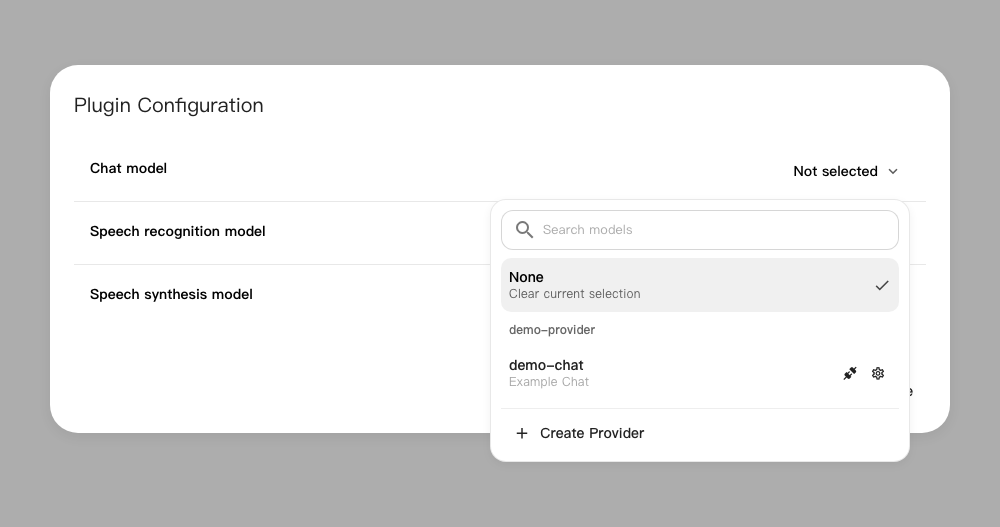

### Persona selector {#persona}

Choose an existing persona and save its ID. The screenshot uses demo personas.

```json
{
  "persona": {
    "type": "string",
    "description": "Persona",
    "default": "",
    "_special": "select_persona"
  }
}
```

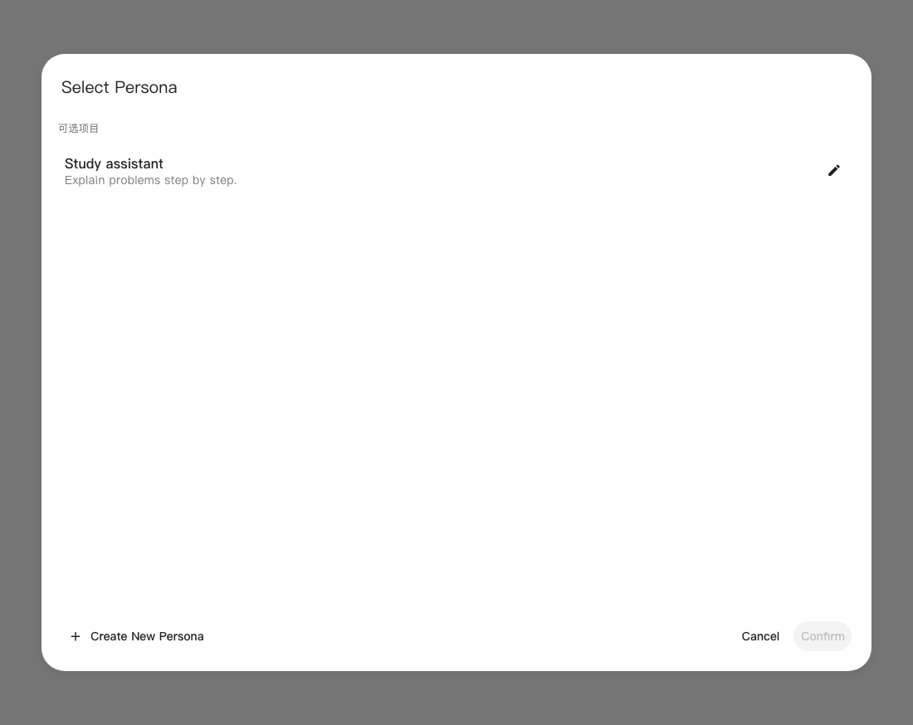

### Knowledge-base selector {#knowledge}

Knowledge bases support multiple selections; use `type: "list"`. The screenshot uses demo knowledge bases.

```json
{
  "knowledge_bases": {
    "type": "list",
    "description": "Knowledge bases",
    "default": [],
    "_special": "select_knowledgebase"
  }
}
```

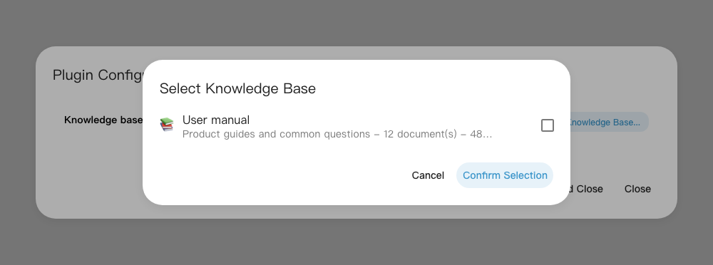

### User selector {#sender}

Search recorded users by name or ID and save a list of user IDs. An unlisted ID can be added manually. The screenshot uses demo users.

```json
{
  "users": {
    "type": "list",
    "description": "Selected users",
    "default": [],
    "_special": "sender_id"
  }
}
```

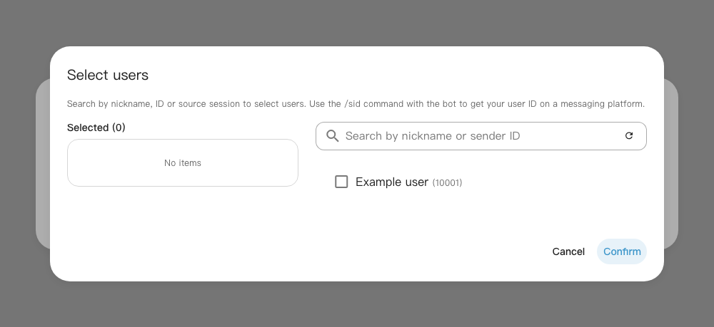

### Session selector {#umo}

Save a list of complete UMOs. For a single selection, use `type: "string"` and `default: ""` to save one UMO. Unlisted UMOs can be entered manually. The screenshot uses demo sessions.

```json
{
  "sessions": {
    "type": "list",
    "description": "Target sessions",
    "default": [],
    "_special": "umo"
  }
}
```

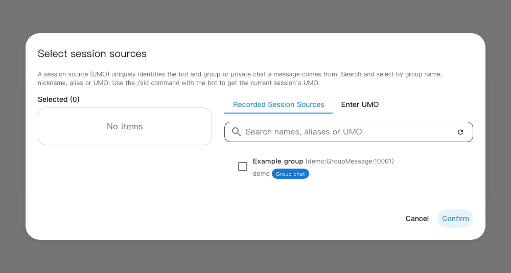

## Common fields

Every field requires a `type`. Add these optional properties as needed:

| Property | Purpose |
| --- | --- |
| `description` | Label displayed in the form |
| `default` | Value used when the field is not configured; must match `type` |
| `hint` | Additional guidance for the field |
| `obvious_hint` | Set to `true` to display `hint` directly |
| `invisible` | Set to `true` to hide the field in the WebUI |

`description`, `hint`, and option `labels` and `subtitles` support [plugin localization](./plugin-i18n.md).

## Saving and updating

Read and modify `AstrBotConfig` like a dictionary. To persist changes from your plugin, call `save_config()`:

```python
self.config["greeting"] = "Welcome back!"
self.config.save_config()
```

Configuration is stored in `data/config/<plugin_directory_name>_config.json`. After updating `_conf_schema.json`, reload the plugin. AstrBot fills in defaults for new fields and removes fields that are no longer in the schema.
