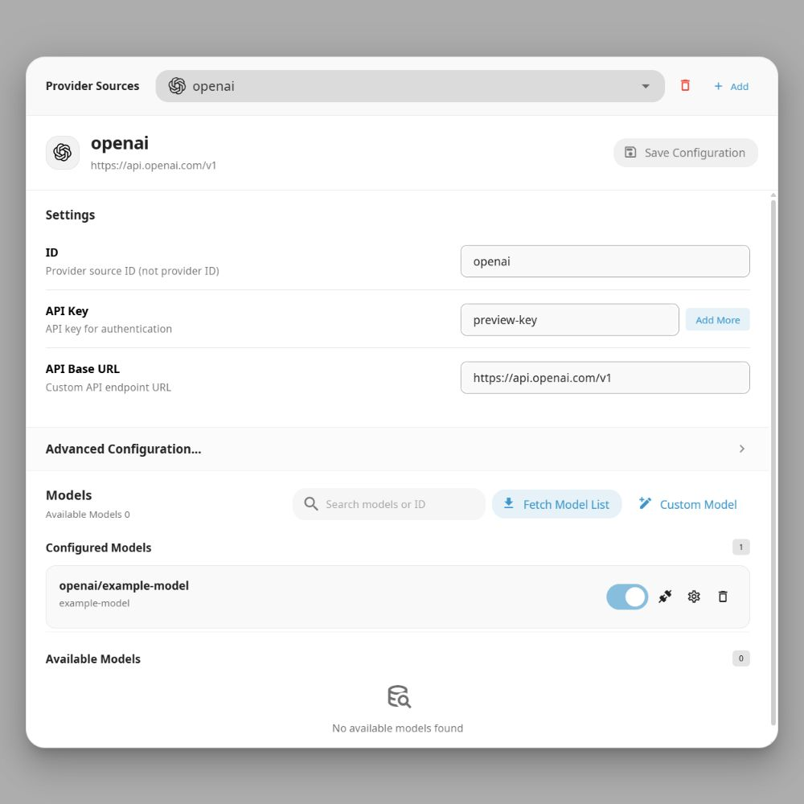

# Connecting Model Services

AstrBot supports the native API formats of OpenAI, Google GenAI, and Anthropic. You can connect any model service provider that conforms to one of these three API formats.

> [!NOTE]
> If you are located in mainland China, we strongly recommend using **official model providers** or compliant providers that follow local laws and regulations, for example:
>
> - [MoonshotAI](https://moonshot.cn/)
> - [GLM](https://bigmodel.cn/)
> - [MiniMax](https://www.minimax.io/)
> - [Qwen](https://qwen.ai/apiplatform)
> - [DeepSeek](https://deepseek.com/)
>
> These providers support the OpenAI API format. You can find the API Base URL and API Key from their documentation and fill them into AstrBot provider settings.
>
> Please note that using non-compliant third-party model services may introduce availability, privacy, or legal risks. For details, see the [EULA](https://github.com/AstrBotDevs/AstrBot/blob/master/EULA.md).

For example, you may choose to connect model services provided by (but not limited to):

- Official OpenAI model services ([OpenAI](https://openai.com/))
- Official Anthropic model services ([Anthropic](https://www.anthropic.com/))
- Google's Gemini model services via Google Cloud ([Google Cloud](https://cloud.google.com/))
- OpenRouter model services ([OpenRouter](https://openrouter.ai/))

## Integration Steps Using DeepSeek as an Example

Using DeepSeek as an example, assuming you have registered and logged in to a DeepSeek account, the steps to connect are:

1. Go to the DeepSeek Console (https://platform.deepseek.com/).
2. Click the "API Keys" menu in the left sidebar, create a new API Key, and copy the key.
3. Click the "API Documentation" link near the bottom of the left sidebar to open the API documentation page.
4. On the API documentation page, find the section about the "OpenAI-compatible interface" and note the API Base URL, for example `https://api.deepseek.com/v1`. (If there is no `/v1`, please add `/v1`.)
5. Open **Providers → Chat Completion**, click **Add**, and select `DeepSeek`. For other OpenAI-compatible services, select `OpenAI Compatible`. Enter the provider name, `API Key`, and `API Base URL`.
6. Click **Save and Fetch Models**, find the desired model, click `+`, and make sure it is enabled. If the model list cannot be fetched, click **Save Configuration**, then **Custom Model** and enter the model ID. Use **Test Model** beside the model to check connectivity.
7. Open **Config**, select the profile to use, and go to **AI → Model**. Set **Chat Model** to the model you just added, then click **Save Configuration** at the bottom right. This setting is for AstrBot built-in AI.

## Provider Configuration in Narrow Windows

The model configuration dialog on the Welcome and Chat pages, and the Providers page, adapt to the actual width of the configuration panel. When space is limited, the provider list collapses into a dropdown at the top. Use it to switch providers. Search and action controls wrap, and narrow forms place inputs below their descriptions.

The configuration area supports vertical and horizontal scrolling. Use its bottom horizontal scrollbar or swipe sideways on a trackpad to view content that still exceeds the available width. Click **Advanced Configuration** to expand or collapse those settings.

The dialog header shows the selected provider's icon, name, and endpoint, with the save button on the right. On phone-sized panels, the save button displays only a disk icon. The selected provider has a highlighted border, and configured models appear in separate list cards to distinguish model actions from provider settings.

## Using Environment Variables to Load Keys

> Introduced in v4.13.0.

You can use environment variables to load provider API keys. In the provider configuration page, set the API Key field to `$ENV_VARIABLE_NAME`, for example: `$DEEPSEEK_API_KEY`.
