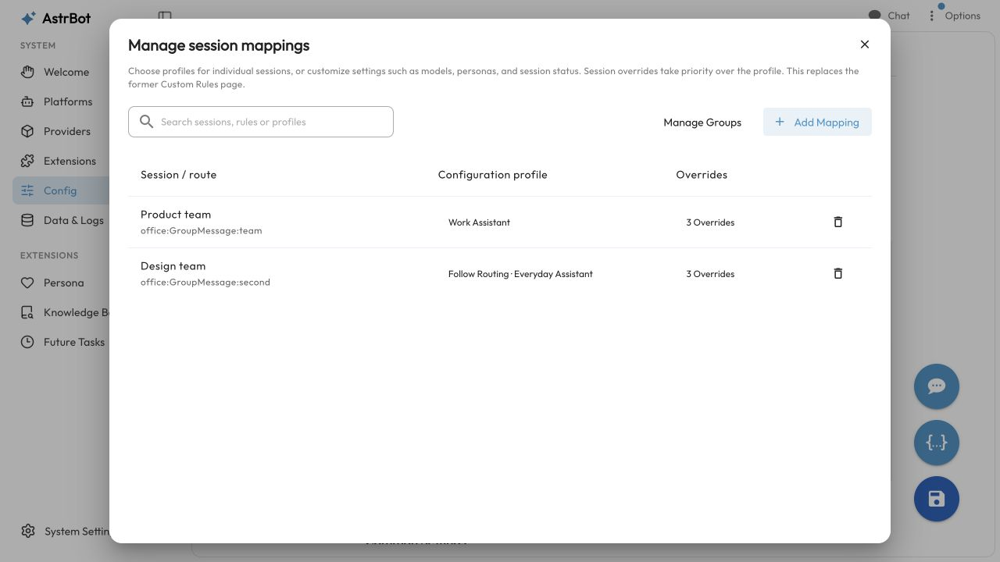
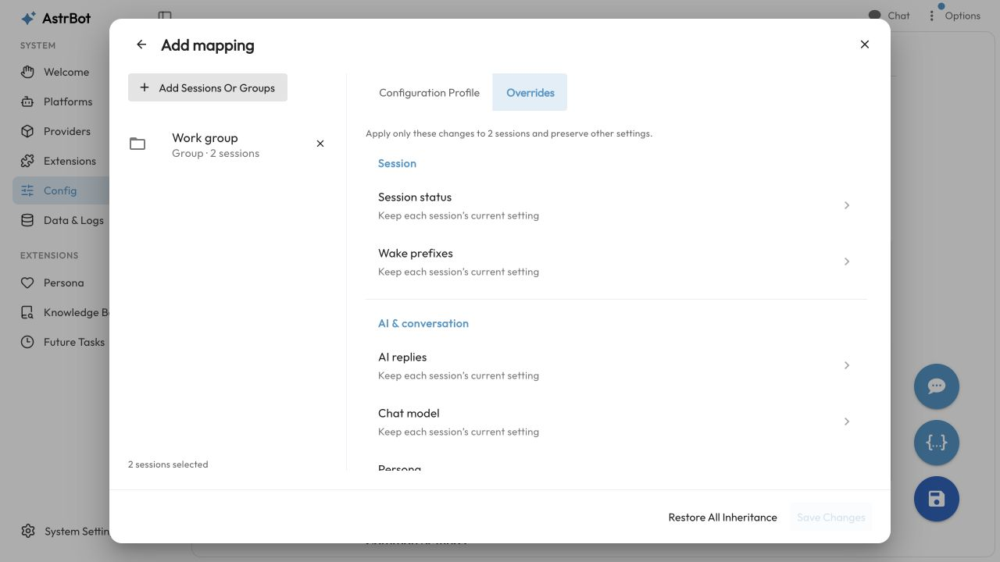
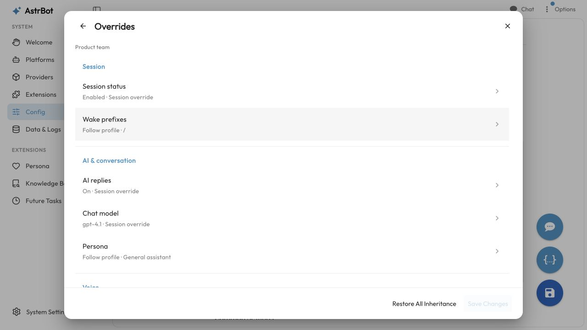
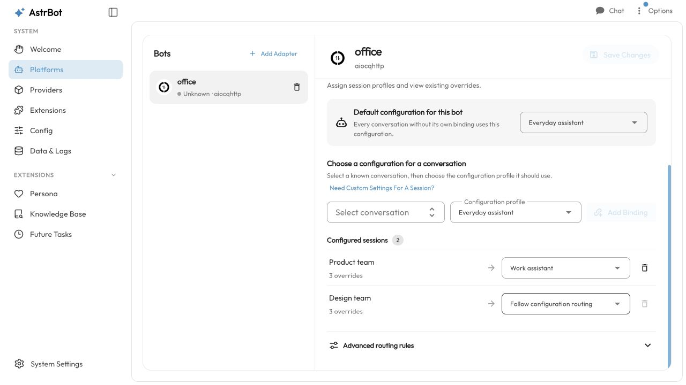
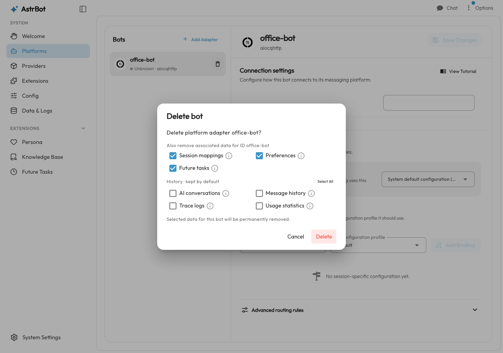

# Session Configuration Mappings (formerly Custom Rules)

Use **Config → Manage session mappings** to assign configuration profiles and customize settings for individual sessions. Whole-bot mappings are managed on the **Bots** page.

| Previous entry | Current entry |
| --- | --- |
| Custom Rules / Session Management / More Features → Custom Rules | Config → Manage session mappings |
| Former Session overrides tab | Config → Manage session mappings |
| `/session-management` or `/config?scope=sessions` | Opens the mappings dialog on the Config page |

## Edit a session

1. Send `/sid` in the target chat to obtain its UMO (Unified Message Origin). For groups with per-member isolation, use the target member's UMO.
2. Open **Config → Manage session mappings → Add mapping → Add sessions or groups** and select the targets.
3. Choose **Configuration profile** to assign a base profile, or **Overrides** to customize individual settings.
4. Choose **Save mapping** for a profile assignment or **Save changes** for overrides.

To edit an existing mapping, click its profile or override count in the table. Saved changes apply to subsequent messages.

## Inheritance

Effective settings are the **assigned profile plus explicit session overrides**. Overrides belong to the UMO and do not change the shared profile.

- **Follow config routing** uses the first matching route, or the default profile if none matches. Explicitly selecting the default profile bypasses routing.
- Switches offer **Follow profile / On / Off**. Explicitly enabling a capability overrides a disabled profile setting, but still requires a working model.
- For models, personas, and other fields, choose **Set for this session** to override a value or **Follow profile** to remove the override.
- Lists replace the profile list. **An empty list clears the setting; it does not restore inheritance.**
- Changing profiles preserves explicit overrides. **Restore all inheritance**, followed by **Save changes**, clears field overrides while keeping the assigned profile, history, variables, aliases, and groups.

You can override session status, wake prefixes, AI and voice settings, model selections, persona, knowledge bases and retrieval count, and plugin lists. System settings and model credentials are configured in the profile.

An empty wake-prefix list disables prefix-based waking. Mentions and other wake mechanisms still work; the profile controls whether private messages require a prefix.

## Groups and batch updates

Use **Manage groups** to organize sessions. Applying a mapping to a group updates its current members; future members do not inherit it automatically.

When editing multiple sessions, **Keep each session’s current setting** leaves a field unchanged. Only fields you edit apply to all targets. **Follow profile** removes that field's override from each session. Changing base profiles preserves individual overrides.

## Remove mappings

Removing a session mapping clears its profile assignment and overrides and restores routing. History, variables, aliases, and groups are preserved.

On the **Bots** page, selecting **Follow config routing** keeps overrides. The trash button removes the entire mapping, including its exact-session route, after **Save Changes**. Use **Need custom settings for a session?** to open the override editor.

When deleting a bot, select **Session mappings** to remove its profile assignments, overrides, and routing rules. Clear this option to preserve them. Shared configuration profiles are not deleted.

## Commands use the same settings

Administrators can use `/provider <index>`, `/provider tts <index>`, and `/provider stt <index>` to set model overrides. `/provider --inherit` restores all three model selections to the profile. Refresh the editor to see command changes.

The built-in `/persona` command has been removed. Set the persona under **Config → Manage session mappings → Overrides → Persona**. Creating or switching conversation histories within the same UMO does not reset overrides.

## Plugins and blocked sessions

**Allowed plugins** (`plugin_set`) defines the allowed set; **Disabled plugins** (`disabled_plugins`) excludes plugins from it. Each list can inherit or override the profile independently. Globally disabled plugins remain disabled; reserved system plugins retain their availability.

Use **Session status → Stopped** to stop AI and plugin responses for a session. **Enabled** removes matching blacklist entries from its override; other access controls still apply. **Follow profile** restores inheritance.

The profile blacklist is under **Config → Access Control → Blacklist** and accepts UMOs or group IDs. It takes precedence over the whitelist, including for administrators and WebChat. Restore blocked sessions through the WebUI.

## Migration

Upgrade migration preserves route order, session settings, knowledge-base references, groups, aliases, selected conversations, and history. Existing forced-persona rules take precedence over the selected conversation's persona when creating the persona override.

Legacy disabled AI/TTS flags become explicit **Off** values; enabled flags become **Follow profile**. Disabled sessions remain stopped. The unused session Rerank toggle is removed; knowledge-base reranking model settings are preserved.

## Retired API migration

The following session-status and batch-setting endpoints and their legacy aliases have been removed:

| Removed endpoint | Removed legacy alias | Replacement |
| --- | --- | --- |
| `GET /api/v1/sessions` | `GET /api/session/list-all-with-status` | Use `GET /api/v1/sessions/active-umos` for known sessions, `GET /api/v1/sessions/rules` for mappings, and `GET /api/v1/sessions/overrides?umo=...` for one session’s explicit and inherited values |
| `PATCH /api/v1/sessions/provider` | `POST /api/session/batch-update-provider` | Update the model configuration paths through `POST /api/v1/sessions/rules` |
| `PATCH /api/v1/sessions/service` | `POST /api/session/batch-update-service` | Update the session-status, AI, or speech-output overrides through `POST /api/v1/sessions/rules` |

Write requests use `rule_key: "config_overrides"` and a `rule_value` object containing the changed configuration paths and values. For batch operations, submit one request per target UMO; group members are available from `GET /api/v1/session-groups`. Removed endpoints do not redirect.
