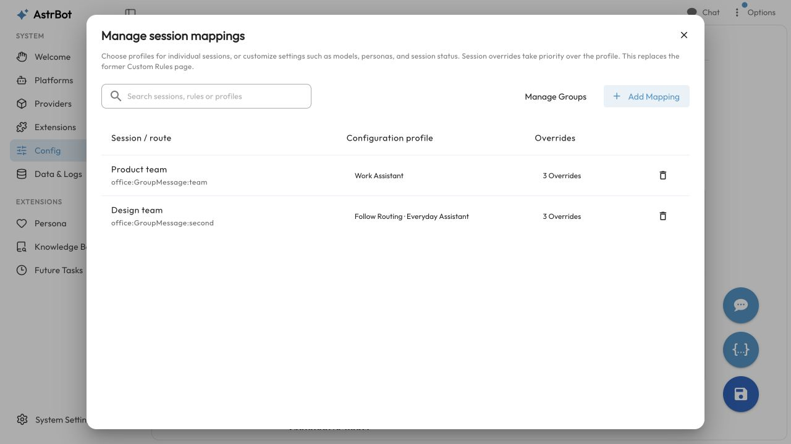
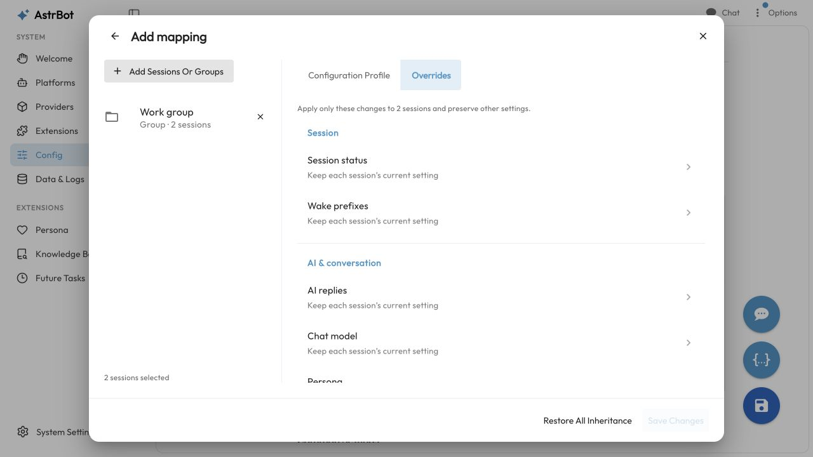
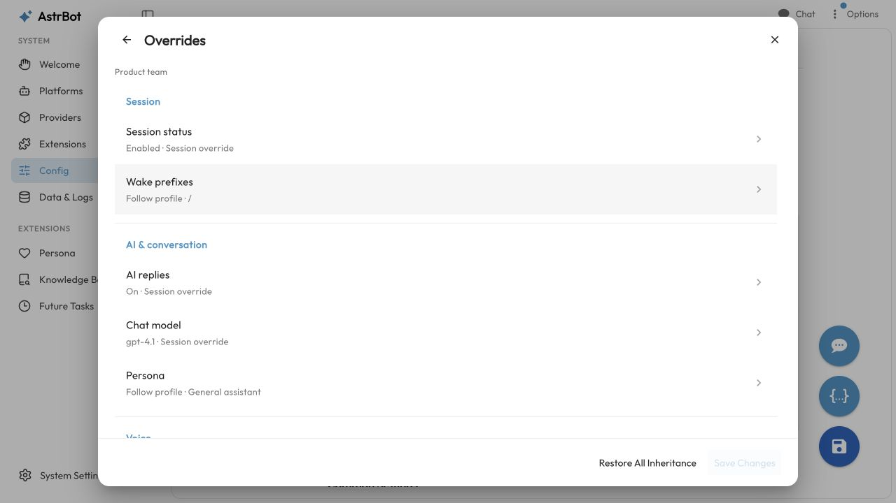
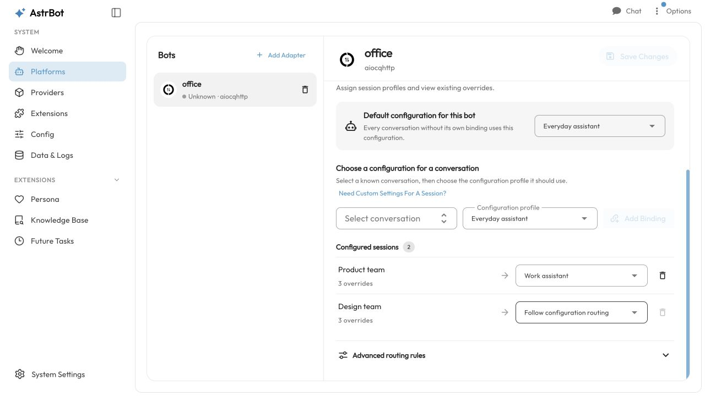
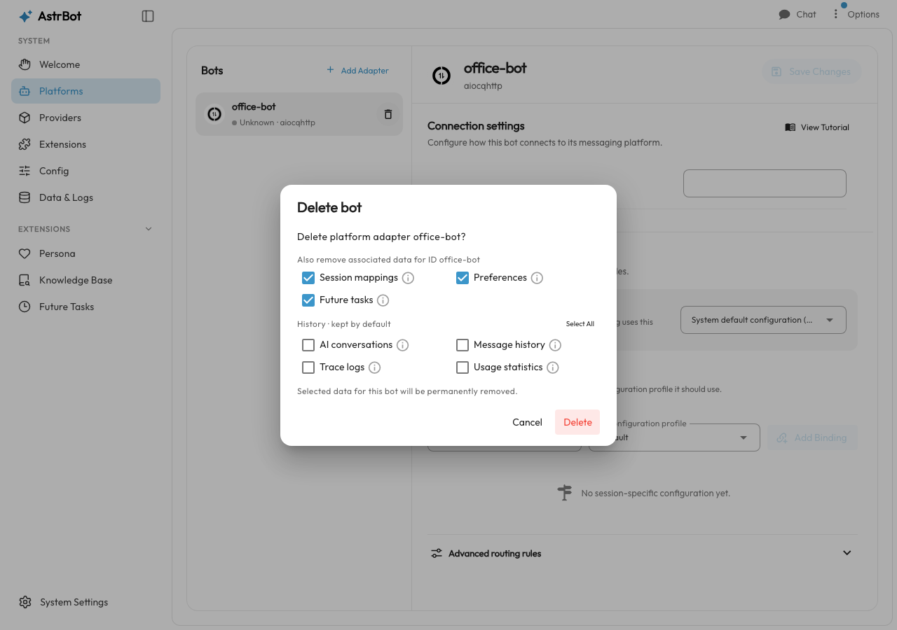

# Session Configuration Mappings (formerly Custom Rules)

Open **Config → Manage session mappings** to view session profiles, overrides, and existing routing rules in one table. The main Config page keeps its profile selector and an adjacent search icon that expands into a search field when clicked; mapping management opens in a dialog.

The description below the title explains profile selection and override priority, and identifies this as the replacement for Custom Rules.

Whole-bot mappings are managed only on the Bots page and are hidden from this dialog. The dialog keeps a fixed height with internal scrolling for longer content.

| Previous entry | Current entry |
| --- | --- |
| Custom Rules / Session Management / More Features → Custom Rules | Config → Manage session mappings |
| Former Session overrides tab | Config → Manage session mappings |
| `/session-management` or `/config?scope=sessions` | Opens the mappings dialog on the Config page |

## Inheritance

Effective settings are the **assigned profile plus explicit session overrides**. Overrides belong to the UMO (Unified Message Origin) and never modify the shared profile.

Each message uses a configuration snapshot throughout its pipeline. Changes saved while that message is being processed apply to subsequent messages. With per-member group isolation enabled, profile selection and overrides use the final isolated UMO; use `/sid` in the target session to identify it.

- Switches have **Follow profile / On / Off** states. Explicitly enabling AI or speech output overrides a disabled profile setting; a working model is still required.
- Select a setting row and choose **Set for this session** for models, personas, knowledge bases, or other fields. **Follow profile** removes that override.
- Lists replace the corresponding profile list entirely. **An empty list clears the setting; use Follow profile to restore inheritance.**
- Changing the assigned profile updates inherited fields while keeping explicit overrides.
- **Restore all inheritance** clears the draft overrides. Save to apply it. This keeps conversations, session variables, aliases, and groups.

Supported fields include session status and wake prefixes; AI, speech recognition and speech output switches; the three model selections; persona; knowledge bases and retrieval count; and allowed and disabled plugins. System settings and model credentials are not session overrides.

Small headings and dividers organize the continuous list into Session, AI & conversation, Voice, Knowledge bases, and Plugins. Session status stays first, followed by Wake prefixes.

Wake prefixes uses the profile's existing `wake_prefix` field. Set multiple prefixes, such as `!` or `Assistant`, to replace the list for the selected session without affecting others. An empty list disables prefix-based waking; mentions and other wake mechanisms still work. Whether private messages require a prefix remains controlled by the profile. Choose Follow profile to restore inheritance.

## Edit a session

1. Send `/sid` in the target chat to obtain its UMO. For groups with per-member isolation, use the actual target message's UMO.
2. Open **Config → Manage session mappings** and choose **Add mapping**. Click **Add sessions or groups** in the left pane. Reuse the session selector to choose multiple sessions, or select existing groups. Added sessions and groups appear in a removable list and may be combined; overlapping members are deduplicated.
3. Choose the destination in the right pane: **Configuration profile** selects a base profile or restores following routing; **Overrides** customizes individual fields. Editing either preserves the other.
4. There is no **Next** step. For a profile, select it and **Save mapping**. For overrides, edit settings in the list and choose **Save changes**. Leaving with unsaved edits prompts for confirmation.

When editing multiple sessions, untouched fields show **Keep each session’s current setting**. Only explicitly edited fields apply to all selected sessions. **Follow profile** removes that field’s override from each session. The panes stack on narrow screens.

Click a profile or override count in the table to edit an existing mapping. Removing a session mapping clears both its profile selection and overrides, restoring routing while keeping history, variables, aliases, and groups. Exact-session assignments on the Bots page share the same session bindings as this dialog. Changing or removing a profile assignment preserves field overrides. Legacy exact routes appear as sessions with aliases and their currently effective profile, without changing stored data on read. Editing the profile assignment writes the session binding and removes the old exact route. Other wildcard routes retain their matching order.

The settings list scrolls independently. **Restore all inheritance** and **Save changes** stay visible at the bottom without covering settings.

The Bots page also lists sessions that only have overrides, showing **Follow configuration routing** and an override count. On the Bots page, selecting **Follow config routing** in the profile dropdown keeps overrides. The trash button instead removes the entire mapping from the draft, including override-only sessions. **Save Changes** deletes its profile assignment, overrides, and exact-session route together. Leaving without saving does not submit the deletion.

Click **Need custom settings for a session?** beside the session profile instructions to open the same mappings dialog directly. Closing it refreshes the bot's mappings while preserving unsaved bot settings and mapping drafts.

## Commands use the same settings

`/provider <index>`, `/provider tts <index>`, and `/provider stt <index>` update the session's model overrides. `/provider --inherit` restores all three model selections to the profile.

The model commands above require administrator permissions. Refresh the editor to see changes made through commands.

The built-in `/persona` command has been removed. Set the session persona or restore inheritance under **Config → Manage session mappings → Overrides → Persona**. There is no separate forced-persona or conversation-persona priority layer. Creating or switching conversation histories within the same UMO does not reset its overrides.

## Plugins and blocked sessions

**Allowed plugins** (`plugin_set`) defines the allowed set. **Disabled plugins** (`disabled_plugins`) excludes plugins from that set. Each list can independently inherit or override its profile value. Globally disabled plugins are not loaded by session settings; reserved system plugins retain their existing availability.

The profile's Plugins page shows **Disabled plugins** only when `disabled_plugins` is nonempty. Clearing the list hides this field.

Set `platform_settings.id_blacklist` under **Config → Access Control → Blacklist**, and use **Session status**, the first item in the session editor (formerly **Blocked sessions**): **Follow profile / Enabled / Stopped**. Stopping adds the session's own UMO to its blacklist override. Enabling removes the matching UMO or group ID while preserving other entries; other access controls still apply. Following the profile removes this override. Batch operations update each session's own list rather than copying another session's blacklist. Entries can be complete UMOs or group IDs. A match stops message processing, including AI and plugin responses. Blacklist takes priority over whitelist, with no administrator or WebChat exemption. Restore blocked sessions through the WebUI.

## Groups and batch updates

Existing groups retain their names and members. They organize sessions for filtering and batch operations; membership does not create inheritance.

Use **Manage groups** in the mappings dialog to manage group membership. Adding a mapping for a group applies it to current members; future members do not inherit it automatically.

Selecting **Configuration profile** changes only members' base profiles and preserves their individual overrides. Selecting **Overrides** shows **Keep each session’s current setting** for untouched fields and applies only fields edited in this draft to all members. Other fields, profiles, and aliases remain intact. Check the result and retry if an operation fails.

## Migration

On upgrade, startup automatically migrates legacy data:

- Model selections, disabled plugins, knowledge bases, and retrieval counts become configuration overrides.
- Knowledge-base references retain their original IDs. `kb_names` accepts names or IDs, so migration does not depend on loaded instances or clear temporarily unavailable references.
- The selected conversation's persona becomes an override; an existing forced-persona rule takes precedence during migration.
- Legacy disabled LLM/TTS flags become explicit Off values. Legacy enabled flags become Follow profile to avoid enabling capabilities previously disabled by the profile.
- Disabled sessions receive a blacklist override containing their own UMO.
- Legacy remarks become UMO aliases, preserving existing nonempty user aliases and automatic names.
- The unused session Rerank toggle and its stored field are removed. Knowledge-base reranking model settings remain intact.
- Groups, selected conversations, session variables, and unrelated preferences are preserved.

## Base configuration and unified bindings

The table's **Configuration profile** column lets a session select a profile or **Follow routing**. Following uses the first matching UMO/UMOP route, then falls back to the default profile. Explicitly selecting the default profile bypasses routing. Saving a profile selection preserves existing field overrides. Restoring all field overrides preserves the selected base profile.

On startup, the former global `umop_config_routing` mapping is migrated to ordered pattern bindings; per-session `config_overrides` records become session bindings with a null base-profile selection. The original route order is preserved, and following sessions are not pinned to the profile that happened to match during migration.

Both use the `preferences` table with key `config_binding`:

| Target | scope | scope_id | value |
| --- | --- | --- | --- |
| Route pattern | `umop` | Pattern | `{"profile_id":"B","overrides":{},"order":0}` |
| Session | `umo` | Full UMO | `{"profile_id":null,"overrides":{"provider_settings.enable":false}}` |

A null `profile_id` follows routing; `"default"` explicitly selects the default profile. Only routes use `order`. Explicit session fields are always applied after selecting one base profile.

When deleting a bot, the former **Custom Rules** and **Config Routing** cleanup options are combined into **Session mappings**. Selecting it removes that bot’s profile assignments, session overrides, and routing rules together; clearing it preserves them. Shared configuration profiles are not deleted.

## Retired API migration

The following session-status and batch-setting endpoints and their legacy aliases have been removed:

| Removed endpoint | Removed legacy alias | Replacement |
| --- | --- | --- |
| `GET /api/v1/sessions` | `GET /api/session/list-all-with-status` | Use `GET /api/v1/sessions/active-umos` for known sessions, `GET /api/v1/sessions/rules` for mappings, and `GET /api/v1/sessions/overrides?umo=...` for one session’s explicit and inherited values |
| `PATCH /api/v1/sessions/provider` | `POST /api/session/batch-update-provider` | Update the model configuration paths through `POST /api/v1/sessions/rules` |
| `PATCH /api/v1/sessions/service` | `POST /api/session/batch-update-service` | Update the session-status, AI, or speech-output overrides through `POST /api/v1/sessions/rules` |

Write requests use `rule_key: "config_overrides"` and a `rule_value` object containing the changed configuration paths and values. For batch operations, submit one request per target UMO; group members are available from `GET /api/v1/session-groups`. Removed endpoints do not redirect.
