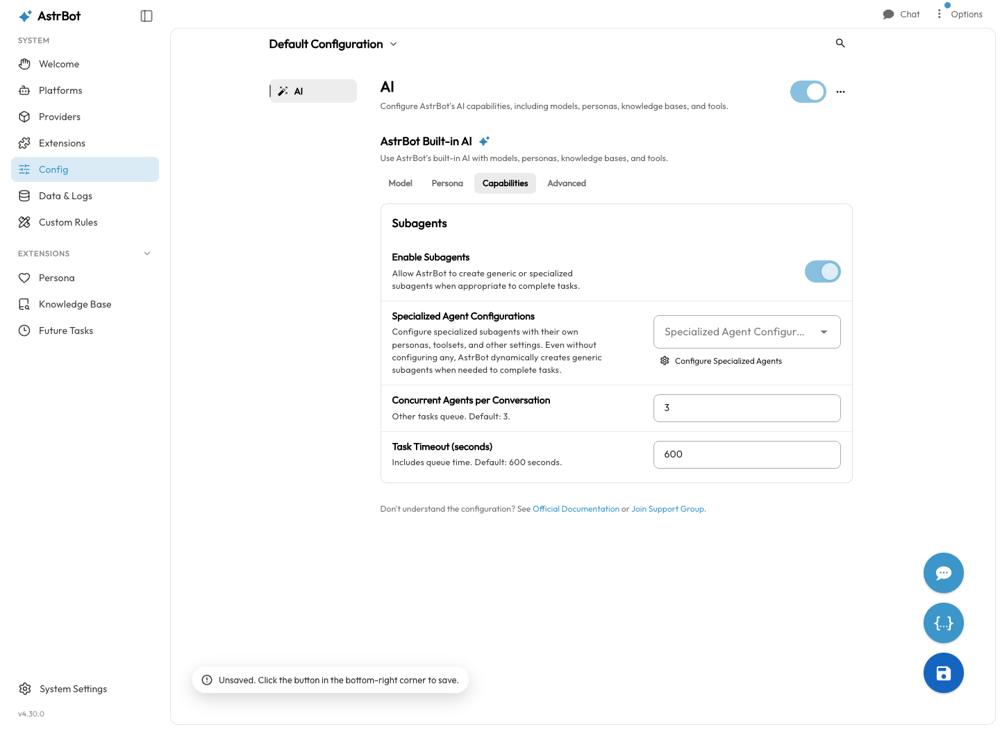
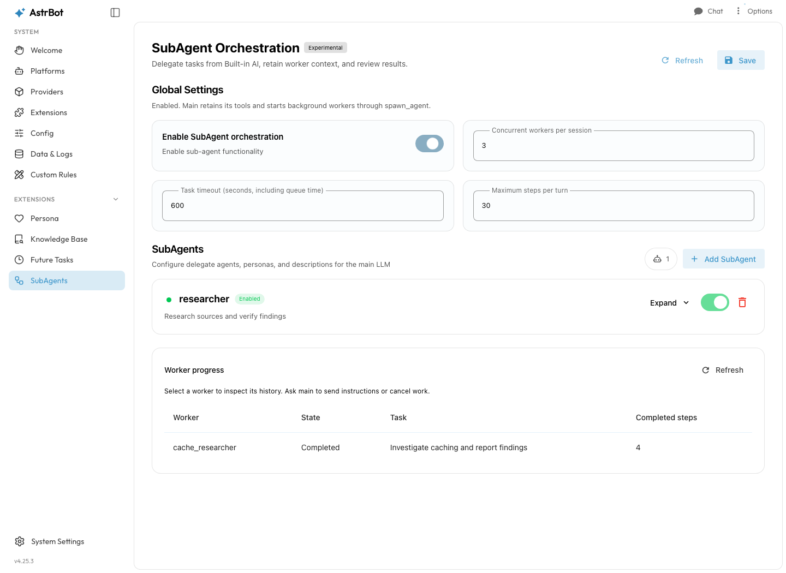
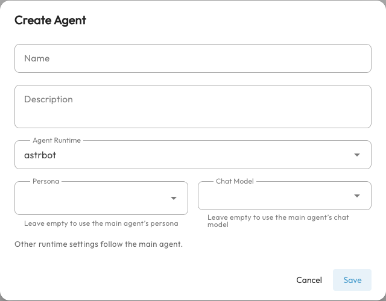

# Subagents {#agent-handsoff-and-subagent}

Subagents let the built-in AI delegate tasks to background agents with independent contexts while continuing the main conversation. No plugin installation is required.

## Enable subagents

Open **Config → AI → Capabilities → Subagents** in the target profile and enable the capability. You can use generic subagents immediately. The default concurrency limit is 3, and the default timeout is 600 seconds, including queue time.

## Configure a specialized agent

1. Click **Configure Specialized Agents**, then **Create Agent**.
2. Select the AstrBot runtime and enter a name and description. The description helps the main agent decide when to delegate.
3. Select a persona and chat model, or leave them empty to follow the main agent.
4. Save, close the dialog, and select the agent under **Specialized Agent Configurations**.

The selected persona supplies the agent's instructions, tools, and skills, within the parent agent's authorized capabilities. Other execution settings, such as step limits and tool timeouts, follow the main agent when the session is created. Configuration changes apply to new sessions.

To edit an agent, click its card. To delete one, remove any references from profiles or other agent configurations first. Configurations for unavailable runtimes remain saved but cannot start new sessions. Developers can [register another runtime](../dev/star/guides/ai.md#custom-agent-runtimes).

## Delegate and follow up

Ask the main agent to delegate a task, for example: “Have a subagent review this report while we discuss the next steps.” The main agent uses these tools:

| Tool | Purpose |
| --- | --- |
| `spawn_agent` | Start a background task. |
| `list_agents` | Check task status. |
| `wait_agent` | Wait for results. |
| `get_agent_result` | Read a result. |
| `send_message` | Add instructions to an existing agent. |
| `cancel_agent` | Stop a task. |

The configuration dialog manages saved agents; ask the main agent to check or stop running tasks. Subagents cannot create further subagents.

Delegated input supports text, images, and file references. Images from the original user message are not forwarded automatically. Follow-up instructions retain the subagent's history; in the built-in runtime, follow-up images and files are passed as text references.

## Restart and conversation behavior

Users in the same conversation share its subagents. Results return to the original parent conversation, even if you switch conversations. Deleted or stopped parents are not woken.

After a restart, queued and unfinished tasks are marked interrupted and are not replayed automatically. Check their status, then ask the main agent to send new instructions to continue in the same subagent conversation.

## Upgrade notes

The previous **SubAgent Orchestration / Subagent Management** sidebar entry has moved to **Config → AI → Capabilities → Subagents → Configure Specialized Agents**. The `/subagent` URL remains accessible.

Existing global settings and expert configurations migrate automatically. Existing conversations and history are preserved.

API clients should replace `/api/v1/subagents/config` and `/api/subagent/config` with `/api/v1/agent-configs` and `/api/v1/agent-configs/{config_id}`. Use `/api/v1/agent-runtimes` to list runtimes and their defaults. These endpoints require the `config` scope; see [OpenAPI scopes](../dev/openapi-scopes.md).

For plugin integration, see [running an Agent](../dev/star/guides/ai.md#running-an-agent-in-an-existing-conversation) and [runtime events](../dev/star/guides/ai.md#runtime-events).
