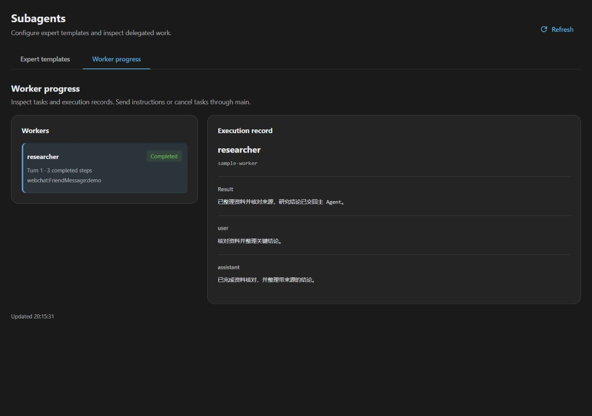

# Subagents {#agent-handoff-and-subagent}

Main can delegate tasks to subagents that run concurrently in the background and return their results. Each subagent has a private history and can use its own model, persona, and tools.

The Subagent extension ships with AstrBot and provides this capability for its built-in Agent. Configure subagents for external Agent services in those services.

## Get started {#configuration}

Enable the Subagent extension and describe the work you want main to delegate, for example:

> Have two subagents research the benefits and risks of this proposal separately. Continue drafting the evaluation criteria yourself, then combine their findings.

Main creates subagents with their initial tasks and continues independent work while they run. Ask main to send follow-up instructions or cancel a task when needed.

Configure execution limits in **Extensions → Plugins → Subagent → Settings**. Open **Subagent management** on the plugin detail page for expert templates and execution records.

## Expert templates

Open **Subagent management → Expert templates** and click **Create expert**. Configure a name, description, provider, persona, system prompt, and tools.

A selected persona supplies its prompt, preset dialogue, and tools. Alternatively, write a custom prompt and choose all, specific, or no tools. Saved templates become available immediately while tasks already started continue running. The list supports editing, enabling, disabling, and deleting experts.

Main can select an expert template or create a generic subagent with its currently available tools. Main retains its own tools.

## Task management

| Tool | Purpose |
| --- | --- |
| `spawn_agent` | Create a subagent with its initial task and optional expert template, name, and provider; immediately return its ID, actual name, provider ID, and state |
| `list_agents` | Read names, provider IDs, states, and completed steps within the current sender and conversation |
| `wait_agent` | Wait for any or all subagents; a wait timeout leaves tasks running |
| `get_agent_result` | Read results or errors repeatedly |
| `send_message` | Steer an active turn, or automatically start another turn if input remains unconsumed or the turn has finished |
| `cancel_agent` | Cancel one subagent independently |

The optional `name` sets this subagent's display name, defaulting to the expert name or `worker`. The optional `provider_id` selects a configured chat provider ID. Selection uses the call override, then the expert configuration, then the current conversation provider. Main can see available provider IDs and model names in the tool parameters. Overrides affect only this subagent and remain in effect for follow-up turns.

Subagents do not automatically inherit main's chat history. Include the necessary context, constraints, and expected output when delegating. Follow-up instructions retain the same subagent ID and private history. Subagents cannot create further subagents.

## Inspect progress

Open **Extensions → Plugins → Subagent → Subagent management → Worker progress** to inspect names, provider IDs, states, turns, completed steps, results, and execution records. This tab is read-only; send instructions and request cancellation through main.

In ChatUI, expand the `spawn_agent` tool's **Result** to inspect the actual name and provider ID, including choices resolved from templates or defaults.

## Execution and recovery

Defaults: 3 concurrent subagents per session, a 600-second timeout including queue time, and 30 steps per turn capped by main's limit. `wait_agent` accepts 0–60000 ms, with `any` to wait for one completion or `all` to wait for every requested subagent.

An active main receives completed results; an idle main resumes to process them. Results stay bound to the original session, conversation, and sender. Switching conversations prevents automatic wakeups for the original conversation and never redirects its results. Proactive delivery depends on the platform; see [Proactive Capabilities](./proactive-agent.md).

Subagent states, execution histories, and pending input persist in AstrBot's database. After restart or extension reload, unfinished tasks become `interrupted`. Main can inspect and resume them without automatically replaying tools that may already have run. Results may be delivered again after an abnormal exit.

Stopping a session cancels its background work. Cancelling one subagent leaves main and its siblings running. Background Shell processes started by a subagent use the Shell session tools and process timeouts.
