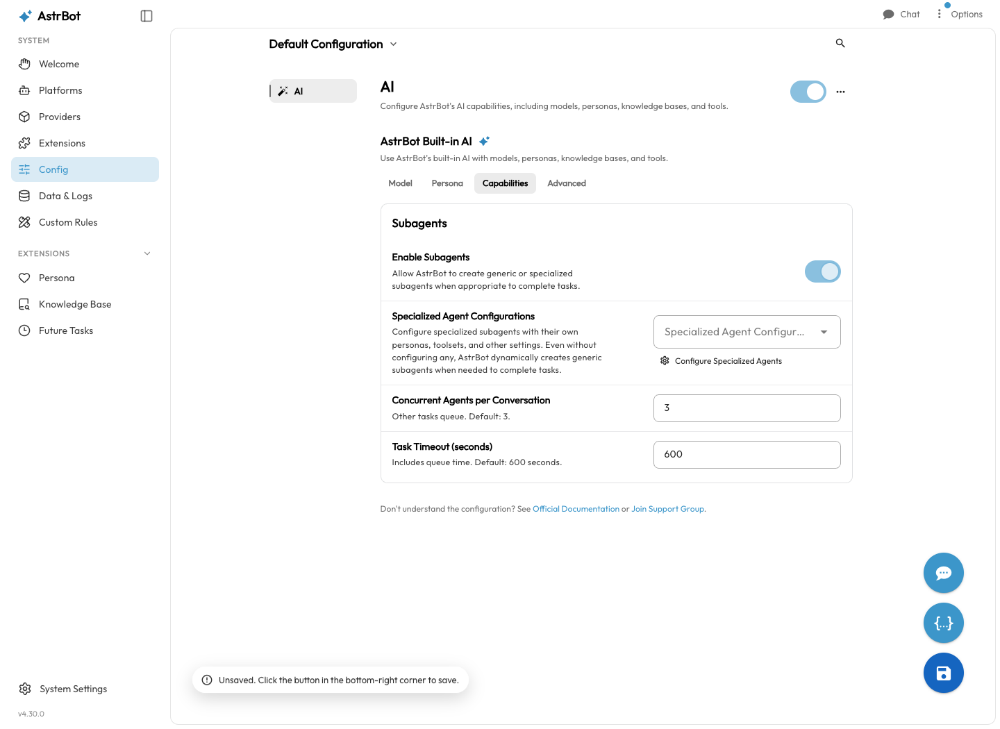
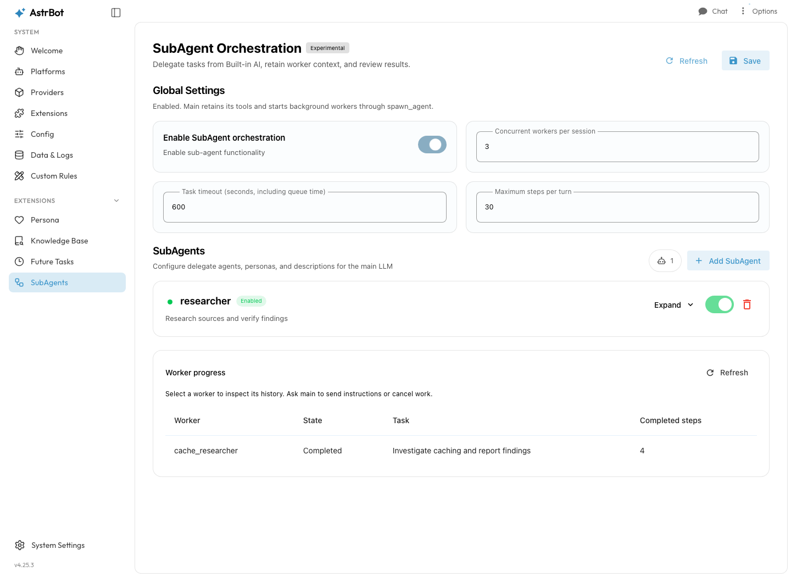
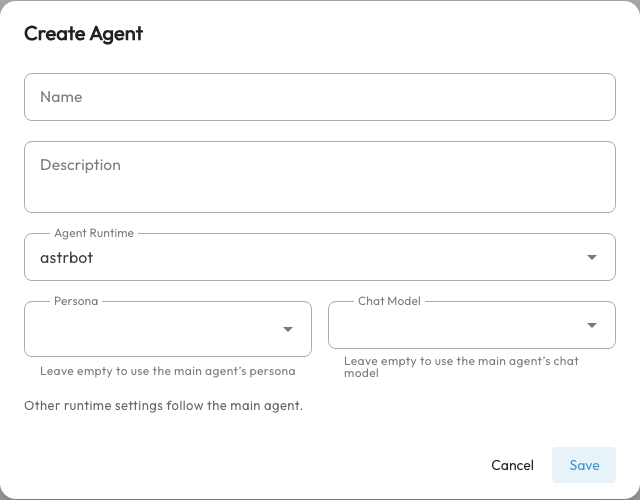

# Subagents {#agent-handsoff-and-subagent}

Subagents are a native **Built-in AI** capability in AstrBot. Main can continue working while delegating tasks to background workers with independent contexts. No separate plugin installation or activation is required.

## Configuration

Open the relevant profile at **Configuration → AI → Capabilities → Subagents**. Enabling the capability allows generic subagents immediately, without creating a saved agent. Concurrency defaults to 3 and timeout defaults to 600 seconds including queue time.

For a dedicated persona or chat model, click **Configure Specialized Agents**, then **Create Agent** in the dialog. Saving refreshes the original selection list. Close the dialog and select the agent under **Specialized Agent Configurations**. Management uses two-column cards with independent saves; click a card to edit or use its menu to delete it.

The previous sidebar **SubAgent Orchestration / Subagent Management** entry moves to **Configuration → AI → Capabilities → Subagents → Configure Specialized Agents**. Management opens in a dialog without leaving the configuration page. The previous `/subagent` URL remains accessible. Global settings have moved into profiles, and the former expert list is stored as database-backed agent configurations.





## AgentConfig and storage

Each configuration profile embeds `{ runtime, config }` under `agent` as its default main agent, edited directly in that profile. Agents created in the management page are stored in the database's `agent_configs` table and referenced by stable UUID `config_id`. Renaming an agent preserves references. Both use the same configuration structure; an inline main agent does not need a database record.

```json
{
  "agent": {
    "runtime": "astrbot",
    "config": {
      "subagents": {
        "enabled": true,
        "config_ids": ["stored-agent-configuration-UUID"],
        "max_concurrent_agents": 3,
        "task_timeout": 600
      }
    }
  }
}
```

`subagents` belongs to the `astrbot` runtime. Referenced AgentConfigs can select another registered runtime; ACP is not bundled in this phase. Native configurations have a form; other runtimes use a JSON editor. Configurations for unavailable runtimes remain stored but cannot create new sessions. Deletion is rejected while a profile or another AgentConfig references a record, and the API returns the reference locations.

Choose an Agent Runtime when creating or editing a configuration. For the AstrBot runtime, the form contains name, description, persona, and chat model. The description helps the main agent decide when to delegate. Empty persona and provider selections follow the main agent. Step limits, retries, compression, tool timeouts, and other runtime settings are inherited when the session is created instead of being duplicated in AgentConfig. The selected persona supplies instructions, tools, and skills, constrained by the parent’s authorized capabilities.



The main system prompt lists only selected and enabled configurations, exposing their IDs, names, runtimes, and descriptions. Full instructions apply to the worker. The `spawn_agent` schema stays fixed: choose an optional `config_id`, or omit it for a generic native worker.

Legacy `agent_runner` is migrated to `agent`, mapping `local` to `astrbot`. Legacy experts are removed from configuration files only after successful database import. Migration preserves existing sessions and history; already created agents retain their configuration snapshots.

## Execution and continuation

`spawn_agent` returns an agent ID after opening its runtime session, without waiting for the model task to complete. Main uses `list_agents` for status, `wait_agent` to wait, `get_agent_result` to read results, `send_message` for further instructions, and `cancel_agent` to stop one task.

Both `spawn_agent` and `send_message` accept a `messages` array using the same component format as `send_message_to_user`. These two tools currently support `plain` (`text`), `image`, and `file` (`path` or `url`). Initial images become model image input, while files are references the worker can read with its tools. Original user-message images are never inherited automatically. Native follow-ups are currently flattened to text retaining image and file references; other runtimes receive the original structured input.

```json
{
  "config_id": "agent-configuration-UUID",
  "messages": [
    {"type": "plain", "text": "Analyze this chart and consult the report"},
    {"type": "image", "path": "chart.png"},
    {"type": "file", "path": "report.pdf"}
  ]
}
```

Relative image paths resolve from the current session workspace. Absolute local paths within the caller's permissions and sandbox file paths are also supported. `send_message` uses the same `messages` input and additionally requires the target `agent_id`.

Results are addressed to the direct parent runtime/session. Delivery first calls the parent's active turn's `steer()` and waits for its durable-consumption receipt in an independent notification task. Rejected or unconsumed input is queued through the normal message pipeline with the exact parent session attached; switching the UMO's selected conversation does not redirect the result. Result bodies are carried in the input itself, without a separate step-start injection or delivery checkpoint. Further instructions steer a running worker or start its next turn with the same private history. Workers cannot spawn more workers.


## Persistence and recovery

Public agent IDs, runtime names, runtime session IDs, direct parent session references, and input/result records are persisted by UMO and owning main conversation. Users sharing a conversation share its subagents; isolation follows the main UMO/conversation without an additional sender boundary. Each input retains its own caller identity and permissions. Sender information is retained only as metadata. Each runtime persists its own private history. After restart, unfinished and queued inputs are marked interrupted and are never replayed automatically. Inspect interrupted records, then use `send_message` to send new instructions to the same conversation. Native main agents and subagents share execution and history handling. History reflects committed turns; interrupted tools are never replayed automatically. Switching main conversations keeps completed results bound to their original parent. Deleted or stopped parents are not woken.

## Agent runtimes

The bundled `astrbot` runtime owns native sessions, history, hooks, model execution, and native capabilities. Main agents and workers use the same session/turn contract; the native tool loop is an implementation detail. Core prepares message inputs and presents outputs. The AstrBot runtime’s subagent orchestration service maintains public identities, accepted tasks, concurrency limits, timeouts, and result delivery without directly reading or writing runtime-owned history storage. Delivery confirmation uses the parent session’s public history view.

Runtime adapters receive typed input through `AgentInput.content`: `PlainInput`, `ImageInput`, and `FileInput` retain the `plain`, `image`, and `file` semantics. These are immutable data objects without IM serialization or media download methods. Tool requests and persisted task records retain the existing `messages` JSON format; conversion happens at the runtime boundary.

An `AgentRuntime` opens or restores an `AgentSession`. `session.run_turn(input)` returns an independently executing turn with replayable `events()`, `result()`, `cancel()`, queued `follow_up()`, and optional `steer()` at a safe boundary. Cancellation of an output reader or result waiter does not implicitly cancel execution. The owner explicitly cancels the turn when its pipeline stops.

Extensions can register a runtime with `ctx.agent.register_runtime(name, runtime)` and select it in an AgentConfig’s `runtime` field. `spawn_agent` uses the configuration through `config_id`; generic workers use `astrbot`. An ACP runtime and continuous voice sessions are not included in this phase. Existing third-party main-agent execution paths remain unchanged.

`list_agents` returns each agent's public `agent_id`, `runtime`, and opaque runtime-owned session ID in `conversation_id`. `send_message` resolves the runtime and session by agent ID. `owner_conversation_id` identifies the separate owning main conversation.

## Entry points and APIs

Open management through **Configuration → AI → Capabilities → Subagents → Configure Specialized Agents**, route `/subagent`. Use `/api/v1/agent-configs` to list/create records and `/api/v1/agent-configs/{config_id}` to read/update/delete one. `/api/v1/agent-runtimes` lists callable runtimes and their defaults. These endpoints require the `config` scope. The former whole-configuration `/subagents/config` and `/api/subagent/config` endpoints are removed.


## Runtime output protocol

Both `turn.events()` and the handle returned by `ctx.agent.run_turn()` expose typed `RuntimeEvent` values: `event_id`, `session`, `turn_id`, UTC `created_at`, and `payload`. `event.type` delegates to `payload.type`. Replay retains event IDs and readers receive independent snapshots. Execution and history persistence do not require a subscriber.

```python
from astrbot.api.agents import TextDelta, MessageCompleted

async for event in run.events():
    payload = event.payload
    if isinstance(payload, TextDelta):
        print(payload.text, end="")
    elif isinstance(payload, MessageCompleted):
        # Replace earlier deltas for this message_id with its complete content.
        print(payload.message_id, payload.content)

result = await run.result()
print(result.status, result.text, result.usage.tokens.total_tokens)
```

Events cover `turn.started`, `turn.prepared`, `text.delta`, `reasoning.delta`, `message.completed`, `request.started/finished`, `tool.started/progress/finished/rejected`, `usage.updated`, and `turn.finished`. A request is one provider method invocation, including fallback and skills-like re-queries, without claiming visibility into hidden HTTP retries. Rejected tool calls never claim execution.

`message_id` associates deltas with the authoritative completed snapshot; do not append that snapshot again. `part_index` identifies a content position. `result.content` contains the final reply only, and `result.text` extracts its plain text without reasoning, tool results or intermediate narration. Content types are `plain`, `reasoning`, `image`, `file`, `audio`, `video`, and namespaced `extension`. Media references distinguish local paths, URLs and base64 data with a MIME type. Core restores platform-specific components from `astrbot.platform` extensions.

Usage events and final usage are cumulative replacement snapshots, never additive increments. Cached input is a subset of input tokens. Unknown counts remain `None`, distinct from zero; context occupancy is separate in `usage.context`. Actual step count is in `result.metrics.steps`. External runtimes declare their session ownership with `runtime_name` and publish only observed facts.

Migration: replace `event.data` with `event.payload`, and `result.chain` with `result.content`. `streaming_delta` / `llm_result` become `text.delta`, `reasoning.delta` / `message.completed`; `agent_stats` becomes `usage.updated`. Final status, errors and metrics replace `err`, `aborted`, and `step_completed`. Existing message sends, `ProviderRequest`, `LLMResponse`, and plugin hook signatures remain unchanged. Explicit tool sends are not intercepted or automatically recorded as runtime output.
