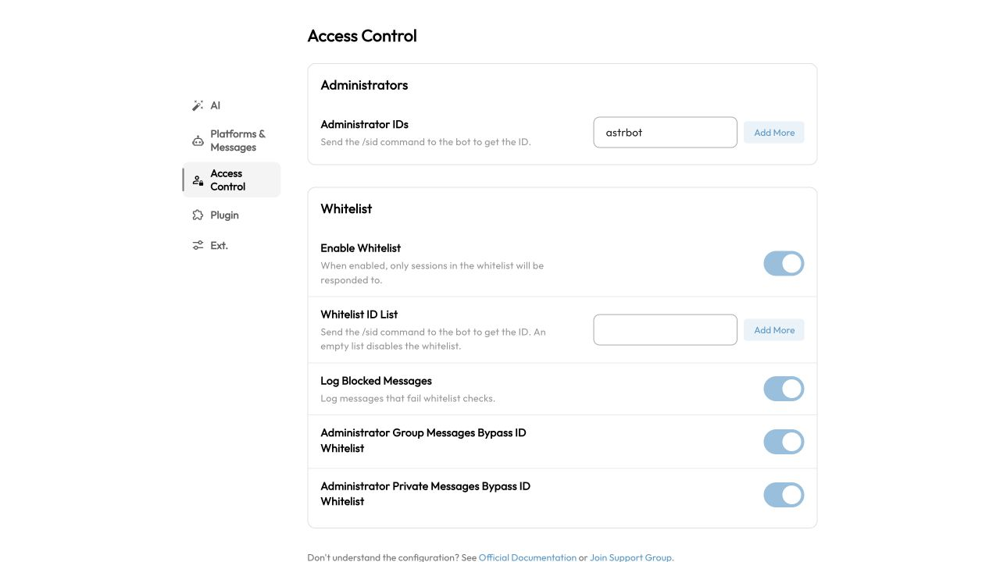
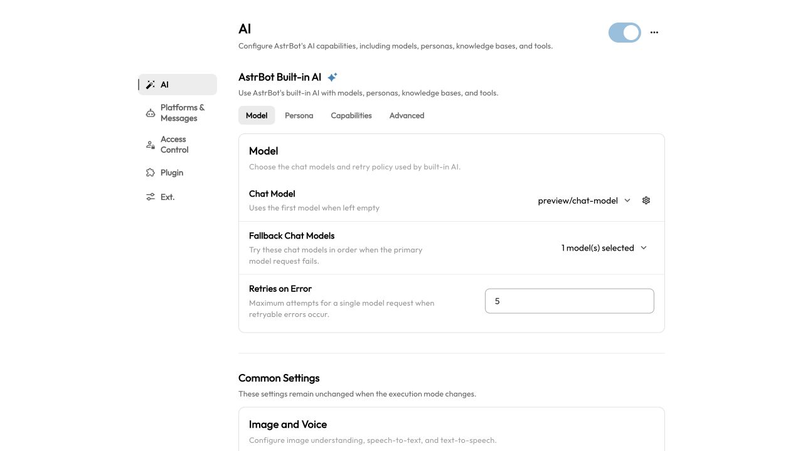
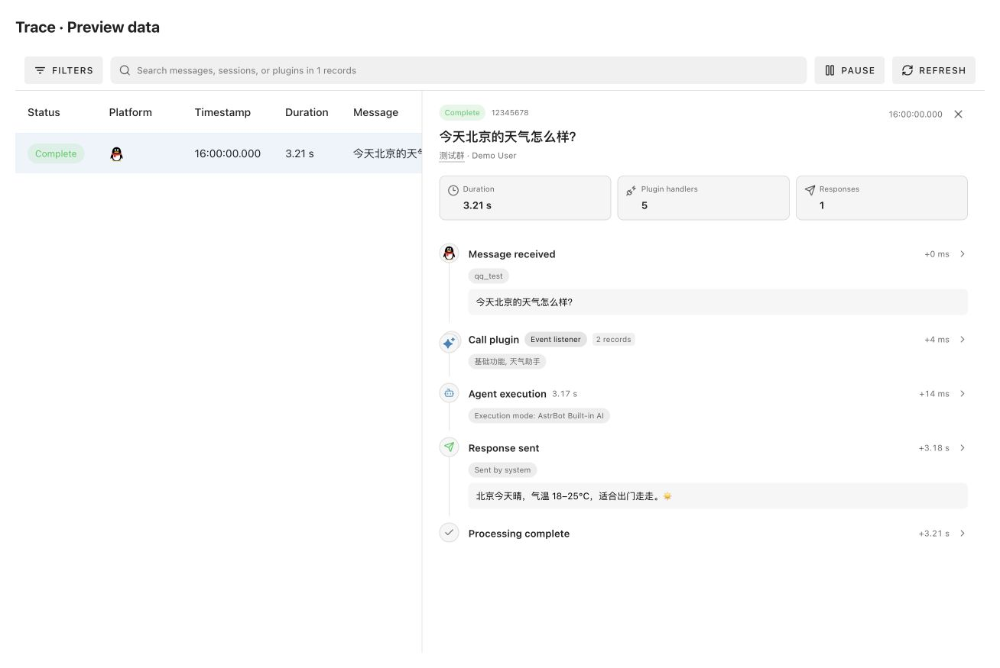

# WebUI

The AstrBot admin panel features plugin management, log viewing, visual configuration, statistics viewing, and more.

## Navigation and Previous Entry Points

These paths use the current default sidebar with a fixed menu order. Extension items still support collapsing, pinning, and grouping by plugin.

| Previous entry point or name | Current entry point |
| --- | --- |
| Providers → Add Provider → Agent Runner | Config → Select a profile → AI → `…` beside the AI heading → Change execution mode |
| Providers → Decision (after Chat Completion) | Providers → Decision (balance-scale icon, between Text to Speech and Embedding) |
| Data / Dashboard | Data & Logs → Statistics |
| Conversation Management / Conversations | Data & Logs → Conversations |
| Logs / Console | Data & Logs → Logs |
| Trace | Data & Logs → Trace |
| Config → Normal Config | Config → Select a profile |
| Config → System Config | System Settings → General, Appearance, Network, or Security, depending on the setting |
| Commands / Command Management | Extensions → Handlers → Command |
| Standalone MCP / Skills entries | Extensions → MCP Servers / Skills |
| Extensions → Installed → Update All | Extensions → Installed → Batch Update Plugins; all updates are selected by default, and individual plugins can be unchecked |
| System Settings → General → Cache → Export diagnostics | System Settings → Maintenance → Diagnostics → Export diagnostics |
| System Settings → Appearance → Customize Sidebar | Removed; the sidebar uses the default menu layout |
| Custom Rules / Future Tasks / SubAgents | Custom Rules is under the sidebar `System` group; Future Tasks and SubAgents are under the `Extensions` group |

Old log, trace, conversation, and statistics URLs still redirect to the corresponding tabs. Agent runners are now saved in each profile; they are no longer created as model providers. See [Agent Execution Mode](./agent-runner.md) for the setup steps.

## Documentation Navigation

The **Usage → Plugins** documentation group contains Plugins, MCP, and Skills. **Usage → AstrBot Built-in AI** contains Agent Sandbox, SubAgent Orchestration, Proactive Capabilities, Web Search, Knowledge Base, and Context Compression. Their URLs remain unchanged.

The Usage sidebar order is WebUI, AstrBot CLI, Built-in Commands, Plugins, AstrBot Built-in AI, Custom Rules, Agent Execution Mode, and Unified Webhook Mode.

| Previous documentation entry | Current documentation entry |
| --- | --- |
| Usage → Plugins, MCP, Skills | Usage → Plugins → Corresponding guide |
| Usage → Agent Sandbox, SubAgent Orchestration, Proactive Tasks, Web Search, Knowledge Base, Auto Context Compression | Usage → AstrBot Built-in AI → Corresponding guide |
| Usage → Tool Use / Function Calling | Removed; the Web Search guide explains the required function-calling capability directly |
| Usage → Agent Runner | Usage → Agent Execution Mode (URL unchanged) |
| Usage → CLI Commands | Usage → AstrBot CLI (URL unchanged) |

## Accessing the Admin Panel

After starting AstrBot, you can access the admin panel by visiting `http://localhost:6185` in your browser.

> [!TIP]
> - If you're deploying AstrBot on a cloud server, replace `localhost` with your server's IP address.

## Login

For first-time login, AstrBot generates a random initial password and prints it in startup logs. Please read the startup log line containing the WebUI credential and use that password to log in (username is usually `astrbot`).

## Two-Factor Authentication

AstrBot WebUI supports TOTP (Time-based One-Time Password) based two-factor authentication.

### Enabling Two-Factor Authentication

1. Open `System Settings → Security` at the bottom of the sidebar and find `WebUI Security`.
2. Toggle on "Enable WebUI TOTP"; a setup dialog with a QR code will appear.
3. Scan the QR code using any TOTP-compatible authenticator app (e.g., Google Authenticator, etc.).
4. Enter the 6-digit verification code generated by the authenticator app to complete the verification.
5. The system will generate recovery codes for logging in if the authenticator device is lost. Be sure to save them securely.

To replace the TOTP secret, you can do so in the TOTP management window, where you will need to verify the current TOTP code first.

### Recovery Codes

- Each recovery code can be used only once. After logging in with a recovery code, two-factor authentication will be automatically disabled, and you will need to set it up again.
- Recovery codes can be regenerated in the TOTP management window.
- If you lose the recovery codes, you will not be able to regain account access through normal means. You will need to manually edit `data/cmd_config.json`, set `dashboard.totp.enable` to `false`, and manually clear `dashboard.totp.secret` and `dashboard.totp.recovery_code_hash` to disable two-factor authentication.

### Security Related

- Once two-factor authentication is enabled, modifying TOTP-related configurations requires verifying the current TOTP code to prevent unauthorized changes.
- Changing the admin panel password will revoke all trusted devices.

## ChatUI

AstrBot includes a built-in ChatUI for talking to configured models directly in your browser.

ChatUI supports these common workflows:

- The sidebar initially loads the 30 most recent conversations. Scroll near the bottom to automatically load older conversations, with a progress bar while loading. Automatic requests pause after a failure; select **Retry** to continue.
  If the list does not fill the sidebar, more pages load automatically. Opening an older conversation by URL keeps its title and selected sidebar entry visible before its page loads.
- Create, rename, and delete conversations, and switch previous conversations from the sidebar.
- Select the config profile, model provider, and model on the chat page; if Provider session separation is enabled, you can also choose a model for the current session only.
- Send text, images, files, and voice input; uploaded attachments show previews and use file signature checks to help identify file types.
- View model thinking, tool-call status, knowledge-base or web-search references, and per-message token and latency statistics.
- Copy or regenerate existing replies, including regenerating with another model.
- Edit a user message and continue generation from that point, or start a thread from a specific excerpt.
- Switch between streaming/normal response modes and SSE/WebSocket transport modes.

To return to the model configured in the selected profile, open the model selector and choose **Default model** (**Follow the selected profile's default model**). This clears the override for the current conversation; other conversations retain their saved model choices. Logging out clears all saved ChatUI model choices in this browser.

> [!NOTE]
> To keep message delivery ordered, keep only one ChatUI page open for the same browser session. If you open chat in multiple tabs, the system may ask you to reconnect.

## Visual Configuration

Select `Config` in the sidebar, then choose the profile to edit from the selector at the top. Sections appear in this order: `AI`, `Platforms & Messages`, `Access Control`, `Plugin`, and `Ext.`. Use the search control at the top to find a setting. The profile selector, search button, and section navigation stay fixed while only the configuration pane on the right scrolls.

- In `AI`, built-in AI settings have `Model`, `Persona`, `Capabilities`, and `Advanced` tabs. Use `… → Change execution mode` beside the AI heading to connect a third-party agent.
- `Access Control` contains administrator IDs and the session whitelist, including whitelist logs and administrator exemptions.
- `Platforms & Messages` contains message-trigger, session-isolation, and delivery settings.
- `Plugin` selects the plugins enabled for this profile. To edit an individual plugin's parameters, open `Extensions` and click that plugin's gear icon (`Extension Config`).
- `Ext.` contains segmented reply, group chat context, and text-to-image settings (output toggle, word count threshold, rendering strategy, service endpoint, and custom templates).

Under `Ext. → Segmented Reply`, turn on `Enable Segmented Reply` to configure segmentation, intervals, and content cleanup. Turning it off hides the detailed options. Random intervals, the log base, the segmentation regex, and split-word lists also depend on the selected mode.

| Previous location | Current location |
| --- | --- |
| Platform | Platforms & Messages |
| Platform → General → Administrator IDs | Access Control → Administrators → Administrator IDs |
| Platform → Whitelist | Access Control → Whitelist |

After selecting an explicit model, click the gear beside the selector to open its settings dialog. Gears are also available in model and fallback-model menus. Clicking a gear does not change the selection or fallback order. Saving model settings immediately affects every profile using that model; the current profile's model selection still requires `Save Configuration`. Automatic selection has no gear beside the selector.

After editing, click the disk icon labeled `Save Configuration` in the lower-right corner and check for a successful save message.

Use the `{}` icon labeled `Edit Configuration File` to edit the current profile as JSON. Select `Apply This Configuration` to stage the changes in the visual editor, close the editor, and then select `Save Configuration`.

### System Settings

Global settings are under `System Settings` at the bottom of the sidebar:

The page title and section navigation stay fixed while only the settings pane on the right scrolls.

- `General`: timezone, external callback address, logs, and cache.
- `Appearance`: theme colors.
- `Network`: HTTP proxy, Python package sources, and GitHub proxy. For the address to use when AstrBot runs in Docker, see [Deploy with Docker](/en/deploy/astrbot/docker.md).
- `Security`: WebUI HTTPS, login rate limits, and TOTP.
- `Maintenance`: backup, restore, diagnostic export, and restart.
- `OpenAPI`: developer access keys.

System configuration changes save automatically. Check for a successful save message and restart AstrBot if the page indicates that a restart is required.

Backups under `Maintenance` include session aliases, model usage statistics, OpenAPI access keys, and MCP server configuration. Workspace files require a separate backup. TOTP trusted devices are excluded; replacing data from a backup clears existing device trust and requires device verification again. Older backups cannot recover data they did not include: export a new backup from the original instance before migrating. If a backup has no MCP configuration, the target instance's MCP configuration is kept.

## Plugins

Select `Extensions` in the sidebar. The top tabs are `Plugins`, `Skills`, `MCP Servers`, and `Handlers`. Within `Plugins`, switch between `Installed` and `AstrBot Plugin Market` to view local and market plugins.

On either plugin list, you can also click `Install Plugin` (+) in the bottom right corner to manually install plugins via URL or file upload.

> Due to the plugin update mechanism, the AstrBot Team cannot fully guarantee the security of plugins in the plugin market. Please carefully verify them. The AstrBot Team is not responsible for any losses caused by plugins.

### Handling Plugin Load Failures

If a plugin fails to load, the admin panel will display the error message and provide a **"Reload"** button in the failed plugins list. This allows you to quickly reload the plugin after fixing the environment (e.g., installing missing dependencies) or modifying the code, without having to restart the entire application.

## Data & Logs {#data}

Select `Data & Logs` in the left sidebar to switch between `Statistics`, `Conversations`, `Logs`, and `Trace` from the tabs at the top of one workspace. `Statistics` opens by default the first time; afterwards, the page reopens the tab you last used.

### Statistics

The `Statistics` tab summarizes platform instances, messages, model calls, tokens, and uptime. It also shows message trends, platform message rankings, model-call trends, model usage rankings, and conversation model usage rankings. Use the range selector at the top to view 1 day, 3 days, or 1 week.

### Conversations

Use the `Conversations` tab to find and manage saved conversation records:

- Filter by keyword, bot ID, private/group conversation type, or UMO, and sort by creation or update time.
- By default, the list loads 30 records per page from the server. When **Group by session** is enabled, pagination switches to UMO sessions and expanding a session reveals all of its conversations. Full message history is loaded only after you select a conversation and is then shown in the preview on the right.
- Edit titles, export multiple selected conversations, or delete multiple selected conversations.
- Use the `{}` button in the preview header to inspect the raw `history` JSON in a read-only, word-wrapped Monaco editor.
- Select `Back to legacy` in the upper-right corner if you still need the original table-based view.

### Logs

The `Logs` tab shows AstrBot runtime logs in real time. You can filter by log level and install missing Pip packages from this page. To view DEBUG logs, first set `Console Log Level` to `DEBUG` under `System Settings → General → Logs`.

Click `Export diagnostics` and confirm the content and privacy notice to download a ZIP. It includes available disk and rotated logs, configured custom logs, up to 500 cached events, available trace history, configuration profiles and routes, plugin versions and status, environment details and a manifest. Existing data remains exportable when file logging or tracing is disabled; missing trace history is recorded without enabling tracing. Trace history is limited to the latest 50 traces and 16 MiB in total. Disk logs are limited to 256 MiB of source data, skipping individual files larger than 64 MiB and, in redacted mode, oversized lines. Truncation and missing items are recorded. Raw databases and plugin source code are excluded. The dialog enables `Redact credentials (recommended)` by default. Recognized credentials are masked, and public IPv4/IPv6 addresses use consistent aliases such as `[PUBLIC_IP_1]` across the bundle. Alternate spellings of the same address share an alias; protocols, ports, paths, local and other non-public addresses remain. No original-address mapping is included. Conversations and personal data may remain; review before sharing. Uncheck this option when diagnosis requires original values. This retains passwords, keys, tokens, public IPs and other sensitive data, and adds `raw` to the filename; share only privately with someone you trust. Reopening the dialog resets the option to enabled. Only authenticated dashboard administrators can download bundles; developer API keys are not accepted. The `Export diagnostics` button under `System Settings → Maintenance → Diagnostics` uses the same export. This settings entry was moved from `System Settings → General → Cache`.

The export dialog offers `Last hour`, `Last 12 hours`, `Last day`, `Last 3 days` and `Custom`, with `Last day` selected by default. Preset ranges are calculated when you click download. Select `Custom` to enter start and end times using your browser’s local time. Only disk logs, cached logs and traces within that range are exported. Timestamp-free continuation lines follow the preceding disk-log record; standalone content without a recognized timestamp is excluded. Disk timestamps without an explicit offset use the server’s local time. Traces are selected by start time and retain their complete details, with the existing limit of the latest 50 matching traces and 16 MiB. Configuration, plugin status and environment details remain current snapshots. The selected range is recorded in `manifest.json`.

In the diagnostic bundle, cached logs are stored in `logs/astrbot.in-memory.log`, cached traces in `traces/history.in-memory.jsonl`, and persisted trace history in `traces/history.jsonl`. The `webui_version` field in `environment.json` records the version declared by the WebUI assets being served, or `null` when unavailable.

Open `Filters` next to the search box to filter by level, source (System/Plugin), individual plugin, and bot platform, or exclude user-chat logs. Combine these conditions with `Search logs`. The plugin dropdown lists only plugins that appear in the current logs, not every installed plugin, so installed plugins that have not logged anything are absent. Plugin menus prefer display names and show plugin IDs as subtitles; `System` replaces the former Core source label.

The toolbar contains search, fullscreen, font-size controls, and `Install Pip packages`. The default font size is 12px, adjustable from 8–16px in 2px steps. The former auto-scroll switch is replaced by bottom-following behavior: new logs follow when you are at the bottom, without interrupting reading older entries. Top-row filters move into the `Filters` sidebar; closing it preserves selections. Logs remain in memory, without new file-reading or database persistence.

### Trace

The Agent execution heading shows chips for recorded model and persona IDs, plus the number of actual tool calls when nonzero. Hover over a model chip to see its provider ID. These remain visible when the execution chain is collapsed; nested and parallel Agents are counted separately, and unavailable metadata is omitted.

Below the detail title, UMO and sender appear on separate icon-and-value rows. UMO aliases retain their hover tooltip showing the full identifier.

Trace text and tooltips use the system UI font rather than Outfit. Running status is blue; completed and error statuses remain green and red.

List and detail timestamps include month and day using `MM-DD HH:mm:ss.SSS` in the browser's local time zone; timeline timestamp tooltips use the same format.

Traces containing Agent calls add a borderless Tokens statistics card. Its total sums this execution's input (including cached input) and output, displayed with two-decimal k/M notation while the tooltip retains exact counts; hover or focus to inspect input, output, and cached-input counts. Only the latest cumulative snapshot per Agent is used, and separate Agents are summed. Unavailable usage shows an em dash rather than a reported zero.

The Type column precedes UMO. Blue Agent indicates an Agent call; green Command indicates a command-handler call. Neutral Group chat / Private chat chips appear independently alongside them. Ordinary listeners and event hooks do not count as commands. Message type comes from the summary, falling back to UMO for older records; unknown types have no chat chip. Legacy command flags are derived for the current page without opening each trace's details.

New spans identify calls with `astrbot.kind` and describe execution through timestamps and status. They no longer store `astrbot.action`, `astrbot.end_action`, or `astrbot.duration_ms`; duration is calculated from nanosecond timestamps and `astrbot.handler_type` remains. Existing trace history stays readable without rewriting stored records.

Long titles show two lines and received/sent message previews show four lines by default. Overflowing text offers Show full text / Collapse. This only folds the display; recorded content is not truncated.

Complete means the entire event has finished processing, not just its model request or response delivery. Ordinary messages and Cron tasks share the event execution lifecycle. Cron does not run through the message Pipeline; its trace ends after Agent execution and history saving, and failures or cancellations also close the trace with an error.

The detail timeline uses a compact grouped layout: "Plugin handler triggered (Type)" becomes "Call plugin" with a category chip, and "Start Agent" becomes "Agent execution". A consistent right-hand chevron replaces repeated standalone View details links; click a regular node's heading to inspect its raw data, or a plugin call group to expand its calls. Platform IDs move to secondary chips, metadata chips use neutral colors, and times show offsets from trace start with precise timestamps on hover.

Agents fold their execution chain by default. Click Agent execution to expand request preparation, tools, and plugin hooks; Raw data exposes the Agent's own fields. Folding follows actual span parent relationships, without capturing unrelated interleaved branches. Expansion preserves record order and final responses stay on the main line. Collapsed headers retain internal error indicators, and folding does not change call, response, or span counts.

Under Settings → General, Log & Cache Cleanup is now Log, Cache & Trace Cleanup. Total usage includes the trace database and its sidecar files. The menu adds Clear Trace Data, and Clean All includes historical traces. Confirmation warns that completed/interrupted traces are permanently removed while running traces are retained; the database file is not deleted directly. Clean Logs and Clean Cache do not clear traces.

Toggle Enable Trace Recording under Settings → General → Logs. It shares the same global setting as the trace toolbar’s start/pause button; disabling recording stops collecting new traces without deleting history. Below it, configure the database path, capacity budget (MB), and retention days. Defaults are `logs/traces.db`, 80 MB, and 7 days; restart the backend after changing the path. Top-level text fields such as system prompts have no separate 4 KB truncation limit; whole-trace content and node budgets still apply.

The trace tab has no outer gray card; its toolbar and list sit directly on the page with only the necessary separators. The former hint and switch are replaced by a toolbar button showing Pause (enabled and connected), Connecting (enabled but disconnected), or Start (disabled). Filters, recording, and refresh use matching light-gray icon-and-text buttons sharing the input's background color, all 36px high. Search fills the remaining width, pushing actions to the right. Its placeholder includes the message count instead of a separate counter. Click to pause or resume. Updates show loading and prevent repeated clicks; failures preserve the previous state and display an error. Pausing retains the list and open details in both themes.

The `Trace` tab shows message execution chains: receipt, plugin handlers, Agent requests, responses, and completion. It opens as a full-width Vuetify datatable with columns ordered as status chip, platform logo, timestamp, duration, message, type, UMO, sender, and Spans. Header and cell text uses 13px with a 40px header height, while body row height and spacing use Vuetify defaults; only cell content such as status, platform icons, and messages is customized. Status chips use the flat variant; the platform column is 80px wide with a non-wrapping header. Duration updates while execution is active. Click a row to open its timeline details on the right; use the close button or Escape to return to the list. History loading, incoming records, and filtering never automatically open another trace. Scroll horizontally on narrow screens. Spans counts actual spans including the message root, excluding span events; collapsing does not change the count. The search placeholder shows the total message traces matching the current filters. History is searched, filtered, and paginated server-side. Vuetify's datatable pager replaces Load more, with 50 rows by default, options of 25/50/100, and previous/next and first/last page controls. The browser retains only the current page's summaries and loads full detail only for the selected trace, releasing it on close. Search/filter changes return to page one. New records refresh the first page without inserting into historical pages. Open `Filters` next to search to select `Has errors`, `Has model calls`, and `Has plugin calls`. Multiple selections require all conditions and can be combined with search. No selection shows all traces; `Reset` clears selections, and closing the sidebar preserves them. This sidebar replaces the former `All / Errors / Agent / Plugins` single-select tabs. Use the toolbar recording button to enable or disable trace recording.

Session aliases replace raw UMOs when available; hover over the dotted underline to see the full UMO. Plugins use their display name when available; hover to see the plugin ID. Handler names and duration are also shown. Listener nodes omit the redundant `AdapterMessageEvent` type; other hook event types remain visible. Plugin handler nodes use the plugin logo when available and the plugin card's default blue star icon if it is missing or fails to load. Neutral chips next to the title show the category, matching the plugin detail page: command/command group, event listener, event hook, or LLM tool.

> [!NOTE]
> Traces are persisted in dedicated SQLite at `data/logs/traces.db` by default, with 7-day retention and an 80 MB capacity target. Old traces are evicted as complete units. WAL and checkpoints may temporarily add disk usage; the target is not an instantaneous hard limit. Pausing leaves history readable and allows existing traces to finish. Traces unfinished at restart are marked errored/interrupted. Queue pressure or storage failures show a warning without blocking message processing. Legacy JSONL files are neither appended nor imported; ordinary logs keep their existing file settings.

Handler names also have a dotted underline. Hover to lazily fetch plugin details and show that handler's description, including nested commands, using the same description as the plugin detail page. Details are cached for the current page; hover again to retry a failed request.

Streaming responses show one final aggregated response after delivery finishes, without intermediate chunks or protocol closing frames. Messages sent independently by tools or plugins during generation remain separate responses.

Timeline chips show the runner name without an execution-mode prefix, using the profile page's labels (`local` uses the AstrBot built-in AI title), and plugin names (comma-separated in collapsed groups). Response ownership chips are removed: successful public sends through `event.send()` and `Context.send_message()` record message outlines without a source field. Context sends attach to the current event execution, without creating a new trace when none is active. Nested forwarding is recorded once; streaming keeps only its final aggregate and separate tool messages.

Consecutive nodes of the same type are collapsed by default, such as "Call plugin" with an "Event listener" chip, with a record count and stacked icons. Click to expand or collapse the individual records. Different handler categories and records separated by another node type remain separate, preserving execution order. Collapsed groups still show error counts, and summary cards continue to count actual calls.

The message list and message-received node show the platform logo. The message-received node shows `platform_id` in a secondary chip. A generic icon is used when no logo matches or the image fails to load; text still indicates processing status. The former standalone Select persona node is removed; the resolved `persona_id` appears in the Agent request prepared details. The search placeholder is "Search messages, sessions, or plugins in X records". Summary cards show duration, plugin handler calls, and responses, without counting steps.

## Command Management

Use `Extensions → Handlers → Command` to centrally manage all registered commands; system plugins are hidden by default.

Filter by plugin, type (command / command group / subcommand), permission, and status, and combine with the search box for quick lookup. Command group rows can expand to show subcommands, badges display the subcommand count, and subcommand rows are indented to indicate hierarchy.

You can enable/disable and rename each command.

## Updating the Admin Panel

When AstrBot starts, it automatically checks if the admin panel needs updating. If it does, the first log entry (in yellow) will prompt you.

In the browser WebUI, open `⋮ → Update AstrBot` in the upper-right corner, expand `Advanced settings`, and click `Download and Update` under `Update Dashboard to Latest Version Only`. The page refreshes automatically after a successful update. In the desktop app, the update entry opens the desktop application updater.

You can also use the `/dashboard_update` command to manually update the admin panel (admin command).

Admin panel files are located in the data/dist directory. If you need to manually replace them, download `dist.zip` from https://github.com/AstrBotDevs/AstrBot/releases/ and extract it to the data directory.

## Customizing WebUI Port

Modify the `port` in the `dashboard` configuration in the data/cmd_config.json file.

## Forgot Password

Modify the `password` in the `dashboard` configuration in the data/cmd_config.json file and delete the entire password key-value pair.

> [!TIP]
> For more details, see [FAQ - Forgot Dashboard Password](/en/faq.md#forgot-dashboard-password).
