# 插件配置

在插件目录中定义 `_conf_schema.json`，AstrBot 会根据它生成 WebUI 配置表单，并把配置传给插件。

## 最小示例

在[插件模板](./simple.md)中添加 `_conf_schema.json`：

```json
{
  "greeting": {
    "type": "string",
    "description": "问候语",
    "default": "你好！"
  }
}
```

在 `main.py` 中接收并读取配置：

```python
from astrbot.api import AstrBotConfig
from astrbot.api.event import AstrMessageEvent, filter
from astrbot.api.star import Context, Star


class GreetingPlugin(Star):
    def __init__(self, context: Context, config: AstrBotConfig):
        super().__init__(context)
        self.config = config

    @filter.command("greet")
    async def greet(self, event: AstrMessageEvent):
        yield event.plain_result(self.config["greeting"])
```

重载插件，在 WebUI 的 **插件** 页面打开该插件的配置。修改问候语后点击 **保存并关闭**，发送 `/greet` 即可收到配置中的回复。

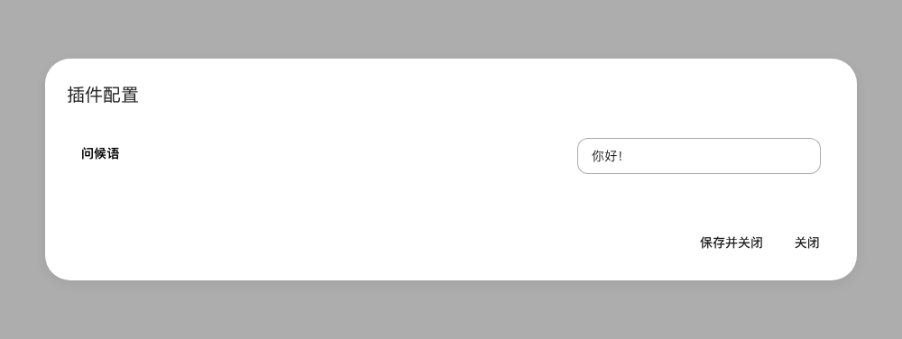

## 控件示例

以下每个 JSON 示例都是一份完整的 `_conf_schema.json`。可以单独使用，也可以将需要的配置项合并到同一个文件中。

### 单行文本 {#string}

使用 `string` 保存一行文字。

```json
{
  "nickname": {
    "type": "string",
    "description": "助手名称",
    "default": "AstrBot"
  }
}
```

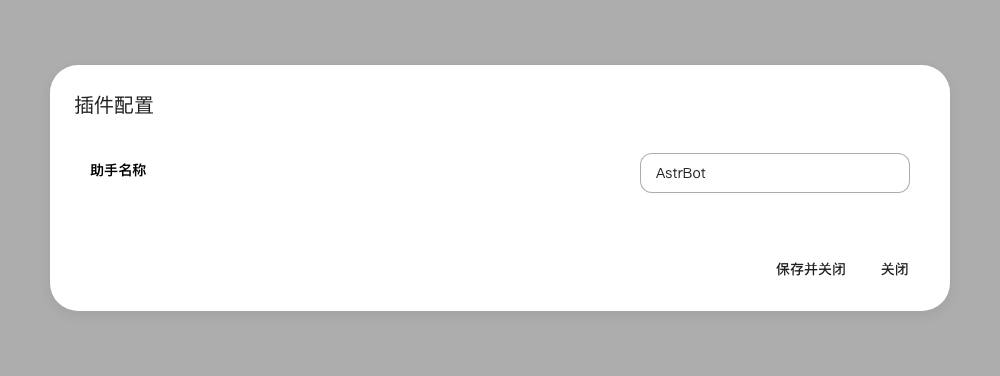

### 多行文本 {#text}

使用 `text` 显示多行输入框。

```json
{
  "reply_template": {
    "type": "text",
    "description": "回复模板",
    "default": "你好！\n请告诉我你需要什么帮助。"
  }
}
```

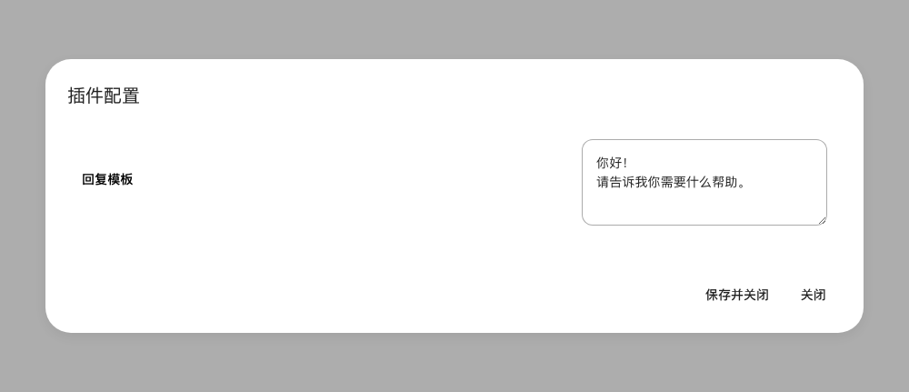

### 数字输入 {#number}

`int` 保存整数，`float` 保存小数。

```json
{
  "retries": {
    "type": "int",
    "description": "重试次数",
    "default": 3
  },
  "timeout": {
    "type": "float",
    "description": "超时时间（秒）",
    "default": 2.5
  }
}
```

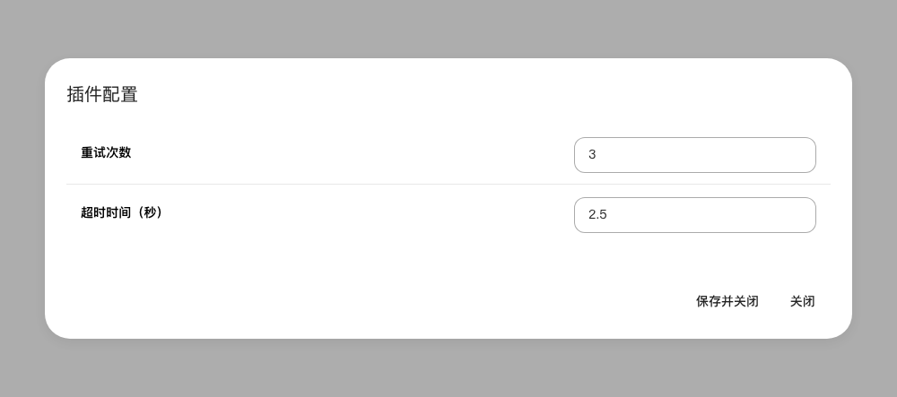

### 开关 {#bool}

`bool` 保存 `true` 或 `false`。

```json
{
  "enabled": {
    "type": "bool",
    "description": "启用自动回复",
    "default": true
  }
}
```

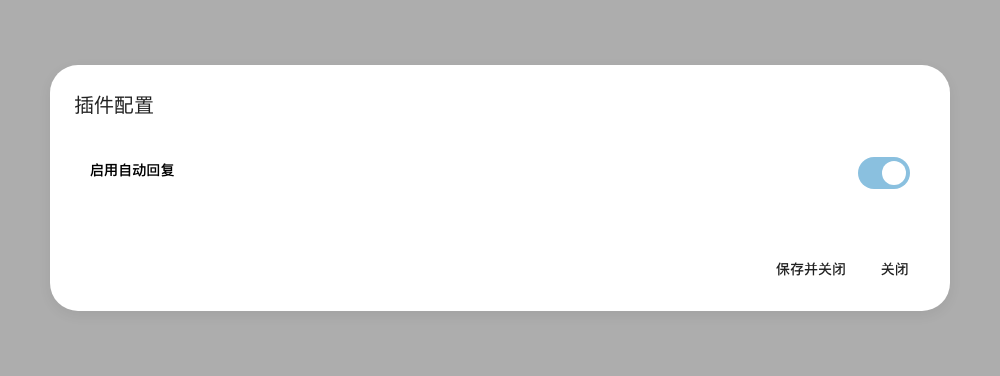

### 密码输入 {#secret}

为 `string` 添加 `secret: true` 可遮罩内容；字符串 `list` 也支持此字段。遮罩不加密保存的值，示例密钥为虚构数据。

```json
{
  "api_key": {
    "type": "string",
    "description": "API Key",
    "default": "demo-key-not-a-real-secret",
    "secret": true
  }
}
```

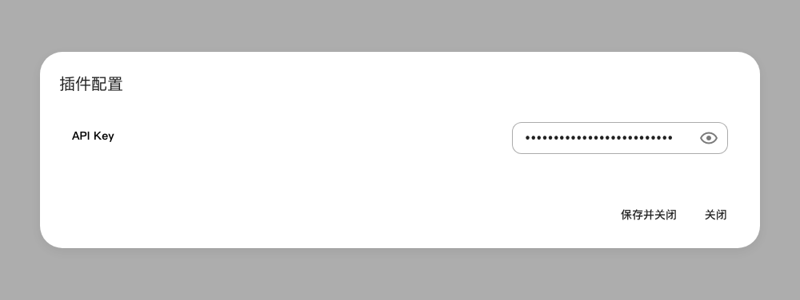

### 单选下拉框 {#select}

`options` 定义保存值，`labels` 定义显示名称，`subtitles` 提供选项说明；三者按位置对应。截图展示展开后的选项。

```json
{
  "reply_mode": {
    "type": "string",
    "description": "回复风格",
    "default": "short",
    "options": [
      "short",
      "detailed"
    ],
    "labels": [
      "简短",
      "详细"
    ],
    "subtitles": [
      "适合快速问答",
      "提供步骤与解释"
    ]
  }
}
```

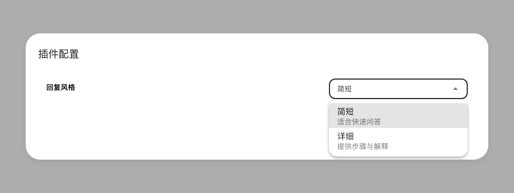

### 多选下拉框 {#multiselect}

`list` 配合 `options` 显示多选下拉框，保存选项值列表。

```json
{
  "channels": {
    "type": "list",
    "description": "启用范围",
    "default": [
      "private"
    ],
    "options": [
      "private",
      "group"
    ],
    "labels": [
      "私聊",
      "群聊"
    ]
  }
}
```

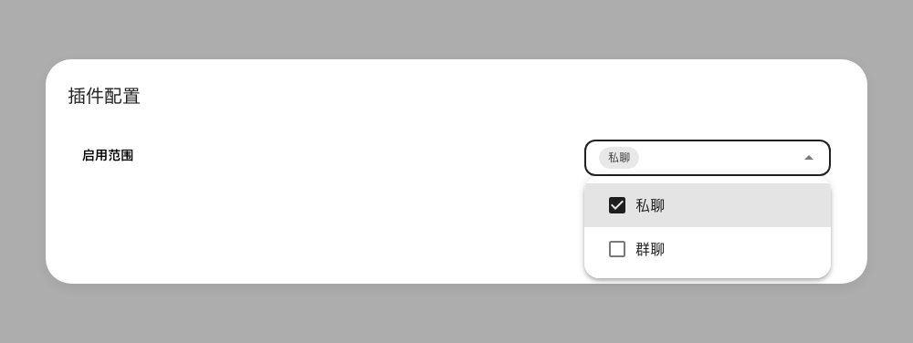

### 复选框组 {#checkbox}

在多选配置上添加 `render_type: "checkbox"` 可直接展示复选框。

```json
{
  "channels": {
    "type": "list",
    "description": "启用范围",
    "default": [
      "private"
    ],
    "render_type": "checkbox",
    "options": [
      "private",
      "group"
    ],
    "labels": [
      "私聊",
      "群聊"
    ]
  }
}
```

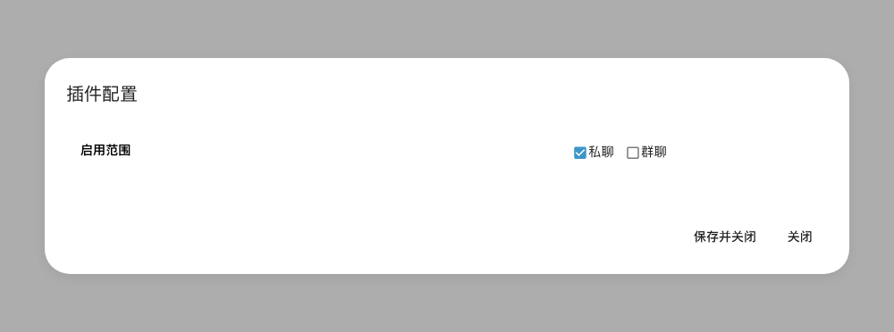

### 滑块 {#slider}

`int` 和 `float` 可通过 `slider` 指定最小值、最大值与步长。

```json
{
  "temperature": {
    "type": "float",
    "description": "随机程度",
    "default": 0.7,
    "slider": {
      "min": 0,
      "max": 2,
      "step": 0.1
    }
  }
}
```

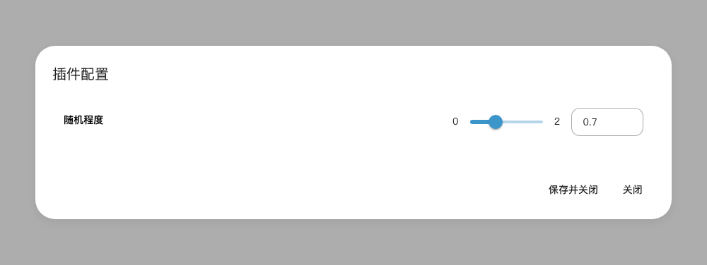

### 字符串列表 {#list}

不设置 `options` 时，`list` 提供列表编辑器，可添加或删除字符串。截图展示点击“添加更多”后的编辑器。

```json
{
  "keywords": {
    "type": "list",
    "description": "触发词",
    "default": [
      "AstrBot",
      "help"
    ]
  }
}
```

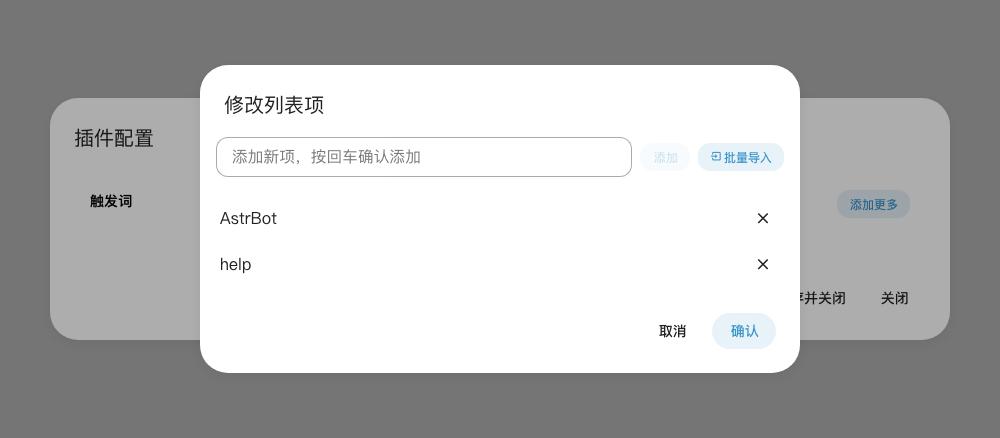

### 代码编辑器 {#editor}

`editor_mode` 将文本输入替换为代码编辑器。`editor_language` 指定语法高亮，`editor_theme` 可选 `vs-light` 或 `vs-dark`；保存值仍为字符串。

```json
{
  "payload": {
    "type": "text",
    "description": "请求内容",
    "default": "{\n  \"temperature\": 0.7\n}",
    "editor_mode": true,
    "editor_language": "json",
    "editor_theme": "vs-light"
  }
}
```

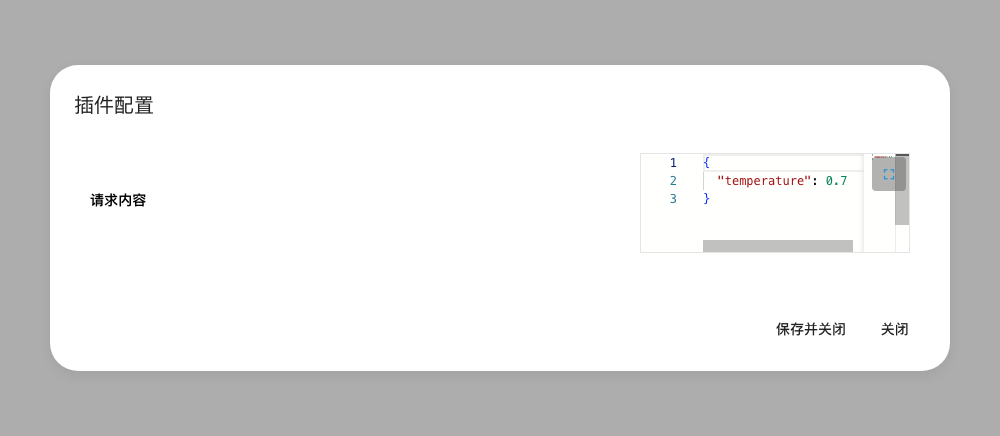

### 文件上传 {#file}

`file` 保存上传文件的路径列表，`file_types` 指定允许的扩展名。截图展示打开后的上传窗口。

```json
{
  "reference_files": {
    "type": "file",
    "description": "参考文件",
    "default": [],
    "file_types": [
      "pdf",
      "txt"
    ]
  }
}
```

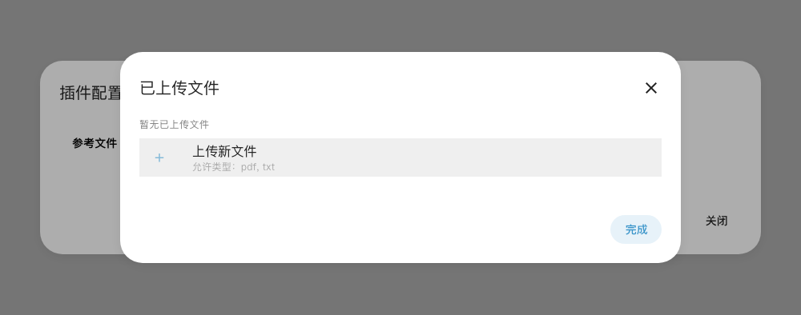

### 配置分组 {#object}

`object.items` 定义子字段。`collapsed: true` 让分组默认收起，点击标题可展开；截图为展开状态。最外层配置对象不能折叠。

```json
{
  "advanced": {
    "type": "object",
    "description": "高级设置",
    "collapsed": true,
    "items": {
      "timeout": {
        "type": "int",
        "description": "超时时间（秒）",
        "default": 30
      },
      "retries": {
        "type": "int",
        "description": "重试次数",
        "default": 3
      }
    }
  }
}
```

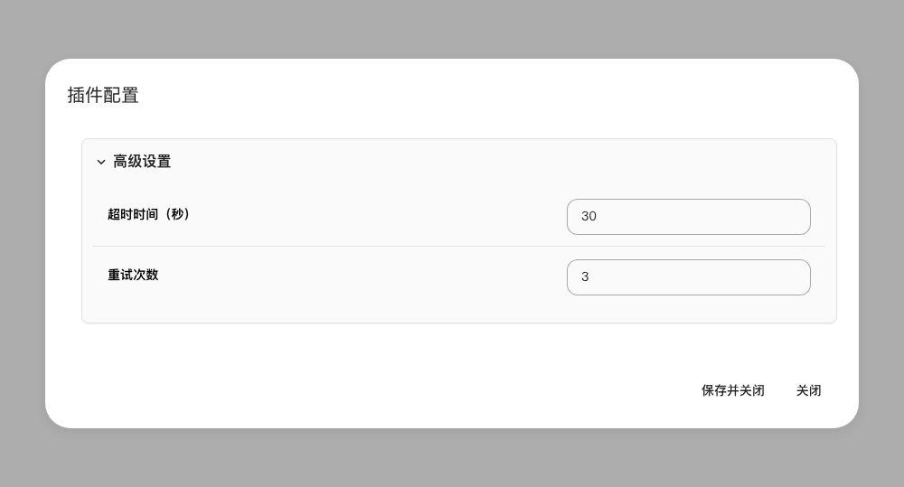

### 键值对编辑器 {#dict}

`dict` 允许用户添加键值对；可选的 `template_schema` 为常用键提供类型与默认值。截图展示打开后的编辑器。

```json
{
  "headers": {
    "type": "dict",
    "description": "自定义请求头",
    "default": {
      "X-App": "demo"
    },
    "template_schema": {
      "X-App": {
        "type": "string",
        "description": "应用标识",
        "default": "demo"
      }
    }
  }
}
```

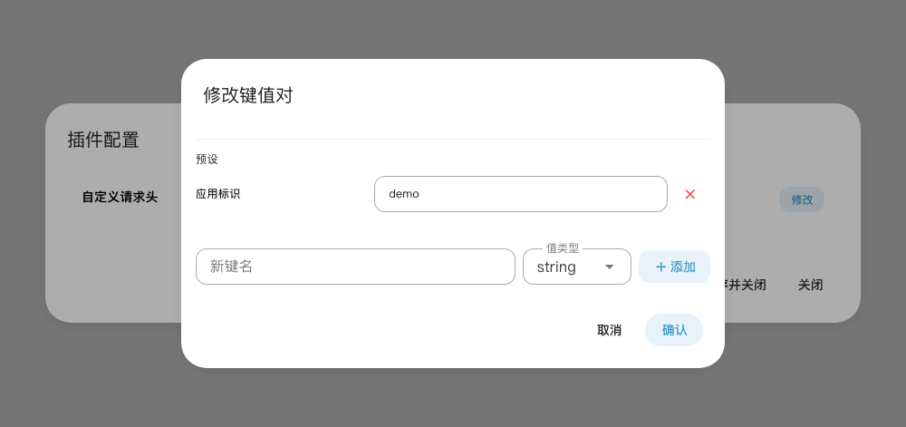

### 模板列表 {#template-list}

`templates` 定义可重复添加的结构，`display_item` 指定列表摘要字段。截图展示添加一条模板并展开后的状态；保存的条目会带有 `__template_key` 标识。

```json
{
  "rules": {
    "type": "template_list",
    "description": "自动回复规则",
    "default": [],
    "templates": {
      "keyword": {
        "name": "关键词回复",
        "display_item": "keyword",
        "items": {
          "keyword": {
            "type": "string",
            "description": "关键词",
            "default": "help"
          },
          "reply": {
            "type": "text",
            "description": "回复内容",
            "default": "请描述你遇到的问题。"
          }
        }
      }
    }
  }
}
```

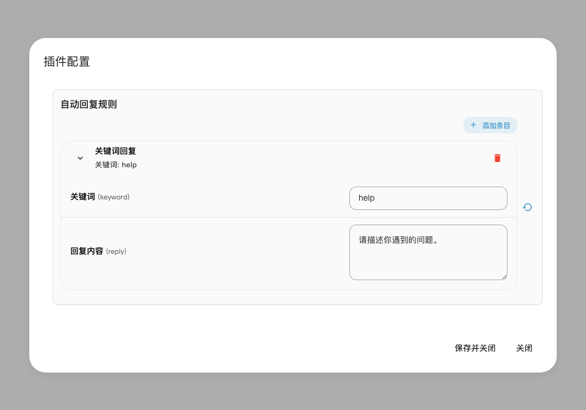

保存后的 `rules` 示例：

```json
{
  "rules": [
    {
      "__template_key": "keyword",
      "keyword": "help",
      "reply": "请描述你遇到的问题。"
    }
  ]
}
```

### 模型选择器 {#provider}

三种选择器分别列出已配置的对话、语音识别和语音合成模型，保存提供商 ID。截图展示对话模型选择菜单，候选项为演示数据。

```json
{
  "chat_model": {
    "type": "string",
    "description": "对话模型",
    "default": "",
    "_special": "select_provider"
  },
  "stt_model": {
    "type": "string",
    "description": "语音识别模型",
    "default": "",
    "_special": "select_provider_stt"
  },
  "tts_model": {
    "type": "string",
    "description": "语音合成模型",
    "default": "",
    "_special": "select_provider_tts"
  }
}
```

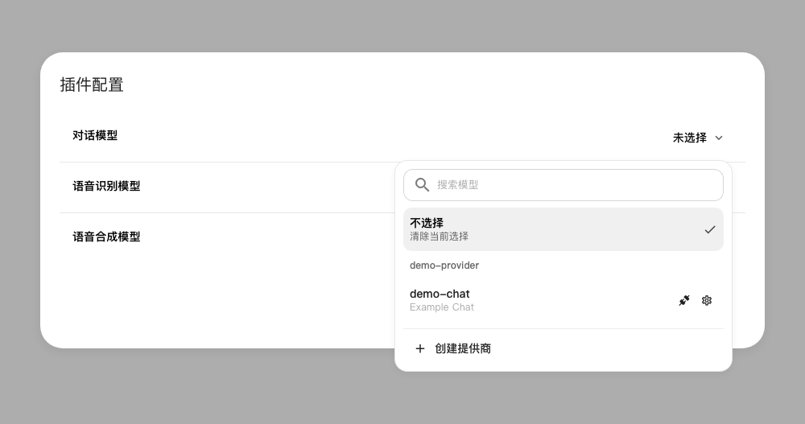

### 人格选择器 {#persona}

从已有的人格中选择，保存人格 ID。截图中的人格为演示数据。

```json
{
  "persona": {
    "type": "string",
    "description": "人格",
    "default": "",
    "_special": "select_persona"
  }
}
```

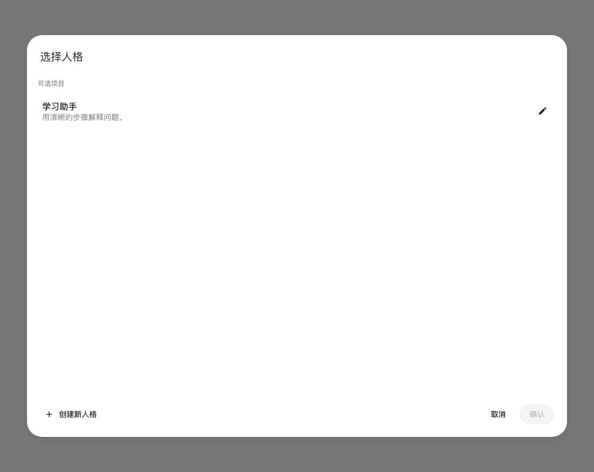

### 知识库选择器 {#knowledge}

知识库支持多选，应使用 `type: "list"`。截图中的知识库为演示数据。

```json
{
  "knowledge_bases": {
    "type": "list",
    "description": "知识库",
    "default": [],
    "_special": "select_knowledgebase"
  }
}
```

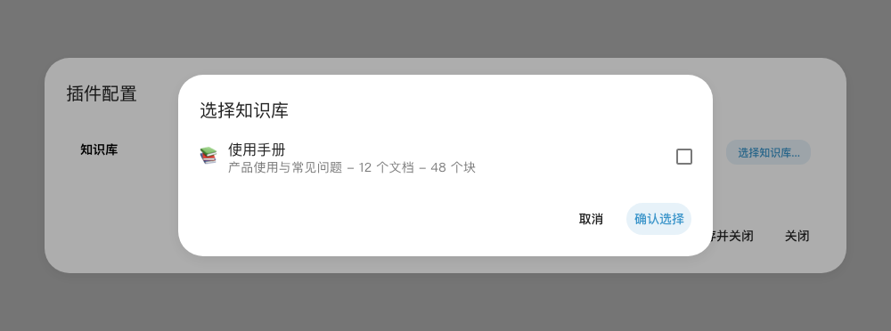

### 用户选择器 {#sender}

按昵称或 ID 搜索已记录的用户，保存用户 ID 列表。没有搜索结果时可手动添加 ID。截图中的用户为演示数据。

```json
{
  "users": {
    "type": "list",
    "description": "指定用户",
    "default": [],
    "_special": "sender_id"
  }
}
```

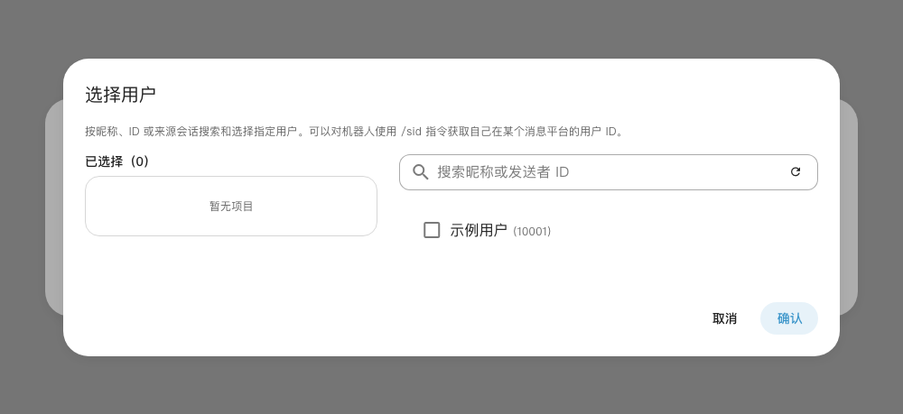

### 会话选择器 {#umo}

保存完整的 UMO 列表。单选时改用 `type: "string"` 和 `default: ""`，返回一个 UMO 字符串。支持手动输入未记录的 UMO，截图中的会话为演示数据。

```json
{
  "sessions": {
    "type": "list",
    "description": "目标会话",
    "default": [],
    "_special": "umo"
  }
}
```

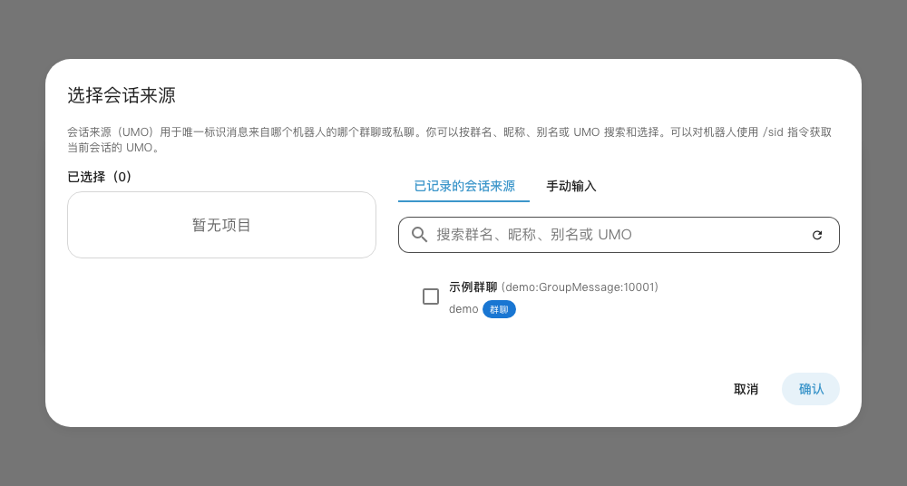

## 通用字段

每个配置项都必须指定 `type`。以下字段可按需添加：

| 字段 | 用途 |
| --- | --- |
| `description` | 在表单中显示的名称 |
| `default` | 未配置时使用的默认值，类型应与 `type` 一致 |
| `hint` | 配置项的补充说明 |
| `obvious_hint` | 设为 `true` 时直接显示 `hint` |
| `invisible` | 设为 `true` 时不在 WebUI 中显示 |

`description`、`hint` 和选项的 `labels`、`subtitles` 支持[插件国际化](./plugin-i18n.md)。

## 保存与更新

`AstrBotConfig` 可像字典一样读取和修改。需要从插件中保存修改时，调用 `save_config()`：

```python
self.config["greeting"] = "欢迎回来！"
self.config.save_config()
```

配置文件保存在 `data/config/<插件目录名>_config.json`。更新 `_conf_schema.json` 后重载插件，AstrBot 会为新增配置项补充默认值，并移除 Schema 中已删除的配置项。
