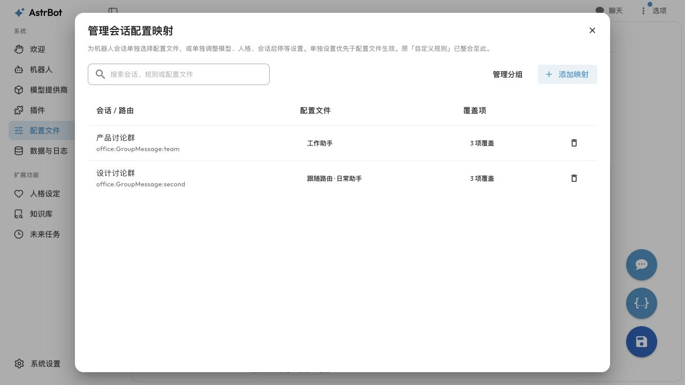
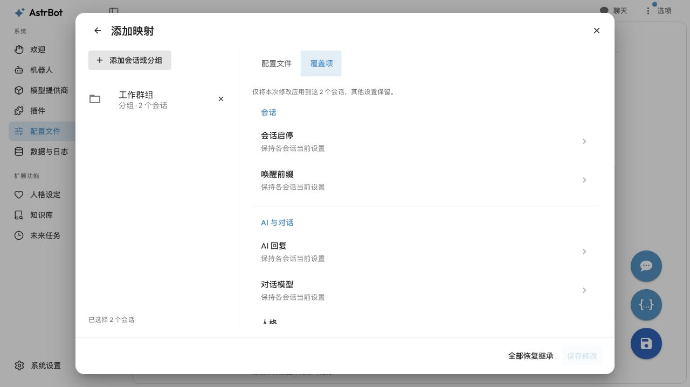
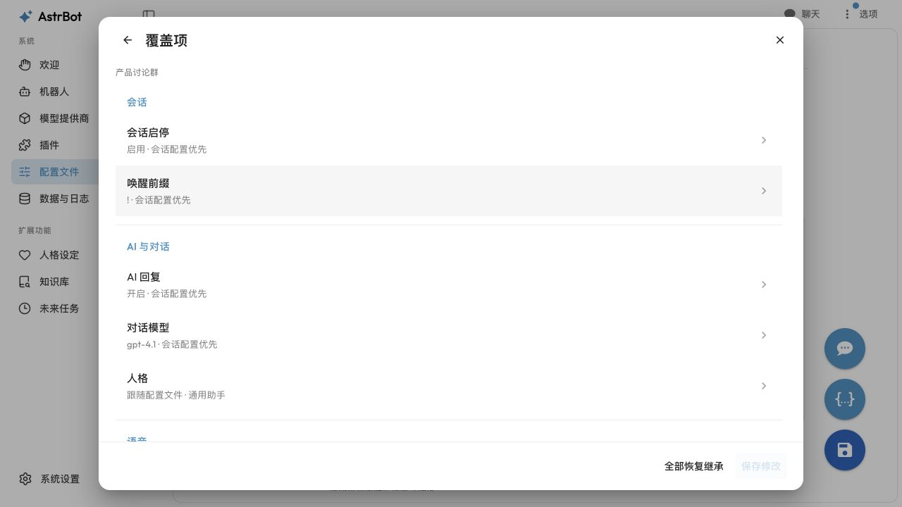
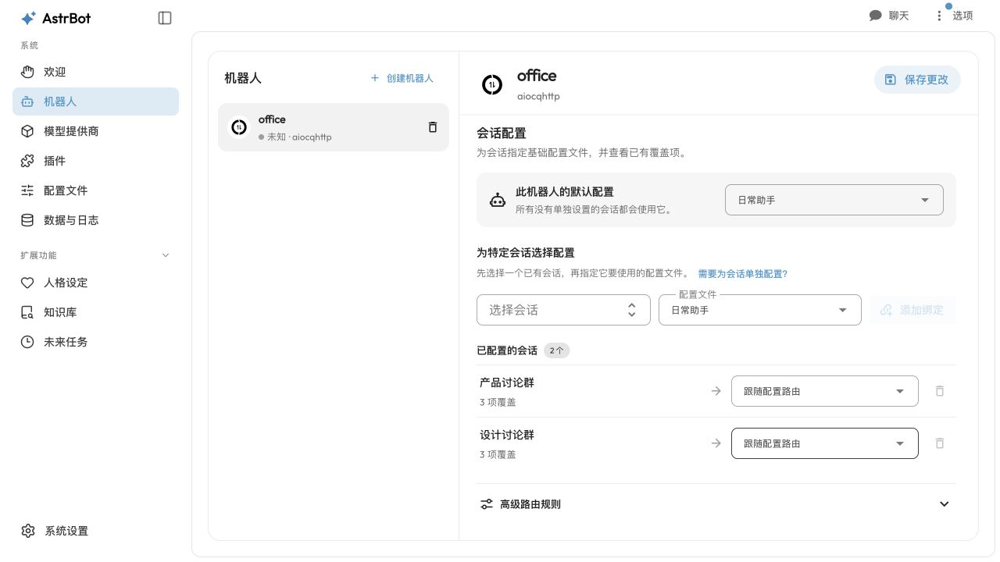
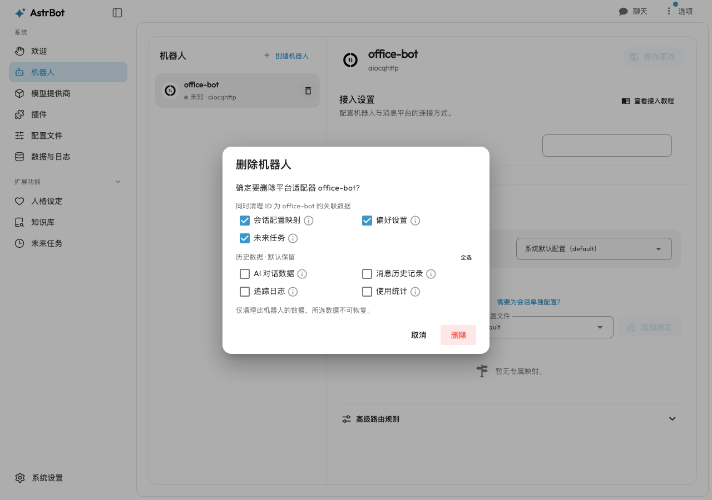

# 会话配置映射（原自定义规则）

通过 **配置文件 → 管理会话配置映射** 为会话指定基础配置、修改专属设置。整台机器人的映射在 **机器人** 页面管理。

| 旧入口 | 新入口 |
| --- | --- |
| 自定义规则 / 会话管理 / 更多功能 → 自定义规则 | 配置文件 → 管理会话配置映射 |
| 原「会话专属配置」页签 | 配置文件 → 管理会话配置映射 |
| `/session-management` 或 `/config?scope=sessions` | 打开配置文件页面的映射管理弹窗 |

## 添加和编辑覆盖

1. 在目标会话发送 `/sid` 获取 UMO（统一消息来源）。群聊按成员隔离时，使用目标成员的 UMO。
2. 打开 **配置文件 → 管理会话配置映射 → 添加映射 → 添加会话或分组**，选择目标。
3. 选择 **配置文件** 指定基础配置，或选择 **覆盖项** 修改部分设置。
4. 配置文件选择完成后点击 **保存映射**；覆盖项编辑完成后点击 **保存修改**。

编辑已有映射时，点击表格中的配置文件或覆盖项即可。保存的修改从后续消息开始生效。

## 配置如何生效

最终设置由 **基础配置文件 + 会话显式覆盖** 组成。覆盖绑定 UMO，不会修改共享配置文件。

- **跟随配置路由** 使用第一条匹配的路由，没有匹配则使用默认配置。明确选择默认配置会跳过路由匹配。
- 开关提供 **跟随配置文件 / 开启 / 关闭**。显式开启可以覆盖基础配置中的关闭状态，但仍需配置可用模型。
- 模型、人格等字段选择 **为此会话单独设置** 即可覆盖，选择 **跟随配置文件** 移除覆盖。
- 列表整体替换基础列表。**空列表表示清空，不表示恢复继承。**
- 切换配置文件会保留显式覆盖。点击 **全部恢复继承** 并 **保存修改** 会清除字段覆盖，保留基础配置选择、历史、变量、别名和分组。

支持覆盖会话启停、唤醒前缀、AI 与语音设置、模型、人格、知识库及检索数量、插件名单。系统设置和模型凭据在配置文件中设置。

唤醒前缀为空列表时，不通过前缀唤醒，仍可通过 @ 机器人等方式触发；私聊是否需要前缀由配置文件决定。

## 分组与批量应用

通过 **管理分组** 组织会话。为分组应用映射只影响当前成员，后续新增成员不会自动继承。

多选编辑时，**保持各会话当前设置** 表示不修改该字段；只有本次编辑的字段会应用到全部目标。选择 **跟随配置文件** 会移除各会话的该项覆盖。更换基础配置会保留各自的覆盖项。

## 删除映射

删除会话映射会清除基础配置选择和覆盖项，恢复跟随路由。历史、变量、别名和分组会保留。

在 **机器人** 页选择 **跟随配置路由** 会保留覆盖项；点击垃圾桶并 **保存更改** 则会删除整条映射及该会话的精确路由。点击 **需要为会话单独配置？** 可打开覆盖项编辑器。

删除机器人时，勾选 **会话配置映射** 会清理其配置文件绑定、覆盖项和路由规则，取消勾选则保留。共享配置文件不会删除。

## 指令与页面共用一份覆盖

管理员可以通过 `/provider <序号>`、`/provider tts <序号>`、`/provider stt <序号>` 设置模型覆盖。`/provider --inherit` 恢复三类模型跟随配置文件。通过指令修改后，刷新编辑器即可看到新值。

内置 `/persona` 指令已移除，请在 **配置文件 → 管理会话配置映射 → 覆盖项 → 人格** 中设置。同一 UMO 下新建或切换聊天记录不会重置覆盖。

## 插件与黑名单

**可用插件**（`plugin_set`）决定允许集合，**禁用的插件**（`disabled_plugins`）从中排除插件。两项可独立继承或覆盖。全局停用的插件仍保持停用，保留的系统插件不受可选插件名单控制。

选择 **会话启停 → 停用** 可停止该会话的 AI 与插件响应。**启用** 会从覆盖中移除匹配的黑名单条目，其他访问控制仍然生效。**跟随配置文件** 恢复继承。

配置文件中的黑名单位于 **配置文件 → 访问控制 → 黑名单**，支持 UMO 或群 ID。黑名单优先于白名单，对管理员及 WebChat 同样生效。请通过 WebUI 恢复被拦截的会话。

## 旧数据迁移

升级会保留路由顺序、会话设置、知识库关联、分组、别名、当前对话选择和历史。迁移人格覆盖时，已有强制人格规则优先于当前对话的人格。

旧 AI/TTS 的关闭状态迁为显式 **关闭**，开启状态迁为 **跟随配置文件**。已停用的会话保持停用。未接入检索逻辑的会话 Rerank 开关会移除，知识库自身的重排模型设置保留。

## 旧接口迁移

已删除以下会话状态与批量设置接口及其旧兼容入口：

| 已删除接口 | 同时删除的旧入口 | 替代方式 |
| --- | --- | --- |
| `GET /api/v1/sessions` | `GET /api/session/list-all-with-status` | 使用 `GET /api/v1/sessions/active-umos` 获取已知会话，使用 `GET /api/v1/sessions/rules` 获取映射，使用 `GET /api/v1/sessions/overrides?umo=...` 获取单个会话的覆盖项和继承值 |
| `PATCH /api/v1/sessions/provider` | `POST /api/session/batch-update-provider` | 通过 `POST /api/v1/sessions/rules` 更新模型对应的配置路径 |
| `PATCH /api/v1/sessions/service` | `POST /api/session/batch-update-service` | 通过 `POST /api/v1/sessions/rules` 更新会话启停、AI 或语音输出对应的覆盖项 |

新的写入请求使用 `rule_key: "config_overrides"`，`rule_value` 为本次修改的配置路径和值。批量操作需对每个目标 UMO 分别提交；分组成员可从 `GET /api/v1/session-groups` 获取。旧接口不再提供重定向。
