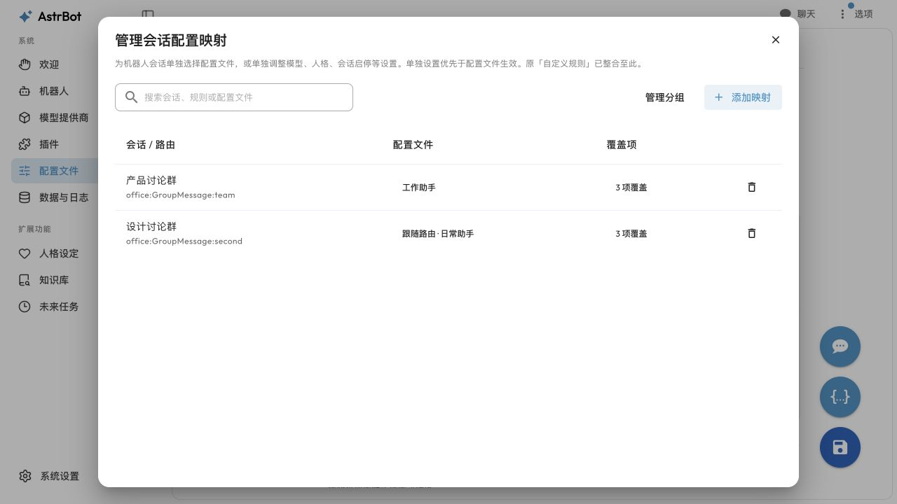
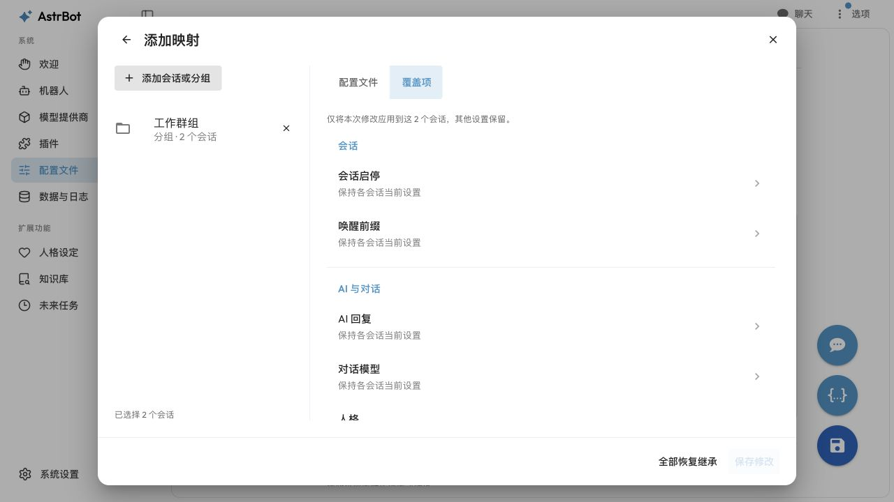
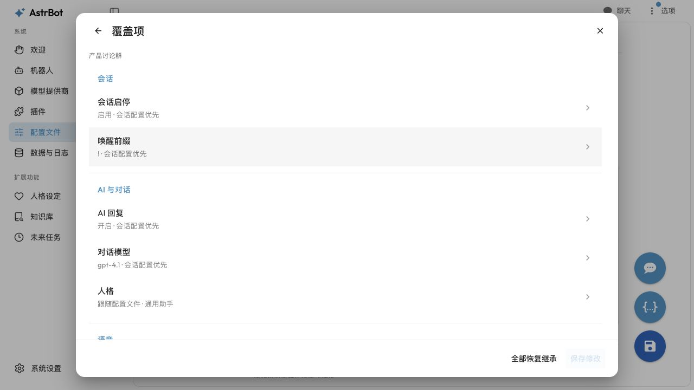
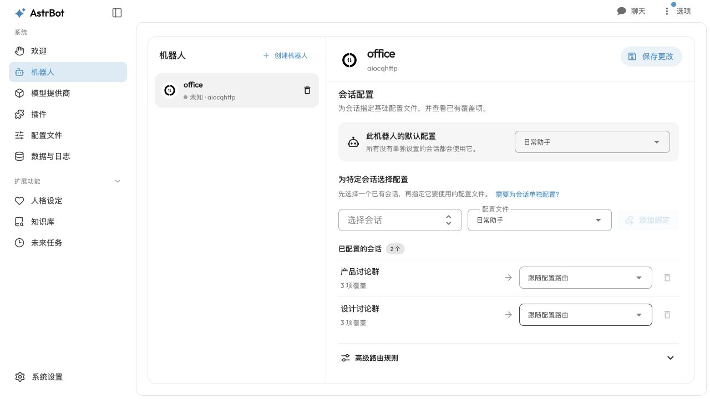
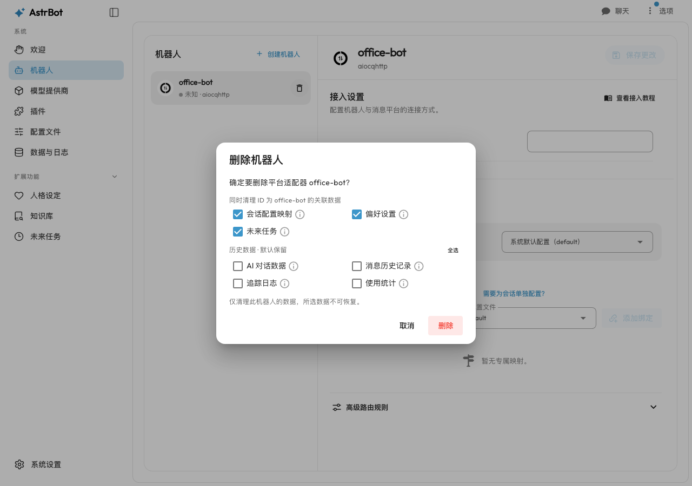

# 会话配置映射（原自定义规则）

打开 **配置文件 → 管理会话配置映射**，通过表格查看会话的基础配置与覆盖项，以及已有的配置路由。配置文件主页面保留配置选择器及其右侧的搜索图标（点击展开搜索框），映射管理在弹窗内完成。

标题下的说明介绍了配置文件与会话专属设置的关系，并标明原「自定义规则」已整合至此。

整台机器人的映射仅在机器人页管理，不在此弹窗显示。弹窗保持固定高度，长列表在内部滚动。

| 旧入口 | 新入口 |
| --- | --- |
| 自定义规则 / 会话管理 / 更多功能 → 自定义规则 | 配置文件 → 管理会话配置映射 |
| 原「会话专属配置」页签 | 配置文件 → 管理会话配置映射 |
| `/session-management` 或 `/config?scope=sessions` | 打开配置文件页面的映射管理弹窗 |

## 配置如何生效

最终设置由**一个基础配置文件 + 会话显式覆盖**组成。覆盖绑定 UMO（统一消息来源），不会修改共享配置文件。

每条消息在处理期间使用同一份配置快照，处理过程中保存的修改从后续消息开始生效。启用群聊按成员隔离后，配置文件和覆盖项都按隔离后的最终 UMO 选择；可在目标会话中发送 `/sid` 查看。

- 表格中的「配置文件」可以指定一个配置文件，或选择「跟随配置路由」。跟随时继续使用第一条匹配的 UMO/UMOP 路由；没有匹配则使用默认配置。明确选择默认配置和跟随路由是两种不同的操作。
- 切换基础配置点击「保存映射」后生效；已有覆盖项保留。
- 开关有 **跟随配置文件 / 开启 / 关闭** 三种状态。会话明确开启 AI 或语音输出时，可以覆盖配置文件的关闭状态，但仍需配置可用模型。
- 模型、人格、知识库等项目，点击对应设置行，在弹窗中选择「为此会话单独设置」后编辑；选择「跟随配置文件」移除该项覆盖。
- 列表整体替换，不与基础列表合并。**空列表表示清空；恢复继承需要选择「跟随配置文件」。**
- 切换会话匹配的配置文件后，未覆盖项随基础配置变化，显式覆盖保留。
- 「全部恢复继承」会清除覆盖草稿，点击「保存修改」后生效。不会删除聊天记录、会话变量、别名或分组。

目前支持会话启停、唤醒前缀，AI、语音识别、语音输出开关，三类模型，人格，知识库及检索数量，以及可用插件、禁用插件。系统设置和模型连接凭据不属于会话专属配置。

列表用小标题和分隔线分为「会话」「AI 与对话」「语音」「知识库」「插件」，各组连续展示。「会话启停」仍为首项，「唤醒前缀」紧随其后。

「唤醒前缀」使用配置文件原有的 `wake_prefix` 字段，可为会话设置多个前缀，例如 `!`、`小助手`。保存后替换该会话的前缀列表，不影响其他会话。空列表表示不通过前缀唤醒，仍可通过 @ 机器人等方式触发；私聊是否需要前缀仍由配置文件决定。选择「跟随配置文件」恢复继承。

## 添加和编辑覆盖

1. 在目标群聊或私聊发送 `/sid` 获取 UMO。按成员隔离的群聊应使用实际目标消息的 UMO。
2. 打开 **配置文件 → 管理会话配置映射**，点击「添加映射」，在左栏点击「添加会话或分组」，复用会话选择器多选会话，或选择已有分组。添加结果以列表展示，可逐项移除；会话和分组可同时添加，重叠成员会去重。
3. 在右栏选择映射目标：「配置文件」用于指定基础配置或恢复跟随路由；「覆盖项」用于修改部分字段。选择一种不会清除另一种设置。
4. 无需「下一步」。配置文件选好后点击「保存映射」；覆盖项通过设置列表逐项编辑，最后点击「保存修改」。未保存修改在离开时会提示确认。

多选编辑覆盖项时，未编辑的字段显示「保持各会话当前设置」。只将本次明确编辑的字段应用到所有选中会话；选择「跟随配置文件」会分别移除该字段的覆盖。窄屏下两栏上下排列。

已有映射可直接点击表格中的配置文件或覆盖项进行修改。删除会话映射会同时清除其基础配置选择与覆盖项，恢复跟随配置路由，保留会话历史、变量、别名及分组。机器人页的具体会话配置与这里共用会话绑定；修改配置归属会保留覆盖项，移除归属会恢复跟随路由。旧的精确会话路由以会话及别名展示，按当前实际生效的配置显示，读取时不改动数据；首次修改归属时写入会话绑定并移除旧精确路由。其他通配符路由仍保留原有匹配顺序。

覆盖列表独立滚动，底部的「全部恢复继承」和「保存修改」始终可见，不遮挡设置项。

机器人页的「会话配置」也会显示仅有覆盖项的会话，标记为「跟随配置路由」并显示覆盖项数量。在下拉框选择「跟随配置路由」只移除基础配置绑定，保留覆盖项。点击垃圾桶会从草稿列表移除整条映射；点击「保存更改」后，同时删除配置文件绑定、覆盖项和该会话的精确路由。仅有覆盖项的会话也可删除；保存前离开页面不会提交删除。

在「为特定会话选择配置」的说明后，点击「需要为会话单独配置？」可直接打开同一个映射管理弹窗。关闭后会更新机器人页的映射列表，并保留尚未保存的机器人设置和映射草稿。没有条目时显示「暂无专属映射。」。

## 指令与页面共用一份覆盖

`/provider <序号>`、`/provider tts <序号>`、`/provider stt <序号>` 修改对应会话模型。`/provider --inherit` 恢复三类模型跟随配置文件。

上述模型指令需要管理员权限。通过指令修改后，刷新编辑器即可看到新值。

内置 `/persona` 指令已移除。会话人格及恢复继承统一在「配置文件 → 管理会话配置映射 → 覆盖项 → 人格」中设置。人格不再有独立的「强制规则 → 当前对话选择 → 默认人格」优先级；同一 UMO 下新建或切换聊天记录不会重置覆盖。

## 插件与黑名单

**可用插件**（`plugin_set`）决定允许集合；**禁用的插件**（`disabled_plugins`）从中排除插件。两项可以独立继承或覆盖。全局停用的插件不会因为会话配置而重新加载；保留的系统插件不受可选插件名单控制。

配置文件的插件页仅在 `disabled_plugins` 非空时显示「禁用的插件」，清空后隐藏该项。

在 **配置文件 → 访问控制 → 黑名单** 中可设置 `platform_settings.id_blacklist`。会话专属配置中的原「黑名单会话」改为首项「会话启停」，提供「跟随配置文件 / 启用 / 停用」。停用将当前 UMO 加入该会话的黑名单覆盖；启用移除匹配当前会话的 UMO 或群 ID，保留其他条目，且其他访问控制仍然生效。跟随配置文件移除该项覆盖。批量操作分别处理每个会话，不复制其他会话的黑名单。支持完整 UMO 或群 ID；命中后停止消息处理，包括 AI 与插件响应。黑名单优先于白名单，管理员及 WebChat 没有豁免。请通过 WebUI 恢复被拦截的会话。

## 分组与批量应用

分组保留原来的名称和成员，仍只是用于筛选与批量操作的会话集合，不会自动产生配置继承。

通过映射管理弹窗中的「管理分组」维护成员。添加映射时选择分组，会对当前成员批量应用；后续新增成员不会自动继承。

选择「配置文件」只更改成员的基础配置，保留各自的覆盖项。选择「覆盖项」时，未编辑字段显示「保持各会话当前设置」，仅将本次修改的字段应用到所有成员；其他字段、基础配置与别名保留。请检查保存结果，失败后可重试。

## 旧数据迁移

升级启动时自动迁移：

- 原全局 `umop_config_routing` 拆为按模式存储的 `config_binding` 记录，保留原匹配顺序。
- 原会话 `config_overrides` 转为同名结构的 `config_binding` 记录，基础配置为跟随路由；不会固定到迁移当时匹配的配置文件。

- 模型、插件禁用名单、知识库和检索数量转换为配置覆盖。
- 知识库关联保留原 ID，`kb_names` 支持名称或 ID；迁移不依赖知识库是否已加载，暂时不可用的关联不会被清空。
- 当前选中对话的人格迁入覆盖；若存在旧强制人格规则，优先保留规则值。
- 旧 LLM/TTS 的关闭迁为显式关闭；旧开启迁为跟随，避免意外开启基础配置已关闭的能力。
- 旧会话停用迁为会话黑名单包含自身。
- 旧备注迁为 UMO alias；已有非空用户 alias 优先，自动名称保留。
- 移除未接入检索逻辑的会话 Rerank 开关及旧字段，不修改知识库自身的重排模型。
- 分组、当前对话选择、会话变量等无关数据保留。

## 配置绑定存储

路由和会话使用 `preferences` 表中的同一种绑定结构，键为 `config_binding`：

| 目标 | scope | scope_id | value |
| --- | --- | --- | --- |
| 路由模式 | `umop` | 匹配模式 | `{"profile_id":"B","overrides":{},"order":0}` |
| 会话 | `umo` | 完整 UMO | `{"profile_id":null,"overrides":{"provider_settings.enable":false}}` |

`profile_id: null` 表示跟随路由，`"default"` 表示明确选择默认配置；`order` 仅用于保留路由顺序。会话自定义项始终在选定基础配置后应用。恢复全部字段继承不会清除明确选择的基础配置。

删除机器人时，原「自定义规则」和「配置路由」两个清理选项合并为 **会话配置映射**。勾选后，一并清理此机器人的配置文件绑定、会话覆盖项及路由规则；取消勾选则保留这些数据。共享配置文件不会删除。

## 旧接口迁移

已删除以下会话状态与批量设置接口及其旧兼容入口：

| 已删除接口 | 同时删除的旧入口 | 替代方式 |
| --- | --- | --- |
| `GET /api/v1/sessions` | `GET /api/session/list-all-with-status` | 使用 `GET /api/v1/sessions/active-umos` 获取已知会话，使用 `GET /api/v1/sessions/rules` 获取映射，使用 `GET /api/v1/sessions/overrides?umo=...` 获取单个会话的覆盖项和继承值 |
| `PATCH /api/v1/sessions/provider` | `POST /api/session/batch-update-provider` | 通过 `POST /api/v1/sessions/rules` 更新模型对应的配置路径 |
| `PATCH /api/v1/sessions/service` | `POST /api/session/batch-update-service` | 通过 `POST /api/v1/sessions/rules` 更新会话启停、AI 或语音输出对应的覆盖项 |

新的写入请求使用 `rule_key: "config_overrides"`，`rule_value` 为本次修改的配置路径和值。批量操作需对每个目标 UMO 分别提交；分组成员可从 `GET /api/v1/session-groups` 获取。旧接口不再提供重定向。
