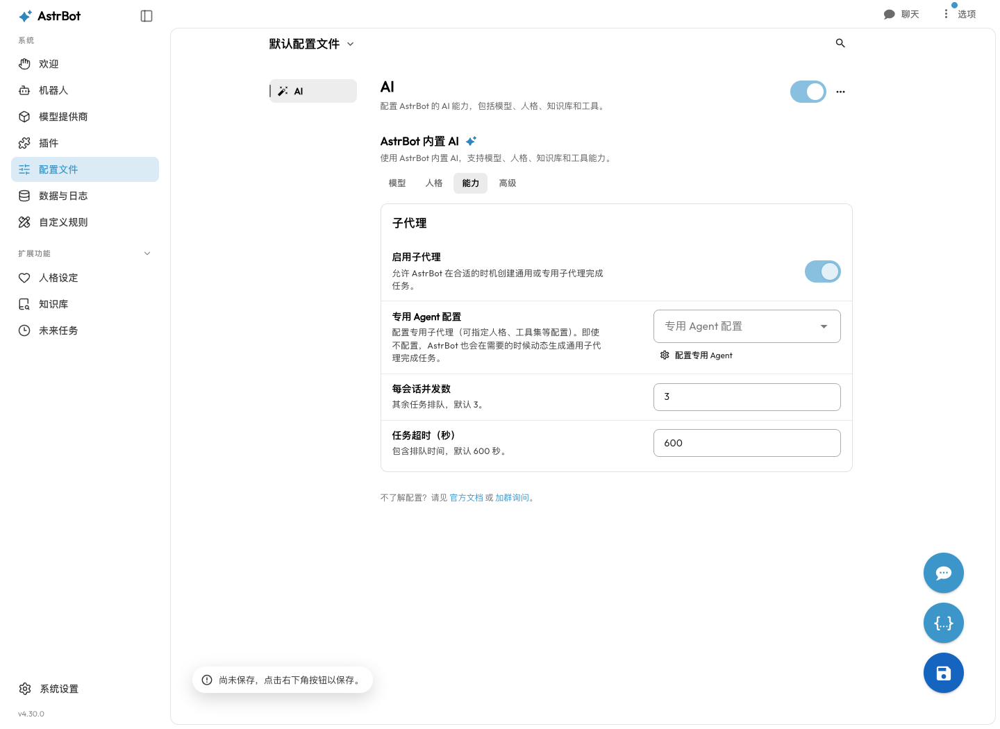
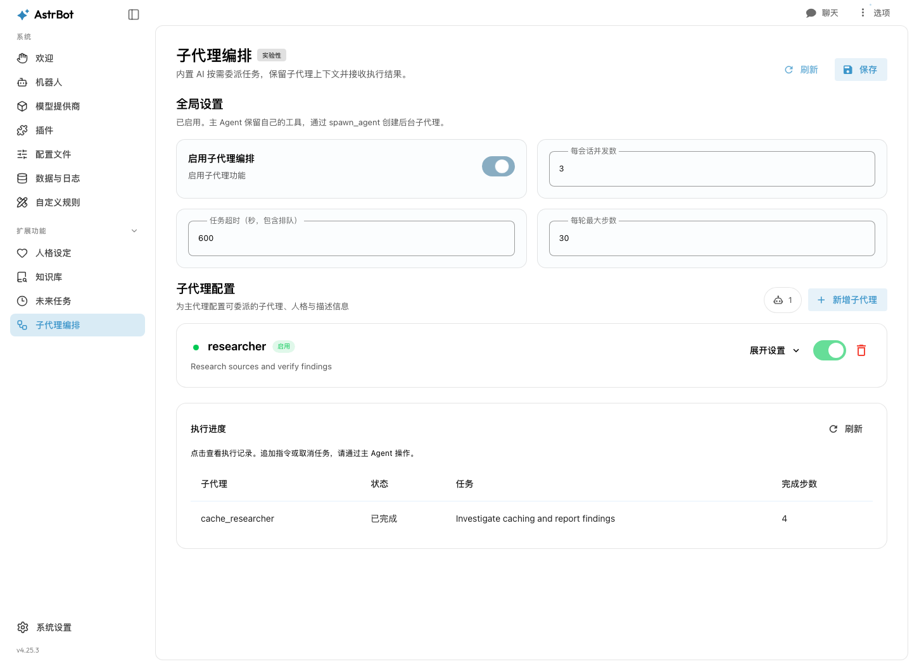
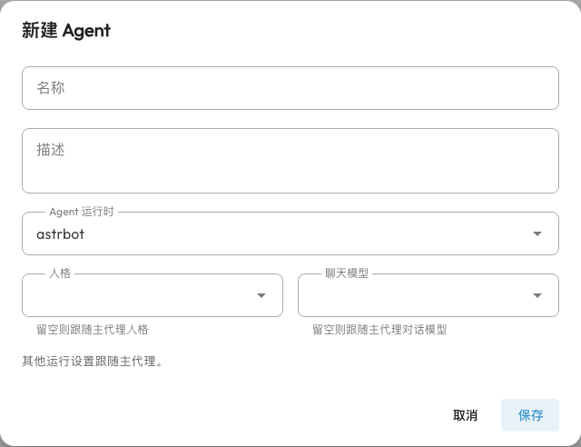

# 子代理 {#agent-handsoff-与-subagent}

子代理是 AstrBot **内置 AI** 的委派能力。主 Agent 可以继续与用户交流，同时把任务交给具有独立上下文的后台 worker。无需安装或启用额外插件。

## 配置入口

进入对应配置档的 **配置 → AI → 能力 → 子代理**，启用后即可创建通用子代理，无需预先配置 Agent。并发数默认 3，超时默认 600 秒且包含排队时间。

如果需要独立的人格或聊天模型，点击该区域的 **配置专用 Agent**，在弹窗中点击 **新建 Agent**。保存后，原配置页的选择列表会同步刷新；关闭弹窗，在 **专用 Agent 配置** 中勾选它。管理弹窗使用两列卡片，每个 Agent 独立保存；点击卡片编辑，使用菜单删除。

原侧边栏的“子代理编排 / 子代理管理”入口已移至 **配置 → AI → 能力 → 子代理 → 配置专用 Agent**。入口以弹窗打开，不离开当前配置页；旧地址 `/subagent` 仍可直接访问。旧全局设置已迁入配置档，旧专家列表改为数据库中的 Agent 配置。





## AgentConfig 与存储

每个配置档的 `agent` 内嵌 `{ runtime, config }`，代表该配置档的默认主代理，继续现场配置。管理页创建的 AgentConfig 存入数据库 `agent_configs` 表，通过稳定 UUID `config_id` 引用；重命名不会改变引用。两处使用相同的运行配置结构，配置档的主代理无需创建数据库记录。

```json
{
  "agent": {
    "runtime": "astrbot",
    "config": {
      "subagents": {
        "enabled": true,
        "config_ids": ["数据库中的配置 UUID"],
        "max_concurrent_agents": 3,
        "task_timeout": 600
      }
    }
  }
}
```

`subagents` 是 `astrbot` runtime 的配置。被引用的 AgentConfig 可以选择其他已注册 runtime；本次未内置 ACP。内置 runtime 提供表单，其他 runtime 使用 JSON 配置编辑。不可用 runtime 的配置仍保留，但不能新建对应会话。被配置档或其他 AgentConfig 引用的记录不能删除，删除接口会返回引用位置。

创建和编辑时均可选择 Agent 运行时。选择 AstrBot 运行时后，表单配置名称、描述、人格和聊天模型。描述用于主代理判断何时委派任务；人格和模型留空时跟随主代理。步数、重试、上下文压缩、工具超时等其他运行设置在创建会话时继承主代理，不在 AgentConfig 中重复保存。所选人格决定提示词、工具和技能范围，最终权限仍受父代理本轮可委派能力限制。



主代理 system prompt 仅列出当前配置档选中且启用的 AgentConfig 名称、ID、runtime 和用途。完整 prompt 不会加入主代理；`spawn_agent` 的 schema 保持固定，通过可选 `config_id` 选择配置，不指定则创建通用内置子代理。

旧的 `agent_runner` 自动迁移为 `agent`，`local` 映射为 `astrbot`；旧全局专家在数据库导入成功后才从配置中清理。迁移不修改已有会话及历史，已经创建的 Agent 继续使用原配置快照。

## 执行与继续对话

`spawn_agent` 建立 agent runtime 会话后返回 agent ID，不等待模型任务完成。主 Agent 可以通过 `list_agents` 查看状态、`wait_agent` 等待结果、`get_agent_result` 读取结果、`send_message` 追加指令，或通过 `cancel_agent` 取消单个任务。

`spawn_agent` 和 `send_message` 都使用 `messages` 数组，组件格式与 `send_message_to_user` 一致。这两个工具目前支持 `plain`（`text`）、`image` 和 `file`（`path` 或 `url`）。首次委派的图片作为模型图片输入，文件作为可供工具读取的引用；不会自动附带原用户消息中的图片。内置 runtime 的追加指令暂时统一转成文本，保留图片和文件的引用，不作为新的多模态输入；其他 runtime 接收原始结构化内容。

```json
{
  "config_id": "agent-configuration-UUID",
  "messages": [
    {"type": "plain", "text": "分析这张图，并参考报告"},
    {"type": "image", "path": "chart.png"},
    {"type": "file", "path": "report.pdf"}
  ]
}
```

图片的相对路径从当前会话工作目录解析，也支持权限范围内的本地绝对路径和 sandbox 文件路径。`send_message` 使用相同的 `messages`，并额外指定目标 `agent_id`。

完成结果绑定直接父代理的 runtime/session。通知任务先调用父代理活跃 turn 的 `steer()`，独立等待其确认消费，子代理任务本身无需等待通知完成。被拒绝或未消费的输入通过正常消息流水线排队，并明确指定原父会话；UMO 当前 conversation 的切换不会改变投递目标。结果正文直接放入本次输入，不再通过单独的 step-start 注入或投递 checkpoint 处理。追加指令会进入正在执行的 worker，或沿用其私有历史开始下一轮。worker 不能继续创建子代理。

管理页只维护 Agent 配置。运行状态、结果、追加指令和取消任务由主 Agent 的工具处理；配置修改不会改变已经启动的会话。

## 持久化与恢复

agent 的公共 ID、runtime 类型、runtime session ID、直接父会话引用和每次输入的执行结果按 UMO 和主 conversation 持久化。同一个 conversation 内的用户共享子代理；对话隔离沿用主会话的 UMO/conversation 划分，不再按发送者额外隔离。每条输入使用其调用者自己的身份和权限，发送者信息仅作为元数据保留。私有对话历史由对应 runtime 保存。重启时，未完成和排队中的输入均标记为已中断，不自动执行；检查中断记录后，可通过 `send_message` 沿用同一会话发送新的指令。内置主代理和子代理共用执行及历史保存策略，以 turn 收尾时提交的历史为准，不自动重放中断中的工具。切换主 conversation 后，结果仍绑定原父会话；父会话已删除或停止时不会唤醒。

## Agent runtime

内置 `astrbot` runtime 管理原生会话、历史、hooks、模型执行和内置能力。主代理与 worker 使用相同的 session/turn 接口；原生 tool loop 是其内部实现。Core 负责消息输入前处理和输出呈现。AstrBot runtime 的子代理编排服务管理公共 ID、已接受任务、并发配额、超时和结果通知，不直接读写 runtime 的私有历史存储；投递确认通过父 session 提供的公共历史视图完成。

Runtime 适配器通过 `AgentInput.content` 接收有类型的输入：`PlainInput`、`ImageInput`、`FileInput` 分别保持 `plain`、`image`、`file` 的语义。这些是不可变的数据对象，不包含 IM 协议序列化或媒体下载方法。工具请求和任务存储继续使用原有的 `messages` JSON 格式，在进入 runtime 时转换为内容对象。

`AgentRuntime` 创建或恢复 `AgentSession`。`session.run_turn(input)` 返回独立执行的 turn，提供可重复读取的 `events()`、`result()`、`cancel()`、排队开始新一轮的 `follow_up()`，以及可选的安全边界 `steer()`。输出消费者或结果等待者被取消不会自动取消执行；流水线停止时，由调用方明确取消该 turn。

扩展实现可以通过 `ctx.agent.register_runtime(name, runtime)` 注册，在 AgentConfig 的 `runtime` 字段选择；`spawn_agent` 通过 `config_id` 使用该配置。通用子代理使用 `astrbot`。本阶段不包含 ACP runtime 或持续实时语音会话；现有第三方主代理执行路径保持原样。

`list_agents` 返回每个 agent 的 `agent_id`、`runtime`，以及通过 `conversation_id` 字段提供的 runtime 私有会话 ID。`send_message` 根据 agent ID 找回 runtime 和会话。`owner_conversation_id` 单独表示所属主会话。

## 入口与接口

管理页入口为 **配置 → AI → 能力 → 子代理 → 配置专用 Agent**，路由 `/subagent`。配置接口使用 `/api/v1/agent-configs`（列表、新建）和 `/api/v1/agent-configs/{config_id}`（读取、更新、删除）。`/api/v1/agent-runtimes` 返回可调用 runtime 及默认配置。这些接口需要 `config` 权限。旧的整包 `/subagents/config` 与 `/api/subagent/config` 接口已移除。


## Runtime 输出协议

`turn.events()` 与 `ctx.agent.run_turn()` 返回句柄的 `events()` 提供同一套有类型的 `RuntimeEvent`：`event_id`、`session`、`turn_id`、UTC `created_at` 和 `payload`。`event.type` 是 `payload.type` 的便利属性。重复读取保留相同事件 ID，每个读者获得独立快照；不订阅事件也会正常执行和保存历史。

```python
from astrbot.api.agents import TextDelta, MessageCompleted

async for event in run.events():
    payload = event.payload
    if isinstance(payload, TextDelta):
        print(payload.text, end="")
    elif isinstance(payload, MessageCompleted):
        # Complete content replaces the deltas for this message_id.
        print(payload.message_id, payload.content)

result = await run.result()
print(result.status, result.text, result.usage.tokens.total_tokens)
```

事件包括 `turn.started`、`turn.prepared`、`text.delta`、`reasoning.delta`、`message.completed`、`request.started/finished`、`tool.started/progress/finished/rejected`、`usage.updated` 和 `turn.finished`。请求事件以一次 provider 方法调用为单位，包含 fallback 和 skills-like 重查询，不声称反映 provider 内部的每次 HTTP 重试。工具校验失败使用 `tool.rejected`，实际执行后才有 `tool.started/finished`。

完整消息用 `message_id` 关联增量；完整快照替换此前增量，不应再次追加。`part_index` 表示消息内内容位置。`result.content` 只包含最终答复，`result.text` 只提取其中的 `plain`，不混入推理、工具输出或中间说明。内容类型为 `plain`、`reasoning`、`image`、`file`、`audio`、`video` 和命名空间扩展 `extension`。媒体引用显式区分本地路径、URL 和带 MIME 类型的 base64 数据。平台专属组件使用 `astrbot.platform` 扩展，由 Core 呈现层还原。

`usage.updated` 和最终 `result.usage` 都是累计快照，不可相加。缓存命中量包含在输入 token 中；未知值为 `None`，不等同于零。上下文占用单独位于 `usage.context`。`result.metrics.steps` 提供实际执行步数。外部 runtime 创建 session 时通过 `runtime_name` 声明归属，并仅发布自己实际观察到的事件。

接口迁移：原 `event.data` 改为 `event.payload`；原 `result.chain` 改为 `result.content`。旧 `streaming_delta` / `llm_result` 对应 `text.delta`、`reasoning.delta` / `message.completed`；`agent_stats` 对应 `usage.updated`；`err`、`aborted` 和 `step_completed` 的信息归入最终状态、错误及执行指标。插件的消息发送、`ProviderRequest`、`LLMResponse` 和 hooks 参数协议保持原样。工具直接发送的消息不被拦截，也不会自动出现在 runtime 输出流中。
