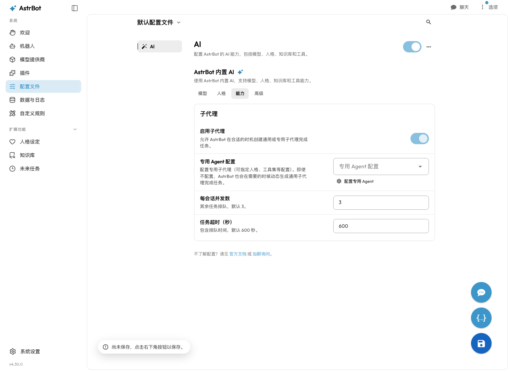
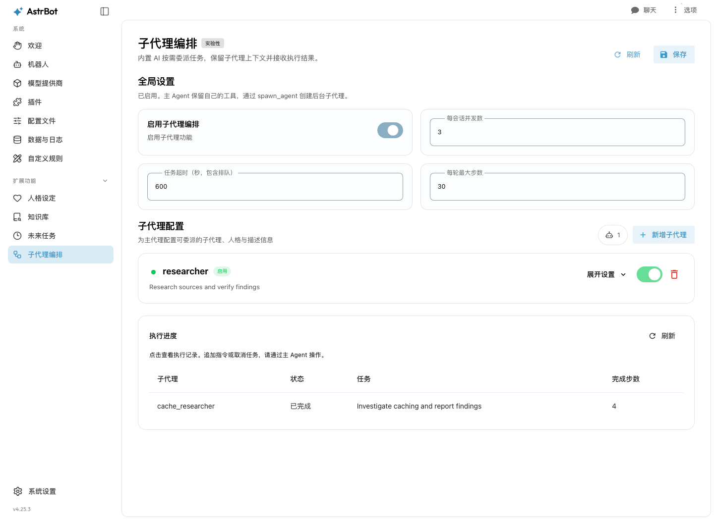
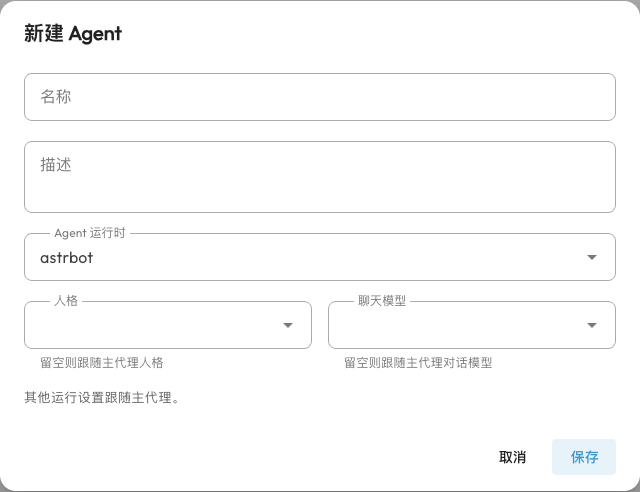

# 子代理 {#agent-handsoff-与-subagent}

子代理让内置 AI 把任务交给具有独立上下文的后台 Agent，同时继续主会话。无需安装额外插件。

## 启用子代理

进入对应配置档的 **配置文件 → AI → 能力 → 子代理**，启用后即可使用通用子代理。并发数默认 3，超时默认 600 秒，包含排队时间。

## 配置专用 Agent

1. 点击 **配置专用 Agent**，然后点击 **新建 Agent**。
2. 选择 AstrBot 运行时，填写名称和描述。描述帮助主 Agent 判断何时委派任务。
3. 选择人格和聊天模型，留空则跟随主 Agent。
4. 保存并关闭弹窗，在 **专用 Agent 配置** 中勾选该 Agent。

所选人格提供提示词、工具和技能，权限受父 Agent 可委派的能力限制。步数上限、工具超时等其他设置在创建会话时继承主 Agent。配置修改适用于新会话。

点击卡片即可编辑 Agent。删除前，需要先解除配置档或其他 Agent 配置对它的引用。不可用运行时的配置仍会保留，但不能启动新会话。

## 委派任务与追加指令

可以对主 Agent 说：“让子代理审阅这份报告，我们继续讨论下一步。”主 Agent 通过以下工具管理任务：

| 工具 | 用途 |
| --- | --- |
| `spawn_agent` | 启动后台任务。 |
| `list_agents` | 查看任务状态。 |
| `wait_agent` | 等待结果。 |
| `get_agent_result` | 读取结果。 |
| `send_message` | 向已有 Agent 追加指令。 |
| `cancel_agent` | 停止任务。 |

配置弹窗只管理保存的 Agent 配置；查看或停止运行中的任务，请让主 Agent 操作。子代理不能继续创建子代理。

委派输入支持文本、图片和文件引用，不会自动附带原用户消息中的图片。追加指令会沿用子代理的历史；内置运行时中的追加图片和文件以文本引用传递。

## 重启与会话行为

同一会话内的用户共享子代理。结果始终返回原父会话，切换会话不会改变投递目标。父会话已删除或停止时不会唤醒。

重启后，排队中和未完成的任务会标记为已中断，不会自动重放。查看状态后，可以让主 Agent 发送新指令，在原子代理会话中继续。

## 升级说明

原侧边栏的 **子代理编排 / 子代理管理** 已移至 **配置文件 → AI → 能力 → 子代理 → 配置专用 Agent**。旧地址 `/subagent` 仍可访问。

原有全局设置和专家配置会自动迁移，已有会话与历史会保留。

API 调用方应将 `/api/v1/subagents/config` 和 `/api/subagent/config` 替换为 `/api/v1/agent-configs` 与 `/api/v1/agent-configs/{config_id}`。使用 `/api/v1/agent-runtimes` 查询运行时及默认配置。这些接口需要 `config` 权限，参见 [OpenAPI 权限](../dev/openapi-scopes.md)。

插件接入请参见[运行 Agent](../dev/star/guides/ai/agents.md#run-session-agent)和 [runtime 事件](../dev/star/guides/ai/agents.md#runtime-events)。
