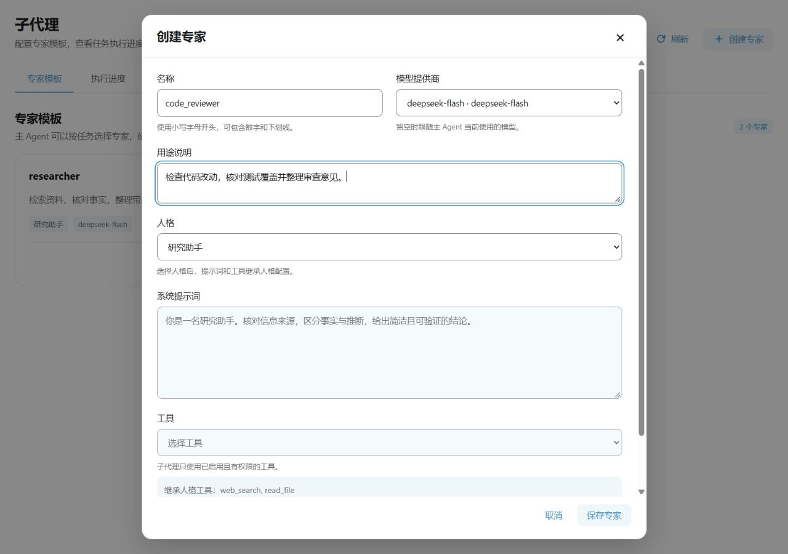
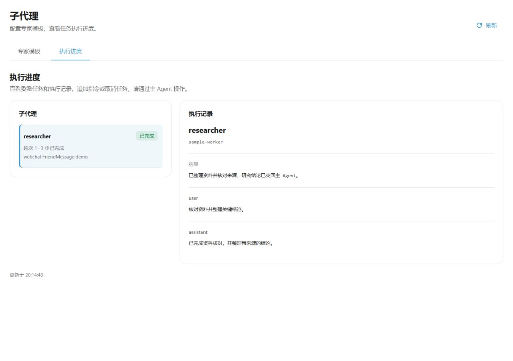

# 子代理 {#agent-handsoff-与-subagent}

子代理让主 Agent 自主委派任务，多个子代理在后台并行执行，并将结果交回主 Agent。每个子代理拥有独立历史，可以使用不同的模型、人格和工具。

该能力适用于 AstrBot 内置 Agent，由随 AstrBot 提供的 Subagent 内置扩展实现。外部 Agent 服务的子代理在对应服务中配置。

## 开始使用 {#configuration}

启用 Subagent 扩展后，直接向主 Agent 描述需要委派的任务，例如：

> 派两个子代理，分别检索这个方案的优点和风险，你继续整理评估标准，最后汇总它们的结果。

主 Agent 会创建子代理并提交任务，在它们执行期间继续处理独立工作。需要调整方向时，也通过主 Agent 追加指令或取消任务。

运行限制在 **扩展 → 插件 → Subagent → 设置** 中调整。专家模板和执行记录位于插件详情中的 **子代理管理** 页面。

## 专家模板

打开 **子代理管理 → 专家模板**，点击 **创建专家**，配置名称、用途说明、模型提供商、人格、系统提示词和工具。

选择人格后，会继承人格的提示词、预设对话和工具；也可以使用自定义提示词，并选择全部、指定或不使用工具。保存后模板立即可用，已经启动的任务继续执行。列表中可以编辑、启用、停用或删除专家。

主 Agent 可以按任务选择专家模板，也可以创建使用自己当前可用工具的通用子代理。主 Agent 保留自己的工具。

## 任务管理

| 工具 | 用途 |
| --- | --- |
| `spawn_agent` | 创建子代理并提交首条任务，可选择专家模板、名称和模型提供商；立即返回 ID、实际名称、provider ID 和状态 |
| `list_agents` | 查看当前发送者、当前对话内的子代理名称、provider ID、状态和完成步数 |
| `wait_agent` | 等待任意或全部子代理完成，等待超时不会取消任务 |
| `get_agent_result` | 读取结果或错误，可以重复读取 |
| `send_message` | 运行中追加指令；本轮未消费或已经结束时，自动开启下一轮 |
| `cancel_agent` | 单独取消一个子代理 |

创建时可用 `name` 设置本次子代理的显示名称，省略时使用专家模板名或 `worker`。`provider_id` 使用已配置的聊天模型提供商 ID；选择优先级为调用参数、专家模板、当前会话默认提供商。主 Agent 可以在工具参数中看到可用的 provider ID 和模型名。覆盖只影响本次子代理，追加任务继续沿用其名称和提供商。

子代理不会自动继承主 Agent 的聊天历史，委派时需要提供必要背景、约束和预期输出。追加指令保留同一个子代理 ID 和独立历史。子代理不能继续创建子代理。

## 查看进度

打开 **扩展 → 插件 → Subagent → 子代理管理 → 执行进度**，查看名称、模型提供商 ID、状态、轮次、完成步数、结果和执行记录。该页签只读，追加指令和取消任务通过主 Agent 操作。

在 ChatUI 中展开 `spawn_agent` 的 **Result**，也可以确认实际名称和 provider ID，包括使用模板或默认配置时的选择。

## 运行与恢复

默认每个会话最多同时运行 3 个子代理，超时 600 秒（包含排队时间），每轮最多 30 步且不超过主 Agent 上限。`wait_agent` 支持 0–60000 毫秒，以及等待任意一个完成的 `any` 或等待全部完成的 `all`。

子代理完成后，主 Agent 在运行中接收结果，空闲时会被唤醒继续处理。结果绑定原来的会话、对话和发送者；切换对话后，不再自动唤醒原对话或将结果发送到其他对话。主动消息送达取决于平台能力，参见[主动能力](./proactive-agent.md)。

子代理状态、执行历史和待处理消息保存在 AstrBot 数据库中。重启或扩展重载后，未完成任务标记为 `interrupted`；主 Agent 可以检查后继续，不会自动重放可能已经执行过的工具。异常退出后，完成结果可能再次交付。

停止会话会取消所属后台任务；单独取消子代理不影响主 Agent 或其他子代理。子代理已启动的后台 Shell 由 Shell 会话工具和进程超时机制管理。
