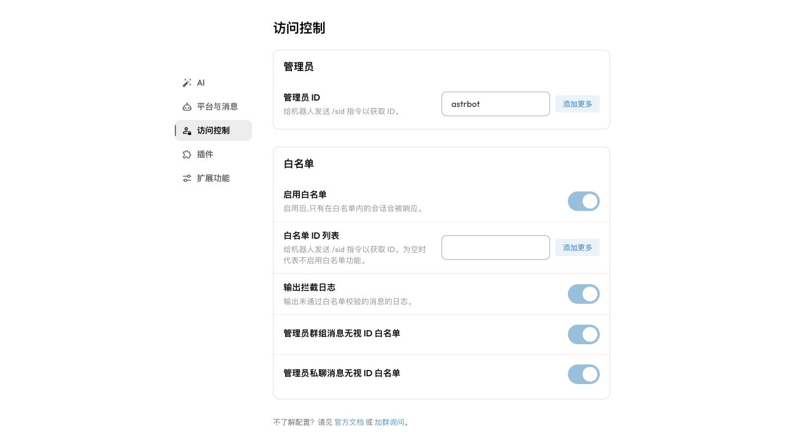
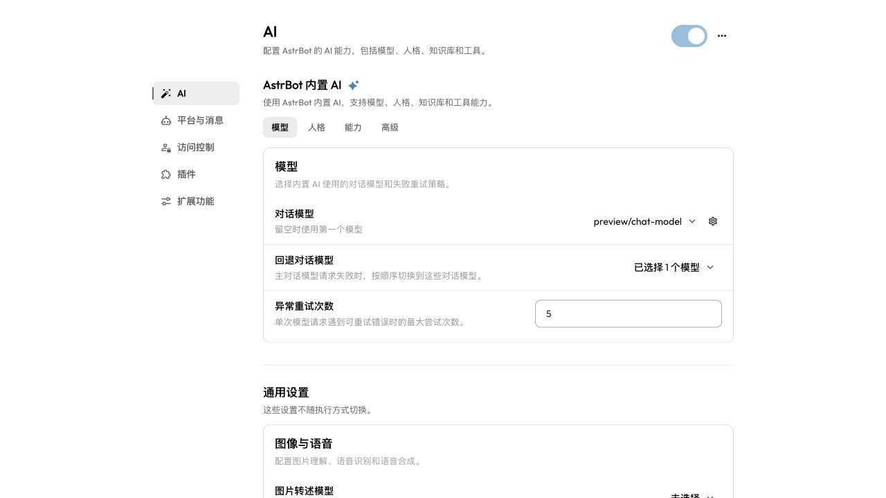
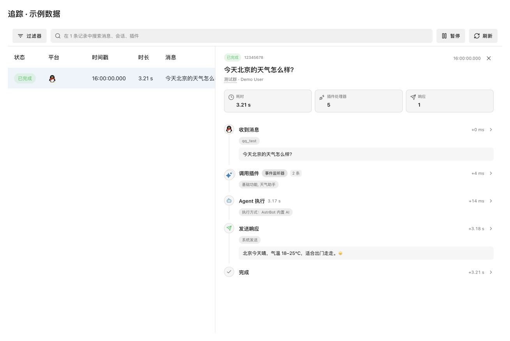

# WebUI

AstrBot 管理面板具有管理插件、查看日志、可视化配置、查看统计信息等功能。

## 菜单与旧入口对照

以下入口对应当前 WebUI 的默认侧边栏。侧边栏使用固定的菜单顺序；扩展功能仍支持折叠、置顶和按插件分组。

| 旧入口或称呼 | 当前入口 |
| --- | --- |
| 模型提供商 → 新增提供商 → Agent 执行器 | 配置文件 → 选择配置文件 → AI → AI 标题旁的 `…` → 更换执行方式 |
| 数据 / 数据统计 | 数据与日志 → 统计 |
| 对话管理 / 对话数据 | 数据与日志 → 对话 |
| 日志 / 平台日志 | 数据与日志 → 日志 |
| 追踪 | 数据与日志 → 追踪 |
| 配置 → 普通配置 | 配置文件 → 选择配置文件 |
| 配置文件 → 系统配置 | 左下角系统设置 → 常规、外观、网络或安全，按配置用途选择 |
| 指令管理 | 插件 → 管理行为 → 指令 |
| 独立 MCP / 技能入口 | 插件 → MCP / 技能 |
| 系统设置 → 外观 → 自定义侧边栏 | 已移除；侧边栏使用默认菜单布局 |
| 自定义规则 / 未来任务 / 子代理编排 | 自定义规则位于侧边栏 `系统` 分组，未来任务与子代理编排位于 `扩展功能` 分组 |

旧日志、追踪、对话和统计页面地址仍会跳转到对应的新标签页。Agent 执行器现在随配置文件保存，不再通过新增模型提供商创建；操作步骤见 [Agent 执行方式](./agent-runner.md)。

## 文档导航

使用文档中的“插件”分组包含插件、MCP 和技能 Skills；“AstrBot 内置 AI”分组包含 Agent 沙盒环境、SubAgent 编排、主动型能力、网页搜索、知识库和上下文压缩。各篇文档的地址保持不变。

“使用”下的导航顺序为 WebUI、AstrBot CLI、内置指令、插件、AstrBot 内置 AI、自定义规则、Agent 执行方式、统一 Webhook 模式。

| 原文档入口 | 当前文档入口 |
| --- | --- |
| 使用 → 插件、MCP、技能 Skills | 使用 → 插件 → 对应文档 |
| 使用 → Agent 沙盒环境、SubAgent、主动型 Agent 能力、网页搜索、知识库、自动上下文压缩 | 使用 → AstrBot 内置 AI → 对应文档 |
| 使用 → 工具使用 Tools / 函数调用 | 已移除；网页搜索文档直接说明所需的函数调用能力 |
| 使用 → Agent 执行器 | 使用 → Agent 执行方式（文档地址不变） |
| 使用 → CLI 指令 | 使用 → AstrBot CLI（文档地址不变） |

## 管理面板的访问

当启动 AstrBot 之后，你可以通过浏览器访问 `http://localhost:6185` 来访问管理面板。

> [!TIP]
> - 如果你正在云服务器上部署 AstrBot，需要将 `localhost` 替换为你的服务器 IP 地址。

## 登录

新用户首次登录时，AstrBot 会生成一个随机初始密码并写入启动日志。请先在启动日志中查找并使用该密码登录（用户名通常为 `astrbot`），登录后请立即修改密码。

## 双因素认证

AstrBot WebUI支持基于 TOTP（Time-based One-Time Password）的双因素认证。

### 开启双因素认证

1. 点击左下角 `系统设置 → 安全`，找到 `WebUI 安全`。
2. 打开“启用 WebUI TOTP 双因素认证”开关，WebUI将显示二维码。
3. 使用任意支持 TOTP 的验证器应用（如 Google Authenticator 等）扫描二维码。
4. 输入验证器应用生成的 6 位验证码完成验证。
5. 系统会生成恢复码，用于丢失验证器设备后的登录。请务必妥善保存。

如需更换 TOTP 密钥，可在 TOTP 管理弹窗中操作，更换时需要先验证当前的 TOTP 验证码。

### 恢复码相关

- 恢复码仅可使用一次。使用恢复码登录后，双因素认证会被自动关闭，需要重新设置。
- 在 TOTP 管理弹窗中可以重新生成恢复码。
- 若恢复码丢失，将无法通过常规途径恢复账户访问权限，需要手动编辑 `data/cmd_config.json`，将 `dashboard.totp.enable` 设为 `false` 并手动清空 `dashboard.totp.secret` 和 `dashboard.totp.recovery_code_hash` 以关闭双因素认证。

### 安全性相关

- 启用双因素认证后，修改 TOTP 相关配置时需要先验证当前的 TOTP 验证码，以防止未经授权的修改。
- 修改管理面板密码会撤销所有受信任设备。

## ChatUI

AstrBot 内置 ChatUI，可在浏览器中直接与已配置的模型对话。

ChatUI 支持以下常用能力：

- 侧边栏会话列表首次加载最近 30 个会话，向下滚动接近列表底部时自动加载较早会话，并显示进度条；加载失败后暂停自动请求，点击“重试”继续。
  列表未撑满侧边栏时会自动补页。通过链接打开较早会话时，即使尚未加载到其所在页，也会显示标题及侧边栏选中项。
- 创建、重命名、删除对话，并在左侧会话列表中切换历史对话。
- 在聊天页选择配置文件、模型提供商与模型；如果启用了 Provider 会话隔离，也可以为当前会话单独选择模型。
- 发送文本、图片、文件与语音输入；上传附件时会展示预览，并根据文件签名辅助识别文件类型。
- 查看模型思考过程、工具调用状态、知识库或网页搜索引用来源，以及每条回复的 Token 和耗时统计。
- 对已有回复执行复制、重新生成，或使用其他模型重新生成。
- 编辑用户消息后从该消息继续生成，也可以针对某段内容开启分支追问。
- 切换流式/普通响应模式，以及 SSE/WebSocket 通信模式。

> [!NOTE]
> 为保证消息接收顺序，同一浏览器会话建议只保留一个 ChatUI 页面。如果你在多个标签页中同时打开聊天页面，系统可能会提示需要重新建立连接。

## 可视化配置

点击左栏 `配置文件`，先从页面顶部选择要修改的配置文件。分区依次为 `AI`、`平台与消息`、`访问控制`、`插件`、`扩展功能`，也可以使用顶部搜索定位配置项。顶部的配置文件选择器、搜索按钮和左侧分区导航保持固定，仅右侧配置内容滚动。

- `AI` 中，内置 AI 的设置分为 `模型`、`人格`、`能力`、`高级`；AI 标题旁的 `… → 更换执行方式` 用于接入第三方 Agent。
- `访问控制` 中设置管理员 ID 和白名单，包括白名单日志与管理员豁免选项。
- `平台与消息` 中设置消息触发方式、会话隔离和发送行为。
- `插件` 中选择该配置文件启用的插件集合。单个插件的参数请在 `插件` 页面中点击对应插件的齿轮图标（`插件配置`）修改。
- `扩展功能` 中设置分段回复、群聊上下文感知和文本转图像（输出开关、字数阈值、渲染策略、渲染服务地址与自定义模板）。

在 `扩展功能 → 分段回复` 中，先打开 `启用分段回复`，再设置分段方式、间隔和内容过滤规则。关闭后，详细选项会隐藏。随机间隔、对数底数、分段正则表达式和分段词列表还会根据所选模式显示。

| 旧入口 | 新入口 |
| --- | --- |
| AI 配置 / 平台配置 / 插件配置 | AI / 平台与消息 / 插件 |
| 平台配置 → 基本 → 管理员 ID | 访问控制 → 管理员 → 管理员 ID |
| 平台配置 → 白名单 | 访问控制 → 白名单 |

明确选择模型后，可点击选择器右侧的齿轮打开模型设置弹窗；模型和回退模型的选择菜单中也有齿轮入口。点击齿轮不会改变模型选择或回退顺序。保存模型设置会立即影响所有引用该模型的配置文件；当前配置文件的模型选择仍需点击 `保存配置`。自动选择模式下不显示右侧齿轮。

修改完成后，点击右下角磁盘图标的 `保存配置` 按钮，确认保存成功提示。

点击右下角 `{}` 图标的 `编辑配置文件` 按钮，可直接编辑当前配置文件的 JSON。编辑后先点击 `应用此配置`，将内容暂存到可视化编辑器，再关闭编辑窗口并点击 `保存配置`。

### 系统设置

全局设置位于左下角 `系统设置`，不在配置文件选择器中：

设置页的标题和分区导航保持固定，仅右侧设置内容滚动。

- `常规`：时区、外部回调地址、日志和缓存。
- `外观`：主题颜色。
- `网络`：HTTP 代理、Python 依赖源和 GitHub 加速地址。Docker 下的代理填法见 [Docker 部署](/deploy/astrbot/docker.md)。
- `安全`：WebUI HTTPS、登录限速和 TOTP。
- `维护`：备份、恢复和重启。
- `OpenAPI`：开发者访问密钥。

系统配置修改后自动保存，请确认保存成功提示；如果页面提示需要重启，再按提示重启 AstrBot。

## 插件

点击左栏 `插件`，顶部可切换 `插件`、`技能`、`MCP` 和 `管理行为`。在 `插件` 标签内，通过 `已安装` 与 `插件市场` 切换查看本地插件和市场插件。

在已安装或插件市场页面，也可以点击右下角 `安装插件`（+）按钮，以 URL / 文件上传的方式手动安装插件。

> 由于插件更新机制，AstrBot Team 无法完全保证插件市场中插件的安全性，请您仔细甄别。因为插件原因造成损失的，AstrBot Team 不予负责。

### 插件加载失败处理

如果插件加载失败，管理面板会显示错误信息，并在 `加载失败插件` 列表中提供 **“重载”** 按钮。这允许你在修复环境（如安装缺失依赖）或修改代码后，无需重启整个程序即可快速重新加载插件。

## 数据与日志 {#数据}

点击管理面板左侧的 `数据与日志`，可以在同一页面通过顶部标签切换 `统计`、`对话`、`日志` 和 `追踪`。首次打开时默认显示 `统计`，之后会自动回到上次打开的标签页。

### 统计

`统计` 页面汇总平台实例、消息、模型调用、Tokens 和运行时间等数据，并展示消息趋势、平台消息排名、模型调用趋势、模型用量排名以及会话模型用量排名。页面顶部可以切换 1 天、3 天或 1 周的统计范围。

### 对话

`对话` 页面用于检索和管理已经保存的对话记录：

- 可以按关键词、机器人 ID、私聊/群聊类型和 UMO 筛选，并按创建时间或更新时间排序。
- 对话列表默认按每页 30 条从服务端分页加载；开启“按会话分组”后，分页单位会切换为 UMO 会话，展开后可查看该会话下的全部对话。只有选中某条对话后，才会加载并在右侧显示完整消息。
- 支持编辑标题、多选导出和多选删除。
- 右侧预览顶部的 `{}` 按钮可以在只读 Monaco 编辑器中查看自动换行的原始 `history` JSON。
- 如果仍需使用原有的表格式页面，可以点击右上角的 `回到旧版`。

### 日志

`日志` 页面显示 AstrBot 的实时运行日志，可以按日志级别筛选，也可以从页面中安装缺失的 Pip 库。需要查看 DEBUG 日志时，请先在 `系统设置 → 常规 → 日志` 中将 `控制台日志级别` 设为 `DEBUG`。

点击右上角的 `导出诊断包`，确认内容与隐私提示后下载 ZIP。包内包含现有磁盘及轮转日志、自定义路径日志、最近最多 500 条缓存、可用的 Trace 历史、配置及路由、插件版本与状态、运行环境和导出清单。未开启文件日志或 Trace 时，仍可导出已有内容；没有 Trace 历史时会在清单中注明，不会自动开启 Trace。Trace 历史最多导出最近 50 条、合计 16 MiB；磁盘日志合计最多读取 256 MiB、单文件超过 64 MiB 时会跳过，脱敏模式下过长的日志行也会跳过，截断和缺失会记入清单，不包含原始数据库或插件源码。导出弹窗默认勾选 `脱敏导出（推荐）`，自动遮盖已识别的凭据，公网 IPv4/IPv6 地址替换为包内一致的 `[PUBLIC_IP_1]` 等编号，保留协议、端口、路径及内网、回环等非公网地址；同一 IP 的不同写法使用同一编号，不在包内附带原始 IP 对照表，但仍可能包含聊天内容和个人信息，分享前请检查。排障需要原始内容时可取消勾选；此时会保留密码、密钥、Token、公网 IP 等敏感信息，文件名带有 `raw` 标记，请仅私下提供给可信的诊断人员，勿公开上传。每次打开弹窗都会恢复默认勾选。仅控制台管理员可下载，开发者 API Key 不可使用。`系统设置 → 常规 → 缓存` 面板中的按钮使用同一功能。

点击搜索框左侧的“过滤器”，在日志容器左侧按日志级别、来源（系统/插件）、具体插件、机器人平台筛选，也可排除用户对话日志；这些条件可与“搜索日志”叠加使用。插件优先显示 display name，菜单副标题显示插件 ID；“系统”对应原先的 Core 来源。

顶部工具栏保留搜索、全屏、字号调整与“安装 Pip 库”。字号默认 12px，可按 2px 步长在 8–16px 之间调整。原来的“自动滚动”开关已移除：滚动到底部后跟随新日志，上翻查看旧日志时不自动跳转。筛选项从顶部移至“过滤器”侧栏，折叠侧栏不会清除筛选条件。日志仍使用内存缓存，不新增文件读取或数据库持久化。

### 追踪

包含 Agent 调用时，详情统计区增加无边框的 Tokens 卡片，展示本轮输入（含缓存输入）与输出的累计总量，以两位小数的 k/M 格式显示，悬浮提示保留精确数量；悬停或键盘聚焦可查看输入、输出及缓存命中明细。同一 Agent 的累计快照只取最新一份，多个 Agent 分别累计。没有已上报用量时显示“—”，不按 0 处理。

“Agent 执行”标题后显示已记录的模型 ID、人格 ID，以及非零的实际工具调用次数。模型标签悬停可查看提供商 ID，执行链折叠后标签仍可见；嵌套或并行 Agent 分别统计，缺失的信息不显示。

详情标题下的 UMO 和发送人分别以“图标 + 值”独立成行，不再使用点分隔；UMO 别名仍可悬停查看完整标识。

追踪区域和悬停提示使用系统默认字体，不使用 Outfit。运行中状态为蓝色，已完成和错误仍分别为绿色和红色。

列表和详情时间戳按浏览器本地时区显示月、日，格式为 `MM-DD HH:mm:ss.SSS`；时间线悬停提示使用同一格式。

UMO 前新增“类型”列：蓝色 Agent 表示 Agent 调用，绿色“指令”表示指令处理器调用；群聊/私聊使用中性标签独立显示。同一追踪可同时显示这些标签；普通监听器和事件钩子不算作指令。消息类型优先读取追踪摘要，旧记录从 UMO 推导，无法确定时不显示群聊/私聊标签。旧记录的指令标记按当前页数据推导，无需逐条打开详情。

新 Span 使用 `astrbot.kind` 表示调用类型，起止时间和状态表示执行结果；不再存储 `astrbot.action`、`astrbot.end_action` 或 `astrbot.duration_ms`。耗时由纳秒起止时间计算，`astrbot.handler_type` 保留。旧追踪仍可读取，历史数据库记录不会自动重写。

长消息标题默认显示 2 行，收到消息和发送响应的正文默认显示 4 行；超出时可点击“展开全文 / 收起”。这仅折叠界面展示，不截断已记录内容。

“完成”表示整条事件的处理已结束，而不是模型请求或响应发送单独结束。普通消息和 Cron 定时任务共用事件执行生命周期；Cron 不经过消息 Pipeline，在 Agent 执行和历史保存结束后完成追踪，异常或取消也会结束并标记错误。

详情时间线采用紧凑分组布局：“触发插件处理器（类型）”改为“调用插件”配合类别标签，“启动 Agent”改为“Agent 执行”。节点右侧统一显示展开箭头，不再每条单独占一行显示“查看详情”；点击普通节点标题查看原始数据，点击调用插件组展开各次调用。平台 ID 放入次行标签，元信息标签使用中性色；时间改为相对追踪开始的偏移，悬停可查看精确时间。

Agent 默认折叠内部执行链，点击“Agent 执行”可展开请求准备、工具和插件钩子；“原始数据”可进一步查看 Agent 自身的字段。折叠按实际 Span 父子关系识别，不把时间上交错的其他分支误归入 Agent；展开仍保持记录顺序，最终响应保留在主线上。内部错误在折叠标题中也会提示，展开/收起不改变调用、响应或 Span 统计。

“设置 → 常规”中的“日志与缓存清理”现为“日志、缓存与追踪清理”，总占用包含追踪数据库及其附属文件。菜单新增“清理追踪数据”；“全部清理”也包含历史追踪。清理前会确认，已完成或中断的追踪将永久移除，运行中的追踪保留；数据库文件本身不会直接删除。“清理日志”和“清理缓存”不会清除追踪。

在“设置 → 常规 → 日志”中可切换“启用追踪记录”，与追踪页工具栏的启动/暂停按钮共用同一个全局配置；关闭后不再采集新追踪，历史仍可查看。其下可配置“追踪数据库路径”“追踪数据库容量预算 (MB)”和“追踪保留天数”，默认分别为 `logs/traces.db`、80 MB 和 7 天；更改数据库路径后重启后端。系统提示词等顶层文本字段没有单独的 4 KB 截断限制，但整条追踪的内容和节点预算仍然生效。

追踪标签页不使用外层灰色卡片，工具栏和列表直接铺在页面上，仅保留必要的分隔线。原来的顶部说明和独立记录开关已移除；工具栏按钮显示“暂停”（启用且已连接）、“连接中”（启用但未连接）或“启动”（停用）。过滤器、记录按钮、刷新均采用图标加文字的浅灰按钮，与搜索框共用背景色，统一为 36px 高；搜索框填满剩余宽度，将操作按钮靠右排列。记录数量并入占位文字：“在 X 条记录中搜索消息、会话、插件”，不单独显示。点击记录按钮可暂停或恢复，更新期间显示加载状态并禁用重复点击；失败时保持原状态并提示错误。暂停不会清除已有列表或关闭详情，明暗主题保持相同布局。

`追踪` 页面实时显示消息执行链：收到消息、触发插件处理器、Agent 相关请求、发送响应和完成。默认只展示全宽 Vuetify datatable 追踪列表，列顺序为状态标签（运行中/已完成/错误）、平台 logo、时间戳、时长、消息、类型、UMO、发送人和 Spans；表头和单元格字体为 13px，表头高度为 40px，内容行高和间距采用 Vuetify 默认样式，仅定制状态、平台图标及消息等单元格内容。状态标签使用 flat 样式；平台列宽度为 80px，表头不会换行。时长在执行期间持续更新。点击某行后才打开右侧时间线详情，点击关闭按钮或按 Escape 返回列表；加载历史记录、新记录到达及筛选变化都不会自动打开其他记录的详情。窄屏列表可横向滚动。Spans 统计实际 Span 数（包括消息根 Span），不包含挂载在 Span 上的事件，折叠不改变计数；搜索占位文字显示满足当前条件的消息 trace 总数。历史记录在服务端搜索、筛选和分页；原来的“加载更多”改为 Vuetify datatable 分页器，默认每页 50 条，可选 25、50、100 条，并支持前后翻页和首尾页。浏览器只保留当前页摘要，只有当前打开的 trace 加载完整详情，关闭后释放详情。搜索或筛选会返回第一页；新记录只实时刷新第一页，不打乱正在查看的历史页。点击搜索框左侧的“过滤器”，勾选“有错误”“有模型调用”“有插件调用”；多选需同时满足所有条件，并可叠加搜索。不勾选则显示全部，“重置”清除勾选，关闭侧栏仍保留条件。原先的“全部 / 错误 / Agent / 插件”单选标签已改为多选侧栏。工具栏记录按钮可启用或禁用追踪记录。

UMO 有别名时显示别名，带点划线的文字可悬停查看完整 UMO。插件优先显示 display name，悬停可查看插件 ID，同时展示 Handler 名称及耗时。事件监听器不再重复显示底层类型 `AdapterMessageEvent`，其他事件钩子的类型仍保留。插件处理器节点优先使用插件 logo，没有 logo 或加载失败时使用插件卡片的默认蓝色星形图标；标题旁的中性标签展示与插件详情页一致的分类：指令/指令组、事件监听器、事件钩子或 LLM 工具。

> [!NOTE]
> 追踪持久化到独立 SQLite：默认 `data/logs/traces.db`，保留 7 天，容量目标 80 MB，按完整 trace 淘汰最旧数据。WAL 和检查点可能暂时增加占用，容量不是瞬时硬上限。暂停后仍可查看历史，已开始的 trace 会完成记录；重启时未完成的 trace 标为错误/中断。写入队列满或存储失败时页面显示警告，不阻塞消息处理。旧 JSONL 不再写入，也不自动导入；普通日志仍沿用原有文件设置。

处理器名称也带有点划线，悬停时才请求插件详情并展示该 Handler 的 description（包括指令组内的子指令），与插件详情页使用同一份说明。详情在当前页面内缓存；加载失败时再次悬停可重试。

流式响应在发送结束后仅展示一条最终汇总的“发送响应”，不展示中间分片或协议收尾帧。流式生成期间，工具或插件单独发送的消息仍会作为独立响应展示。

时间线使用标签展示元信息：Agent 节点沿用配置文件页的执行器名称，不加“执行方式”前缀，`local` 显示为“AstrBot 内置 AI”；插件处理器显示插件名称，折叠组中的多个名称以逗号分隔。“系统发送 / 插件发送”标签已移除：`event.send()` 和 `Context.send_message()` 等公共发送方法记录成功发送的消息 outline，不再记录来源。`Context.send_message()` 关联当前事件执行，没有活跃事件时不额外创建追踪；嵌套转发只记一次。流式响应仍只保留最终汇总，工具单独发送的消息独立保留。

时间线上连续的同类型节点默认折叠，例如“调用插件”配合“事件监听器”标签，显示记录数量及叠放图标；点击可展开或收起每条记录。不同处理器分类或被其他类型节点隔开的记录不会合并，执行顺序保持不变。组内有错误时，折叠标题仍会提示错误数量，统计卡片仍按实际调用次数计算。

左侧消息列表及“收到消息”节点显示平台 logo；“收到消息”节点的次行标签显示 `platform_id`。没有匹配图标或图片加载失败时使用通用图标，处理状态仍通过文字显示。原先的“选择人格”独立节点已移除，实际选中的 `persona_id` 在“准备 Agent 请求”的详情中显示。搜索框提示为“在 X 条记录中搜索消息、会话、插件”，统计卡片显示耗时、插件处理器次数和发送响应次数，不展示步骤数。

## 指令管理

通过 `插件 → 管理行为 → 指令`，可以集中管理所有已注册的指令，默认不显示系统插件。

支持按插件、类型（指令 / 指令组 / 子指令）、权限与状态过滤，配合搜索框快速定位。指令组行可展开查看子指令，徽章显示子指令数量，子指令行会缩进区分层级。

可以对每个指令 启用/禁用、重命名。

## 更新管理面板

在 AstrBot 启动时，会自动检查管理面板是否需要更新，如果需要，第一条日志（黄色）会进行提示。

使用浏览器版 WebUI 时，打开右上角 `⋮ → 更新 AstrBot`，展开 `高级设置`，在 `单独更新管理面板到最新版本` 中点击 `下载并更新`。更新成功后页面会自动刷新。桌面端的更新入口会打开桌面应用更新对话框。

也可以使用 `/dashboard_update` 命令手动更新管理面板（管理员指令）。

管理面板文件在 data/dist 目录下。如果需要手动替换，请在 https://github.com/AstrBotDevs/AstrBot/releases/ 下载 `dist.zip` 然后解压到 data 目录下。

## 自定义 WebUI 端口

修改 data/cmd_config.json 文件内 `dashboard` 配置中的 `port`。

## 忘记密码

修改 data/cmd_config.json 文件内 `dashboard` 配置中的 `password`，将 password 整个键值对删除。

> [!TIP]
> 详细说明请参阅 [FAQ - 管理面板的密码忘记了](/faq.md#管理面板的密码忘记了)。
