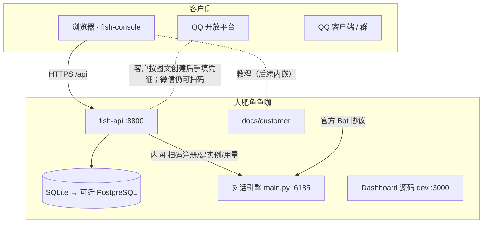
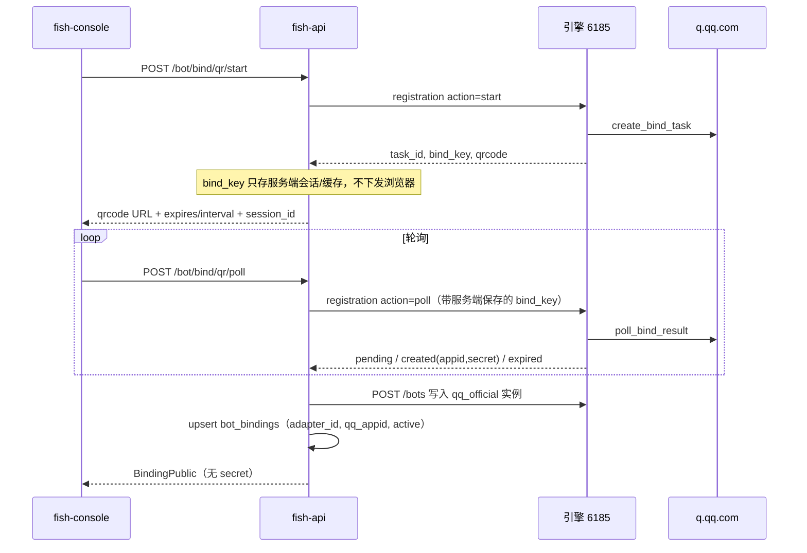
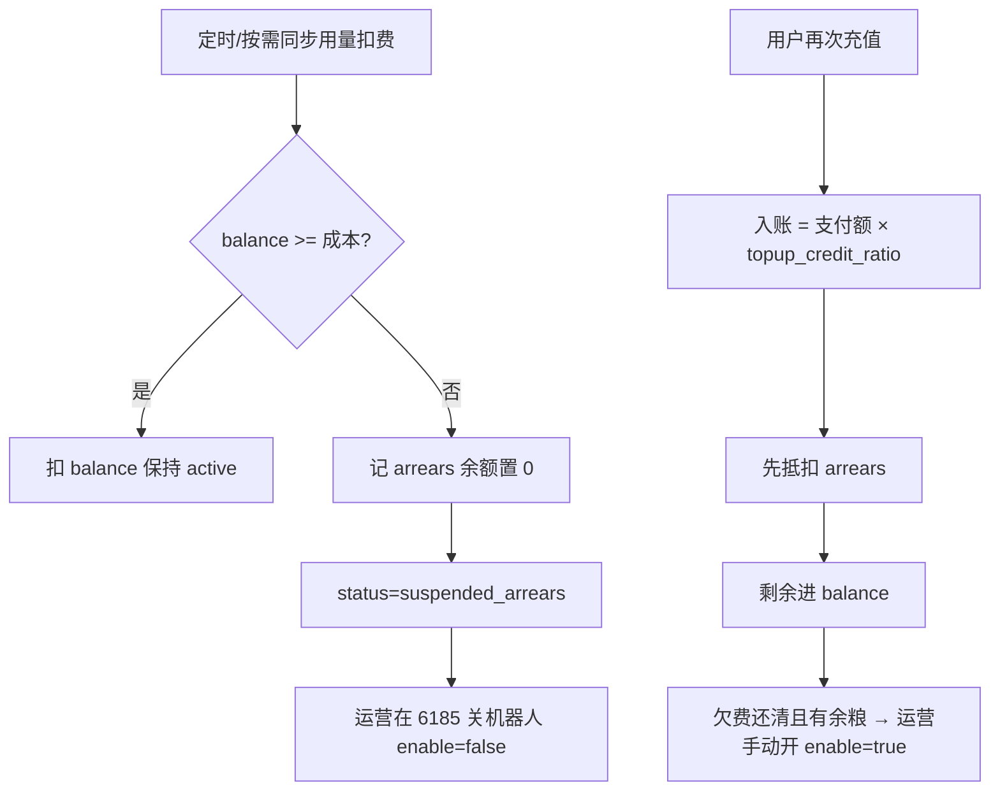

# 大肥鱼鱼咖 · 技术方案

| 字段 | 内容 |
| --- | --- |
| 产品 | 大肥鱼鱼咖 |
| 文档版本 | v0.4 |
| 关联 PRD | [PRD.md](./PRD.md) |
| 服务端口速查 | [README.md#服务与端口](./README.md#服务与端口别搞混) |
| 更新日期 | 2026-11-10 |

---

## 1. 架构总览



**原则**

- **客户流量**：fish-console ↔ fish-api；不把运营 Dashboard 直接暴露给客户。
- **对话流量**：QQ ↔ 引擎内适配器（`qq_official`）。
- **运营流量**：运营人员登录 **6185** WebUI（与 fish-api 账号体系分离）。
- **接鱼凭证**：AppSecret 只在 fish-api 与 6185 服务端之间出现；扫码路径下浏览器永不接触 Secret。

---

## 2. 服务与端口

| 服务 | 技术 | 端口（本地） | 职责 |
| --- | --- | --- | --- |
| 对话引擎 | Python / AstrBot 魔改 | **6185** | 消息、Agent、插件、provider_stats、内置运营 UI |
| fish-api | FastAPI + SQLAlchemy | **8800** | 租户账号、JWT、后续订单/绑定代理 |
| fish-console | React + Vite | **5173** | 注册登录、套餐、绑定、用量展示 |
| dashboard | Vue 源码 | **3000**（可选 dev） | 运营 UI 热更新；生产常由 6185 托管构建物 |
| docs/customer | Markdown | — | 客户教程源码 |

**勿用 8000 当作 fish-api**：本机 8000 常被其他服务占用；fish-api 固定 **8800**。

---

## 3. 技术栈

### 3.1 fish-api

- **运行时**：Python 3.12+，`uv`
- **框架**：FastAPI
- **数据库**：`fish-api/data/fish.db`（`FISH_DATABASE_URL` 可切 PostgreSQL）
- **认证**：JWT（`FISH_JWT_SECRET`）
- **密码**：bcrypt

**已实现路由**

| Method | Path | 说明 |
| --- | --- | --- |
| POST | `/api/v1/auth/register` | 注册并返回 token |
| POST | `/api/v1/auth/login` | 登录 |
| GET | `/api/v1/auth/me` | Bearer 取当前用户 |
| GET | `/health` | 健康检查 |

### 3.2 fish-console

- Vite 代理：`/api` → `http://127.0.0.1:8800`
- JWT 存 `localStorage`；`VITE_BRAND_NAME=大肥鱼鱼咖`

### 3.3 与对话引擎的边界

| 能力 | 集成方式 |
| --- | --- |
| QQ 扫码注册 | fish-api 代调 `POST /api/v1/bot-types/qq_official/registration`（`action=start|poll`，需 **config** scope） |
| 创建平台实例 | fish-api 代调 `POST /api/v1/bots`（需 **bot** scope）；`adapter_id` 由服务端生成 |
| 用量统计 | 读引擎 `provider_stats`；按 cost_control 默认定价算 USD × 汇率 × 展示倍数 → 白饭；按 `umo_prefix` 过滤 |
| 配置与人格 | 按 adapter / UMO 隔离，不迁入 fish-api |

**fish-api 环境变量（接鱼用，待加）**

| 变量 | 说明 |
| --- | --- |
| `FISH_ASTRBOT_BASE_URL` | 默认 `http://127.0.0.1:6185` |
| `FISH_ASTRBOT_API_KEY` | 引擎 OpenAPI Key，scopes 至少含 `config` + `bot` |
| `FISH_QQ_EGRESS_IP`（可选） | 绑定向导展示的出口 IP；没有则只链教程 |

### 3.4 接鱼回家 · 技术流程（M1）

QQ 官方扫码 **不是** 固定二维码。引擎侧（`login_registration.py`）每次向 `q.qq.com/lite/create_bind_task` 申请 `task_id`，二维码 URL 含该 id，会过期；扫码完成后轮询得到 AppID + 加密 Secret，用本次 `bind_key` 解密。



**手填路径（折叠）**

1. `PUT /bot/bind/manual`：body = `{ qq_appid, app_secret }`  
2. fish-api 校验 `can_bind`、一人一机  
3. 同上 `POST /bots` + 落 `bot_bindings`  
4. 响应仍不含 Secret  

**`adapter_id` 约定（服务端生成，客户不可见）**

- 建议：`fish_{user_short}_{qq_appid}`（长度落在引擎限制内）  
- `umo_prefix` = `adapter_id`（与现用量过滤一致）  

**替换现网半成品**

- 现 `PUT /bot/binding` 要求客户填 `adapter_id`，**废止为对外主契约**；改为扫码/手填两套接口。  
- `BotBindPage` 去掉实例 ID 输入，改为扫码向导 + 折叠手填。

**前端只做**

- 展示 `qrcode`（链接或转成二维码图）  
- 按 `interval` 调 poll；过期提示刷新  
- 成功态与失败文案；不存 Secret  

---

## 4. 数据模型

### 4.1 当前 `users`（fish-api）

| 字段 | 说明 |
| --- | --- |
| id | UUID |
| email | 唯一 |
| password_hash | bcrypt |
| paid | 默认 false |
| created_at | 创建时间 |

### 4.2 已落库（fish-api）

**`wallet_accounts`**

| 字段 | 说明 |
| --- | --- |
| `user_id` | 主键，关联 `users` |
| `balance_yuan` | 可用余粮（元，内部记账） |
| `arrears_yuan` | 欠费金额（余额耗尽后继续用产生的欠款） |
| `status` | `active` / `suspended_arrears` / `suspended_manual` |

**`bot_bindings`**

| 字段 | 说明 |
| --- | --- |
| `user_id` | 一人一条（唯一约束） |
| `adapter_id` | 引擎 `platform[].id`，**服务端生成** |
| `umo_prefix` | 筛 `provider_stats.umo`；默认等于 `adapter_id` |
| `qq_appid` | QQ 开放平台 appid |
| `bind_status` | `pending` / `active` / `failed`（已有列） |

**接鱼会话（实现可选，不强制新表）**

- 扫码 `start` 后将 `task_id` + `bind_key` 存 Redis/内存/`bind_sessions` 表，键为 `user_id` 或随机 `session_id`，TTL ≈ 二维码有效期。  
- `poll` 只认当前用户会话，防止串号。

### 4.3 用量（FastAPI 只读 AstrBot 库）

- `FISH_ASTRBOT_DATABASE_URL` → `data/data_v4.db`（只读）
- 按 `bot_bindings.umo_prefix` 过滤 `provider_stats`
- 对内算成本扣 `balance_yuan`；对用户展示 Token 可乘 `FISH_USAGE_DISPLAY_MULTIPLIER`（默认 2，不出现在前端文案）

### 4.4 欠费、停服、充值抵扣（业务闭环）



**充值入账（服务端，用户不见系数）：**

```text
credit = pay_yuan × FISH_TOPUP_CREDIT_RATIO
抵扣欠费 = min(credit, arrears_yuan)
arrears_yuan -= 抵扣欠费
balance_yuan += credit - 抵扣欠费
```

**欠费产生：** 同步任务用 `provider_stats` 汇总成本；`balance` 不够时，缺口累加到 `arrears_yuan`，`status → suspended_arrears`。  
**关停：** 扣费同步发现余额不够时，`status=suspended_arrears`，并尽量调用 AstrBot `PATCH /bots/{id}/enabled` 设为 `false`。  
**恢复：** 充值还清欠费且有余粮后 `status=active`，并尽量自动 `enable=true`。

### 4.5 规划（M1+）

`orders`、支付回调、`usage_sync` 定时任务、运营「待停服」列表。

---

## 5. 安全设计

- 客户密码 bcrypt；生产强 JWT 密钥
- `data/cmd_config.json`、`FISH_ASTRBOT_API_KEY`、QQ AppSecret 不进 Git、不进客户文档、不进浏览器持久化
- fish-api → 6185 仅服务端调用（内网）；生产限制 6185 外网暴露
- 扫码 `bind_key` 不下发客户站；手填 Secret 仅出现在 HTTPS 请求体一次
- 绑定接口均需 JWT + `can_bind`

---

## 6. 部署建议

| 组件 | 建议 |
| --- | --- |
| fish-console | 静态托管（Vercel / CF Pages） |
| fish-api | 与引擎同 VPC；生产 PostgreSQL |
| 对话引擎 | 常驻 `main.py`；6185 限制运营访问 |
| 客户教程 | 仓库 `docs/customer/`；可选 `VITE_DOCS_URL` 外链 |

---

## 7. 实施阶段

| 阶段 | 内容 | 状态 |
| --- | --- | --- |
| A | fish-api + fish-console 账号；根目录 PRD/README/技术方案 | ✅ |
| B | 添饭订单 + 钱包入账（`can_bind`） | 进行中 / 基本可用 |
| C | 接鱼回家：QQ 图文+手填主路径，微信扫码；废止客户填 adapter_id | ✅ 代码已接；本地需配置 `FISH_ASTRBOT_API_KEY` |
| D | 用量读库 + 扣余额 + 欠费；饭碗展示剩余白饭 | ✅ wallet/profile 读取时同步 provider_stats 扣费；耗尽 → suspended_arrears + 关 enable |
| E | 充值抵扣欠费 + 自动恢复 enable | ✅ 入账先还欠；还清有余粮后尝试 `enable=true` |

**阶段 C 实现清单（确认文档后开工）**

1. fish-api：`AstrBotClient`（registration start/poll + create bot）  
2. fish-api：`/bot/bind/qr/start`、`/bot/bind/qr/poll`、`/bot/bind/manual`；收敛旧 `PUT /bot/binding`  
3. fish-console：`BotBindPage` 向导化  
4. `.env.example` 补 `FISH_ASTRBOT_BASE_URL` / `FISH_ASTRBOT_API_KEY`  
5. 同步微调 `docs/customer/getting-started/bind-bot.md`（与现 PRD 对齐；去掉「去运营台扫码」暗示）

---

## 8. 本地联调清单

- [ ] `uv run main.py` → 6185（要聊天才需要）
- [ ] fish-api 8800 `/health` → `ok`
- [ ] fish-console 5173 注册 → dashboard
- [ ] 刷新会话；退出后跳转登录

---

## 9. 变更记录

| 版本 | 日期 | 说明 |
| --- | --- | --- |
| v0.2 | 2025-03-10 | 8800、bcrypt |
| v0.3 | 2025-03-10 | 文档迁根目录；端口表与 README 统一 |
| v0.4 | 2026-11-10 | 接鱼回家：代调 6185 registration/bots；扫码会话存 bind_key；手填兜底；客户不再填 adapter_id |
| v0.5 | 2026-11-10 | QQ 产品面改为图文+手填；微信保留扫码；registration 接口保留不主推 |
