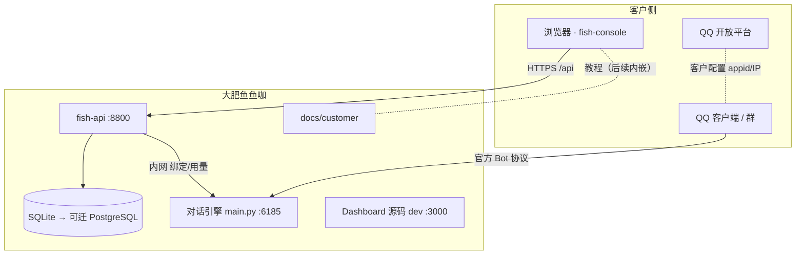
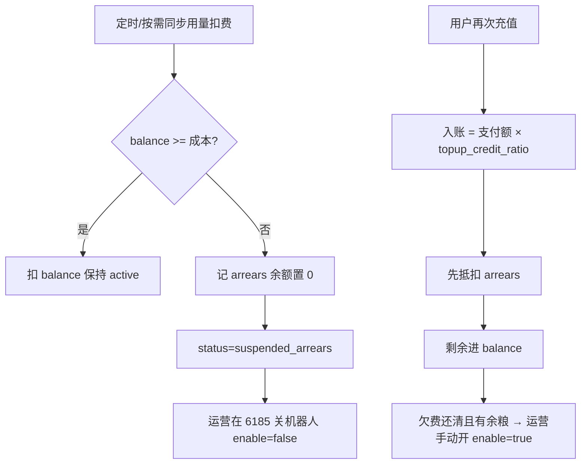

# 大肥鱼鱼咖 · 技术方案

| 字段 | 内容 |
| --- | --- |
| 产品 | 大肥鱼鱼咖 |
| 文档版本 | v0.3 |
| 关联 PRD | [PRD.md](./PRD.md) |
| 服务端口速查 | [README.md#服务与端口](./README.md#服务与端口别搞混) |

---

## 1. 架构总览



**原则**

- **客户流量**：fish-console ↔ fish-api；不把运营 Dashboard 直接暴露给客户。
- **对话流量**：QQ ↔ 引擎内适配器（`qq_official` 等）。
- **运营流量**：运营人员登录 **6185** WebUI（与 fish-api 账号体系分离）。

---

## 2. 服务与端口

| 服务 | 技术 | 端口（本地） | 职责 |
| --- | --- | --- | --- |
| 对话引擎 | Python / AstrBot 魔改 | **6185** | 消息、Agent、插件、provider_stats、内置运营 UI |
| fish-api | FastAPI + SQLAlchemy | **8800** | 租户账号、JWT、后续订单/绑定代理 |
| fish-console | React + Vite | **5173** | 注册登录、套餐、绑定、用量展示 |
| dashboard | Vue 源码 | **3000**（可选 dev） | 运营 UI 热更新；生产常由 6185 托管构建物 |
| docs/customer | Markdown | — | 客户教程源码 |

**勿用 8000 当作 fish-api**：本机 8000 常被其他服务占用；fish-api 固定 **8800**。

---

## 3. 技术栈

### 3.1 fish-api

- **运行时**：Python 3.12+，`uv`
- **框架**：FastAPI
- **数据库**：`fish-api/data/fish.db`（`FISH_DATABASE_URL` 可切 PostgreSQL）
- **认证**：JWT（`FISH_JWT_SECRET`）
- **密码**：bcrypt

**已实现路由**

| Method | Path | 说明 |
| --- | --- | --- |
| POST | `/api/v1/auth/register` | 注册并返回 token |
| POST | `/api/v1/auth/login` | 登录 |
| GET | `/api/v1/auth/me` | Bearer 取当前用户 |
| GET | `/health` | 健康检查 |

### 3.2 fish-console

- Vite 代理：`/api` → `http://127.0.0.1:8800`
- JWT 存 `localStorage`；`VITE_BRAND_NAME=大肥鱼鱼咖`

### 3.3 与对话引擎的边界

| 能力 | 集成方式（规划） |
| --- | --- |
| QQ 扫码/适配器 | fish-api 服务端代调 6185 Dashboard API |
| 用量统计 | 读引擎 `provider_stats` / cost_control，按租户过滤 |
| 配置与人格 | 按 adapter / UMO 隔离，不迁入 fish-api |

---

## 4. 数据模型

### 4.1 当前 `users`（fish-api）

| 字段 | 说明 |
| --- | --- |
| id | UUID |
| email | 唯一 |
| password_hash | bcrypt |
| paid | 默认 false |
| created_at | 创建时间 |

### 4.2 已落库（fish-api）

**`wallet_accounts`**

| 字段 | 说明 |
| --- | --- |
| `user_id` | 主键，关联 `users` |
| `balance_yuan` | 可用余粮（元，内部记账） |
| `arrears_yuan` | 欠费金额（余额耗尽后继续用产生的欠款） |
| `status` | `active` / `suspended_arrears` / `suspended_manual` |

**`bot_bindings`**

| 字段 | 说明 |
| --- | --- |
| `user_id` | 一人一条（可先一对一） |
| `adapter_id` | `cmd_config` 里平台实例 id |
| `umo_prefix` | 筛 `provider_stats.umo` 用 |
| `qq_appid` | QQ 开放平台 appid（可选） |

### 4.3 用量（FastAPI 只读 AstrBot 库）

- `FISH_ASTRBOT_DATABASE_URL` → `data/data_v4.db`（只读）
- 按 `bot_bindings.umo_prefix` 过滤 `provider_stats`
- 对内算成本扣 `balance_yuan`；对用户展示 Token 可乘 `FISH_USAGE_DISPLAY_MULTIPLIER`（默认 2，不出现在前端文案）

### 4.4 欠费、停服、充值抵扣（业务闭环）



**充值入账（服务端，用户不见系数）：**

```text
credit = pay_yuan × FISH_TOPUP_CREDIT_RATIO
抵扣欠费 = min(credit, arrears_yuan)
arrears_yuan -= 抵扣欠费
balance_yuan += credit - 抵扣欠费
```

**欠费产生：** 同步任务用 `provider_stats` 汇总成本；`balance` 不够时，缺口累加到 `arrears_yuan`，`status → suspended_arrears`。  
**关停（当前阶段手动）：** 大肥鱼鱼咖 **6185 运营后台** → 对应客户的 **平台实例** → `enable: false`（或配置档里关 adapter）。fish-api 暂不调 AstrBot 自动关（后续可做内网 API）。  
**恢复：** 欠费还清后运营核对 `wallet_accounts`，再手动 `enable: true`；用户站可显示「余粮恢复，等待开通」。

### 4.5 规划（M1+）

`orders`、支付回调、`usage_sync` 定时任务、运营「待停服」列表。

---

## 5. 安全设计

- 客户密码 bcrypt；生产强 JWT 密钥
- `data/cmd_config.json` 等密钥不进 Git、不进客户文档
- fish-api → 6185 仅服务端调用

---

## 6. 部署建议

| 组件 | 建议 |
| --- | --- |
| fish-console | 静态托管（Vercel / CF Pages） |
| fish-api | 与引擎同 VPC；生产 PostgreSQL |
| 对话引擎 | 常驻 `main.py`；6185 限制运营访问 |
| 客户教程 | 仓库 `docs/customer/`；可选 `VITE_DOCS_URL` 外链 |

---

## 7. 实施阶段

| 阶段 | 内容 | 状态 |
| --- | --- | --- |
| A | fish-api + fish-console 账号；根目录 PRD/README/技术方案 | ✅ |
| B | 支付与 `paid` | 进行中 |
| C | QQ 绑定扫码 | 待做 |
| D | 用量读库 + 扣余额 + 欠费 | 待做 |
| E | 充值抵扣欠费 + 运营停服 SOP | 待做 |

---

## 8. 本地联调清单

- [ ] `uv run main.py` → 6185（要聊天才需要）
- [ ] fish-api 8800 `/health` → `ok`
- [ ] fish-console 5173 注册 → dashboard
- [ ] 刷新会话；退出后跳转登录

---

## 9. 变更记录

| 版本 | 日期 | 说明 |
| --- | --- | --- |
| v0.2 | 2025-03-10 | 8800、bcrypt |
| v0.3 | 2025-03-10 | 文档迁根目录；端口表与 README 统一 |
